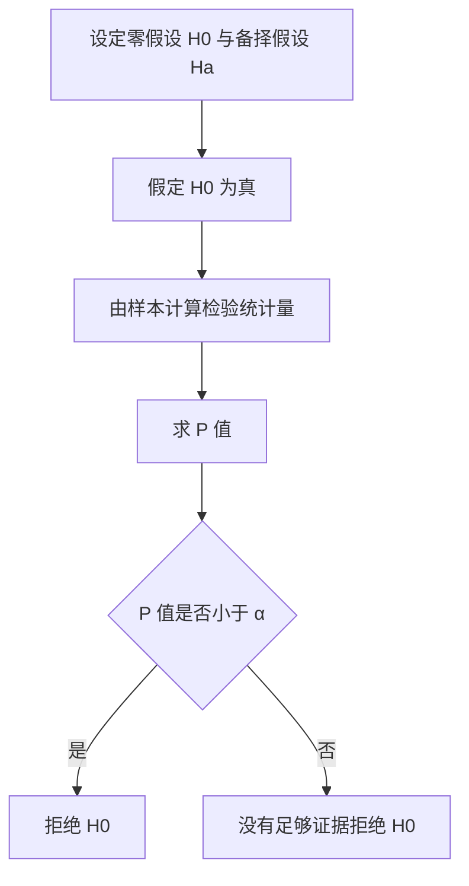
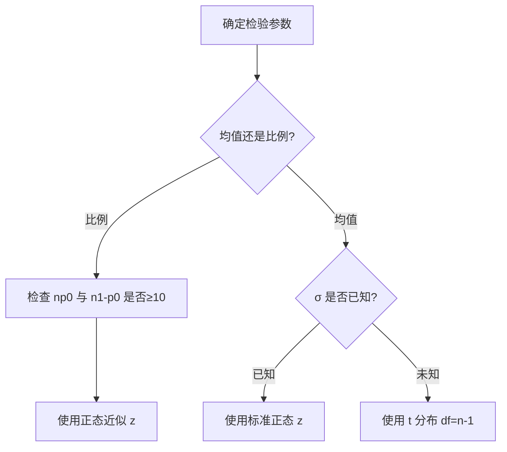
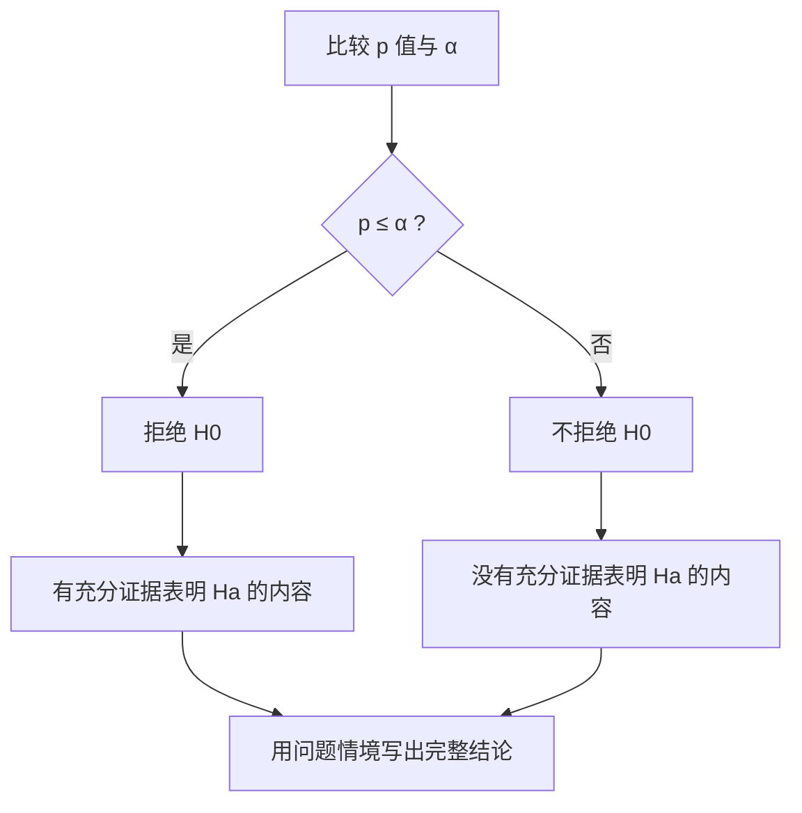
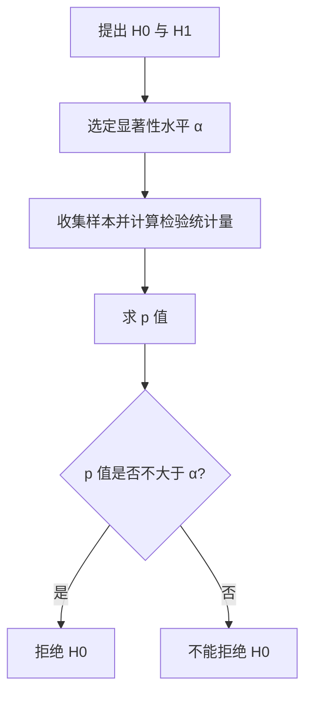
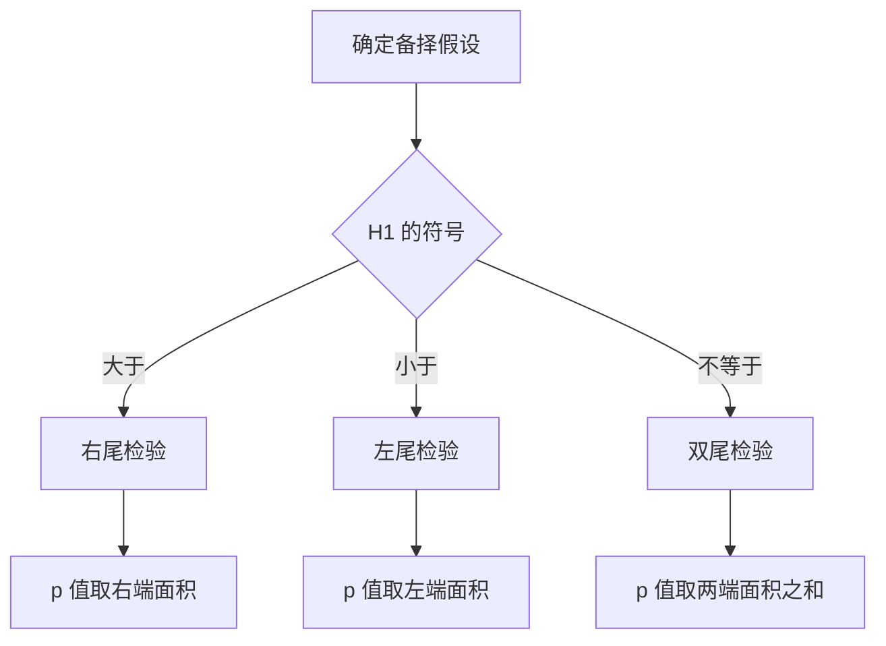
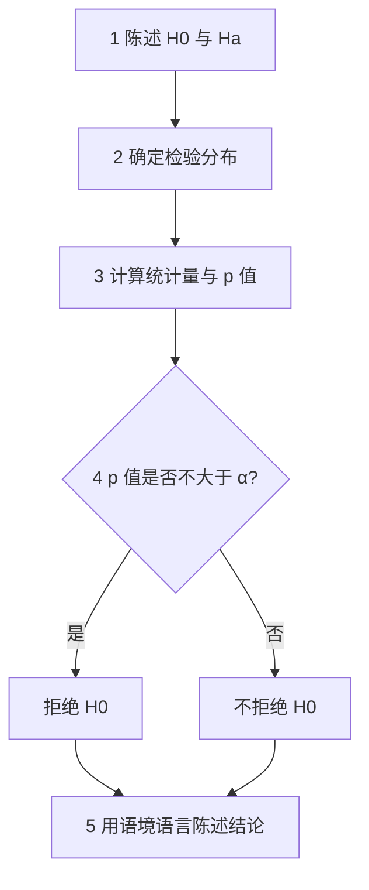

# SPL Run: build_concept_book

- **Adapter:** claude_cli
- **Model:** claude-sonnet-5-5
- **Tokens:** 1661 in / 657 out
- **Latency:** 46051ms
- **Timestamp:** 2026-11-24 08:21:06

## Output

```output


---

## 二项分布

### 定义

若进行 $n$ 次相互独立的试验,每次试验只有“成功”或“失败”两种结果,且成功概率恒为 $p$,则成功次数 $X$ 服从**二项分布**,记作 $X\sim B(n,p)$。其概率质量函数为

$$
P(X=k)=\binom{n}{k}p^{k}(1-p)^{n-k},\qquad k=0,1,\dots,n.
$$

其中 $\binom{n}{k}=\dfrac{n!}{k!(n-k)!}$ 表示在 $n$ 次试验中选出 $k$ 次成功位置的方法数。这个公式的来源很直接:任意一种“恰有 $k$ 次成功”的具体序列,其概率都是 $p^k(1-p)^{n-k}$(由独立性相乘),而这样的序列共有 $\binom{n}{k}$ 种,互不相交,所以相加即得上式。

它的两个重要数字特征为

$$
E(X)=np,\qquad \operatorname{Var}(X)=np(1-p).
$$

适用二项分布需要同时满足四个条件:试验次数固定、每次只有两种结果、各次相互独立、成功概率不变。

### 例题

某工厂的产品合格率为 $p=0.9$。随机抽取 $n=5$ 件,求恰有 4 件合格的概率。

$$
P(X=4)=\binom{5}{4}(0.9)^4(0.1)^1=5\times0.6561\times0.1=0.32805.
$$

再求“至少 4 件合格”的概率,只需加上全部合格的情形:

$$
P(X\ge4)=0.32805+(0.9)^5=0.32805+0.59049=0.91854.
$$

期望为 $E(X)=5\times0.9=4.5$,标准差为 $\sqrt{5\times0.9\times0.1}\approx0.671$。

### 问题求解应用:总体比例的检验

某公司声称其零件次品率不超过 $p_0=0.05$。质检员抽查 $n=20$ 件,发现 $4$ 件次品。这是否足以质疑公司的说法?

设原假设 $H_0:p=0.05$,备择假设 $H_1:p>0.05$。若 $H_0$ 成立,则次品数 $X\sim B(20,0.05)$。计算 $p$ 值,即在 $H_0$ 下得到“不少于 4 件次品”的概率:

$$
P(X\ge4)=1-\sum_{k=0}^{3}\binom{20}{k}(0.05)^k(0.95)^{20-k}.
$$

逐项计算得 $P(X=0)\approx0.3585$,$P(X=1)\approx0.3774$,$P(X=2)\approx0.1887$,$P(X=3)\approx0.0596$,和约为 $0.9841$,故

$$
p\text{ 值}\approx1-0.9841=0.0159.
$$

在显著性水平 $\alpha=0.05$ 下,$0.0159<0.05$,拒绝 $H_0$:有较强证据表明次品率超过 $5\%$。

**解题步骤小结:**(1)检查四个条件是否满足;(2)确定 $n$ 与 $p$;(3)写出所求事件,必要时用补集减少计算;(4)代入公式。当 $n$ 较大且 $np\ge10$、$n(1-p)\ge10$ 时,可用正态分布 $N\big(np,\,np(1-p)\big)$ 近似,这正是大样本比例检验所依据的原理。


*图:从二项模型出发进行总体比例检验的基本流程。*

---

## 中心极限定理

**定义。** 设 $X_1, X_2, \dots, X_n$ 是独立同分布的随机变量，均值为 $\mu$，方差为 $\sigma^2<\infty$。样本均值记为
$$\bar X_n=\frac1n\sum_{i=1}^n X_i .$$
中心极限定理（Central Limit Theorem, CLT）指出：无论总体分布的形状如何，标准化后的样本均值依分布收敛于标准正态分布，即
$$\frac{\bar X_n-\mu}{\sigma/\sqrt n}\ \xrightarrow{\ d\ }\ N(0,1)\quad (n\to\infty).$$
因此，当 $n$ 较大时可近似地认为
$$\bar X_n\approx N\!\left(\mu,\ \frac{\sigma^2}{n}\right),\qquad \sum_{i=1}^n X_i\approx N\!\left(n\mu,\ n\sigma^2\right).$$
样本均值的标准差 $\sigma/\sqrt n$ 称为**标准误**，它随样本量增大而缩小。经验上，若总体不严重偏斜，$n\ge 30$ 时近似通常已相当好。

**直观理解。** 单个观测值可能很不规则，但把许多独立的小波动加在一起后，极端值会相互抵消，结果呈现对称的钟形。


*图：从任意总体反复抽样并计算样本均值，样本均值的分布随 $n$ 增大趋近正态分布。*

**例题。** 某快递站每件包裹的处理时间服从指数分布，均值 $\mu=4$ 分钟，标准差 $\sigma=4$ 分钟（明显右偏）。随机抽取 $n=64$ 件，求平均处理时间超过 4.8 分钟的概率。

*解：* 标准误为
$$\frac{\sigma}{\sqrt n}=\frac{4}{\sqrt{64}}=0.5 .$$
由 CLT，$\bar X\approx N(4,\,0.5^2)$，故
$$P(\bar X>4.8)=P\!\left(Z>\frac{4.8-4}{0.5}\right)=P(Z>1.6)\approx 1-0.9452=0.0548 .$$
约有 5.5% 的可能性。注意：单件包裹处理时间超过 4.8 分钟的概率为 $e^{-1.2}\approx0.30$，远大于上述结果，这正是取平均带来的稳定效应。

**应用：确定样本量。** 若希望平均处理时间的估计误差以 95% 的把握不超过 0.4 分钟，需要
$$1.96\cdot\frac{\sigma}{\sqrt n}\le 0.4\ \Longrightarrow\ \sqrt n\ge \frac{1.96\times4}{0.4}=19.6\ \Longrightarrow\ n\ge 385 .$$
这说明精度每提高一倍，样本量需增加到原来的四倍，因为误差按 $1/\sqrt n$ 缩小。

用代码可以直接验证：

```python
import numpy as np
rng = np.random.default_rng(0)
means = rng.exponential(4, size=(100000, 64)).mean(axis=1)
print((means > 4.8).mean())   # 约 0.055，与理论值吻合
```

**要点。** CLT 是置信区间与假设检验的理论基础；使用时需检查：观测值相互独立、方差有限，且样本量足以抵消总体的偏斜程度。

---

## 正态分布

**定义。** 若连续型随机变量 $X$ 的概率密度函数为

$$
f(x)=\frac{1}{\sigma\sqrt{2\pi}}\exp\!\left(-\frac{(x-\mu)^2}{2\sigma^2}\right),\quad -\infty<x<\infty,
$$

则称 $X$ 服从正态分布,记作 $X\sim N(\mu,\sigma^2)$。参数 $\mu$ 是均值(曲线对称轴),$\sigma>0$ 是标准差(决定曲线的"胖瘦")。曲线下总面积为 1,概率等于面积:$P(a<X<b)=\int_a^b f(x)\,dx$。

当 $\mu=0,\sigma=1$ 时称为**标准正态分布**,记作 $Z\sim N(0,1)$。任何正态变量都可以标准化:

$$
Z=\frac{X-\mu}{\sigma}.
$$

经验法则:约 68%、95%、99.7% 的概率分别落在 $\mu\pm\sigma$、$\mu\pm2\sigma$、$\mu\pm3\sigma$ 之内。


*图:用标准化把任意正态问题转化为标准正态问题的流程。*

**例题。** 某考试成绩 $X\sim N(70,\,10^2)$,求成绩高于 85 分的概率。

标准化:

$$
z=\frac{85-70}{10}=1.5,\qquad P(X>85)=P(Z>1.5)=1-\Phi(1.5)\approx 1-0.9332=0.0668.
$$

即约 6.7% 的考生超过 85 分。

**在假设检验中的应用。** 正态分布之所以成为检验的核心,是因为**中心极限定理**:当样本量 $n$ 足够大时,无论总体形状如何,样本均值 $\bar X$ 近似服从

$$
\bar X\sim N\!\left(\mu,\ \frac{\sigma^2}{n}\right),
$$

于是检验统计量为

$$
z=\frac{\bar x-\mu_0}{\sigma/\sqrt n}.
$$

对比例 $p$,当 $np_0\ge10$ 且 $n(1-p_0)\ge10$ 时,样本比例 $\hat p$ 近似服从 $N\!\left(p_0,\ \dfrac{p_0(1-p_0)}{n}\right)$,统计量为

$$
z=\frac{\hat p-p_0}{\sqrt{p_0(1-p_0)/n}}.
$$

**例:** 某零件长度已知 $\sigma=2$ mm,声称均值 $\mu_0=50$ mm。抽取 $n=64$ 个,得 $\bar x=50.6$。检验 $H_0:\mu=50$ 与 $H_1:\mu\ne50$,显著性水平 $\alpha=0.05$。

$$
z=\frac{50.6-50}{2/\sqrt{64}}=\frac{0.6}{0.25}=2.4.
$$

双侧临界值为 $\pm1.96$。因 $|2.4|>1.96$,拒绝 $H_0$。$p$ 值为 $2\,[1-\Phi(2.4)]\approx 2(0.0082)=0.0164<0.05$,结论一致:样本均值与声称值之间存在统计上显著的差异。

**解题要点。**
1. 先确认条件:$\sigma$ 已知(均值检验)或样本足够大(比例检验)。
2. 写出统计量并标准化。
3. 比较临界值或计算 $p$ 值,再用问题的语言写出结论。

注意:若 $\sigma$ 未知,需用样本标准差并改用 $t$ 分布;正态分布在此仅适用于 $\sigma$ 已知的情形。

---

## 零假设(Null Hypothesis)

**定义。** 零假设记作 $H_0$,是关于总体的一个"无效应、无变化"的陈述,它断言某个总体参数恰好等于一个特定值:

$$H_0:\ \theta = \theta_0$$

其中 $\theta$ 可以是总体均值 $\mu$、比例 $p$ 等。与之相对的是备择假设 $H_a$,它表示"确有效应"(如 $\theta \neq \theta_0$、$\theta > \theta_0$ 或 $\theta < \theta_0$)。

假设检验的逻辑类似于"无罪推定":先假定 $H_0$ 成立,再检验样本数据与这一假定是否严重矛盾。若矛盾足够大,我们**拒绝** $H_0$;若不够大,我们只能说**没有足够证据拒绝** $H_0$,而不能说"证明了 $H_0$ 为真"。

**为什么设成"等于"?** 因为只有给定一个具体的参数值,我们才能算出检验统计量的抽样分布,从而计算"如果 $H_0$ 为真,得到当前这样极端的数据的概率",即 $P$ 值。

**例题。** 某饮料厂声称每瓶净含量为 $500$ mL。质检员怀疑装填不足,随机抽取 $n=36$ 瓶,测得样本均值 $\bar{x}=497$ mL,已知 $\sigma=9$ mL。

1. 建立假设:
$$H_0:\ \mu = 500,\qquad H_a:\ \mu < 500$$

2. 在 $H_0$ 成立时,计算检验统计量:
$$z=\frac{\bar{x}-\mu_0}{\sigma/\sqrt{n}}=\frac{497-500}{9/\sqrt{36}}=\frac{-3}{1.5}=-2$$

3. 单侧 $P$ 值:$P(Z\le -2)\approx 0.0228$。

4. 取显著性水平 $\alpha=0.05$,因为 $0.0228<0.05$,拒绝 $H_0$。结论:有足够证据表明平均净含量低于 $500$ mL。

**问题解决应用。** 如何正确设定 $H_0$?可按以下步骤:

- **找出"现状"或"声称值"**:它通常成为 $H_0$(如"药物无效""均值不变""硬币公平 $p=0.5$")。
- **把研究者想要证明的结论放进 $H_a$**:因为拒绝 $H_0$ 才算"有证据支持"。
- **$H_0$ 中必须含等号**($=$、$\le$ 或 $\ge$)。

**练习:** 某老师想检验新教学法是否提高平均成绩(原平均分为 $75$)。正确设定为 $H_0:\mu=75$,$H_a:\mu>75$。若误将"$\mu>75$"设为 $H_0$,就无法在 $\mu=75$ 这一具体值下计算分布。

**常见误区。** (1)"未拒绝 $H_0$"不等于"接受 $H_0$",只是证据不足;(2)$P$ 值**不是** $H_0$ 为真的概率,而是在 $H_0$ 为真的前提下观察到如此极端数据的概率;(3)拒绝 $H_0$ 可能犯第一类错误,其概率恰为 $\alpha$。


*图:假设检验的基本流程——以零假设为出发点,根据 $P$ 值与显著性水平 $\alpha$ 的比较作出决策。*

---

## 学生t分布

### 定义

当总体标准差 $\sigma$ 未知时,检验总体均值只能用样本标准差 $s$ 代替 $\sigma$。这时统计量

$$
t=\frac{\bar{X}-\mu}{s/\sqrt{n}}
$$

不再服从标准正态分布,而是服从**自由度为 $\nu=n-1$ 的学生t分布**。这是 W. S. Gosset(笔名"Student")在1908年得到的结果。

t分布的主要性质:

- 密度曲线关于 0 对称,呈钟形,与标准正态分布相似。
- 与正态分布相比,它**尾部更厚、峰值更低**。原因是 $s$ 本身随样本波动,增加了不确定性。
- 自由度 $\nu$ 越大,曲线越接近标准正态分布。当 $\nu\to\infty$ 时,t分布收敛于 $N(0,1)$。
- 当 $\nu>2$ 时,方差为 $\dfrac{\nu}{\nu-2}>1$,大于标准正态分布的方差。


*图:根据总体标准差是否已知,选择 z 分布或 t 分布。*

### 例题

某品牌电池标称平均寿命为 $\mu_0=50$ 小时。随机抽取 $n=9$ 个电池,测得样本均值 $\bar{x}=47$ 小时,样本标准差 $s=4.5$ 小时。总体标准差未知。问:在 $\alpha=0.05$ 水平下,能否认为平均寿命低于标称值?

**步骤 1:建立假设。** $H_0:\mu=50$,$H_1:\mu<50$(单侧检验)。

**步骤 2:计算检验统计量。**

$$
t=\frac{47-50}{4.5/\sqrt{9}}=\frac{-3}{1.5}=-2.00
$$

**步骤 3:确定临界值。** 自由度 $\nu=8$,查表得单侧 $t_{0.05,8}=1.860$,所以拒绝域为 $t<-1.860$。

**步骤 4:结论。** 因为 $-2.00<-1.860$,所以拒绝 $H_0$。有证据表明平均寿命低于 50 小时。

若错误地使用正态临界值 $-1.645$,结论虽然相同,但会**低估**临界值的大小,在小样本时容易误判为显著。

### 问题求解应用:置信区间

用同一组数据构造 $95\%$ 双侧置信区间。自由度为 8 时,$t_{0.025,8}=2.306$,因此

$$
\bar{x}\pm t_{0.025,8}\frac{s}{\sqrt{n}}=47\pm 2.306\times1.5=47\pm 3.46
$$

即区间为 $(43.54,\,50.46)$。

这个区间包含 50,与双侧检验"不能拒绝 $H_0:\mu=50$"一致。注意这里是双侧,而上面的例题用的是单侧检验,二者的临界值不同。若用正态临界值 $1.96$,区间半宽只有 $2.94$,明显偏窄。

**使用要点:**

1. 总体 $\sigma$ 未知,且总体近似正态(或 $n$ 较大)时,用 t 分布。
2. 自由度始终是 $n-1$,不是 $n$。
3. 样本量小时,t 与 $z$ 的差别大;当 $n>30$ 时,两者已十分接近。
4. 若数据严重偏斜且样本很小,t 方法的结果不可靠,应考虑其他方法。

---

## 抽样分布的选择

**定义。** 做假设检验时,检验统计量服从哪种抽样分布,取决于两个问题:(1)检验的参数是什么(均值还是比例);(2)总体标准差 $\sigma$ 是否已知。选错分布,$p$ 值和临界值都会出错。

**选择规则:**

| 检验参数 | 条件 | 抽样分布 |
|---|---|---|
| 总体均值 $\mu$ | $\sigma$ 已知,且总体近似正态或 $n\ge 30$ | 标准正态 $z$ |
| 总体均值 $\mu$ | $\sigma$ 未知,用样本标准差 $s$ 代替 | 学生 $t$,自由度 $df=n-1$ |
| 总体比例 $p$ | $np_0\ge 10$ 且 $n(1-p_0)\ge 10$ | 二项分布的正态近似 $z$ |

对应的检验统计量为:

$$z=\frac{\bar x-\mu_0}{\sigma/\sqrt n},\qquad t=\frac{\bar x-\mu_0}{s/\sqrt n},\qquad z=\frac{\hat p-p_0}{\sqrt{p_0(1-p_0)/n}}$$

注意:比例检验的标准误用的是原假设中的 $p_0$,而不是样本比例 $\hat p$。比例检验不需要 $\sigma$,因为二项分布的方差 $np_0(1-p_0)$ 完全由 $p_0$ 决定。

**为什么 $\sigma$ 未知时要用 $t$?** 用 $s$ 替代 $\sigma$ 会引入额外的随机性,$t$ 分布的尾部比正态分布更厚,$df$ 越小越明显;当 $n\to\infty$ 时,$t$ 分布趋近标准正态分布。

**例题 1。** 某工厂声称螺栓平均长度为 $50$ mm。抽取 $n=16$ 个,得 $\bar x=50.8$,$s=1.6$,总体 $\sigma$ 未知。检验 $H_0:\mu=50$。

因为参数是均值且 $\sigma$ 未知,选用 $t$ 分布,$df=15$:

$$t=\frac{50.8-50}{1.6/\sqrt{16}}=\frac{0.8}{0.4}=2.0$$

双侧检验,$t_{0.025,15}=2.131$。由于 $2.0<2.131$,在 $5\%$ 水平上不拒绝 $H_0$。若误用 $z$(临界值 $1.96$),就会错误地拒绝 $H_0$——这正是选错分布的后果。

**例题 2。** 某政策声称支持率为 $p_0=0.40$。调查 $n=200$ 人,有 $92$ 人支持,$\hat p=0.46$。

先检验条件:$np_0=80\ge10$,$n(1-p_0)=120\ge10$,可以使用正态近似。

$$z=\frac{0.46-0.40}{\sqrt{0.40\times0.60/200}}=\frac{0.06}{0.0346}\approx1.73$$

双侧 $p$ 值约为 $0.084>0.05$,不拒绝 $H_0$。

**问题解决流程。**


*图:根据参数类型和 $\sigma$ 是否已知选择抽样分布的决策流程。*

**常见陷阱:** (1)实际问题中 $\sigma$ 几乎总是未知的,默认应优先考虑 $t$;(2)小样本且总体明显偏态时,$t$ 与 $z$ 都不可靠,应改用其他方法;(3)比例检验的条件检查用 $p_0$,而置信区间则用 $\hat p$。

---

## 显著性水平

**定义。** 显著性水平记为 $\alpha$,是在收集样本数据*之前*就设定好的、犯第一类错误的最大可接受概率。第一类错误是指:原假设 $H_0$ 实际为真,却被我们拒绝了。用公式表示:

$$\alpha = P(\text{拒绝 } H_0 \mid H_0 \text{ 为真})$$

常用取值为 $0.10$、$0.05$ 和 $0.01$。$\alpha$ 必须事先确定,不能看了数据再挑,否则检验的错误率保证就失效了。

**与 $p$ 值的关系。** 决策规则很简单:若 $p \le \alpha$,则拒绝 $H_0$;若 $p > \alpha$,则不拒绝 $H_0$。$p$ 值由数据算出,$\alpha$ 则由研究者在数据之前选定,二者不能混为一谈。

**例题。** 某饮料厂声称每瓶平均容量为 $\mu_0 = 500$ mL,已知 $\sigma = 6$ mL。质检员抽取 $n = 36$ 瓶,测得 $\bar{x} = 497.8$ mL。在 $\alpha = 0.05$ 下检验是否偏少。

提出假设:$H_0:\mu = 500$,$H_1:\mu < 500$(左尾检验)。

检验统计量:

$$z = \frac{\bar{x}-\mu_0}{\sigma/\sqrt{n}} = \frac{497.8-500}{6/\sqrt{36}} = \frac{-2.2}{1} = -2.2$$

在 $\alpha = 0.05$ 下,左尾临界值为 $z_{\alpha} = -1.645$。因为 $-2.2 < -1.645$,所以落入拒绝域,拒绝 $H_0$。

等价地,$p = P(Z \le -2.2) \approx 0.0139 < 0.05$,结论相同。

**问题求解应用。** $\alpha$ 的大小体现的是对两类错误的权衡。第二类错误(漏检真实差异)的概率记为 $\beta$。在样本量固定时,减小 $\alpha$ 会使拒绝域变小,从而使 $\beta$ 增大。

- 若第一类错误代价高(例如:误判一种无效药物"有效"并推向市场),应选较小的 $\alpha$,如 $0.01$。
- 若漏检代价高(例如:初筛某种严重疾病),可适当放宽到 $\alpha = 0.10$。

再用上面的例子检验这种敏感性。若改用 $\alpha = 0.01$,临界值为 $z_{0.01} = -2.326$。此时 $-2.2 > -2.326$,**不能**拒绝 $H_0$。同一份数据,结论随 $\alpha$ 而变,这正是必须在看数据前确定 $\alpha$ 的原因。

**常见误区。**

1. $\alpha = 0.05$ 并不表示"$H_0$ 为真的概率是 5%"。它是在 $H_0$ 为真的条件下,拒绝 $H_0$ 的概率。
2. 若拒绝了 $H_0$,只说明结果在 $\alpha$ 水平上统计显著,并不说明差异在实际中很大。本例的差异只有 $2.2$ mL,实际意义需另行判断。
3. 同一批数据反复检验多个假设,整体的第一类错误率会超过 $\alpha$。

**小结。** 显著性水平是检验开始前就划定的"误判红线"。它决定临界值和拒绝域,并与 $\beta$ 此消彼长,要根据两类错误各自的代价来选取。

---

## 稀有事件(Rare Event)

### 定义

**稀有事件**是指在某个假设成立的前提下,发生概率极小的结果。在假设检验中,这个假设就是**零假设** $H_0$。如果我们实际观测到了这样的结果,就有理由怀疑 $H_0$ 本身不成立。

形式化地,设检验统计量为 $T$,观测值为 $t_{\text{obs}}$,则 **$p$ 值**为

$$p = P\big(T \text{ 至少与 } t_{\text{obs}} \text{ 一样极端} \mid H_0\big).$$

当 $p \le \alpha$($\alpha$ 为预先设定的显著性水平,常取 $0.05$ 或 $0.01$)时,我们称该结果为稀有事件,并**拒绝** $H_0$。

注意:"稀有"不是绝对的,而是**相对于某个假设**而言。同一个结果在一个假设下很平常,在另一个假设下却可能极其罕见。

### 例题

某人声称自己手里的硬币是公平的($H_0: p = 0.5$)。你抛了 $20$ 次,得到 $17$ 次正面。这个结果算稀有事件吗?

设 $X$ 为正面次数,在 $H_0$ 下 $X \sim \text{Binomial}(20, 0.5)$。"至少与 17 次一样极端"(单侧)的概率为

$$P(X \ge 17) = \sum_{k=17}^{20}\binom{20}{k}\left(\tfrac12\right)^{20} = \frac{1140 + 190 + 20 + 1}{1\,048\,576} = \frac{1351}{1\,048\,576} \approx 0.0013.$$

因为 $0.0013 < 0.05$(甚至 $< 0.01$),在公平硬币的假设下,这是一个稀有事件。我们据此怀疑硬币并不公平。

### 问题求解应用

**问题**:某工厂声称次品率为 $2\%$。随机抽检 $100$ 件,发现 $7$ 件次品。该声称可信吗?

**步骤**:

1. 建立假设:$H_0: p = 0.02$,备择假设 $H_1: p > 0.02$。
2. 在 $H_0$ 下,$X \sim \text{Binomial}(100, 0.02)$,期望 $\lambda = np = 2$。由于 $n$ 大、$p$ 小,可用泊松近似 $X \approx \text{Poisson}(2)$。
3. 计算 $P(X \ge 7)$:

$$P(X \ge 7) = 1 - \sum_{k=0}^{6} \frac{e^{-2}2^k}{k!} \approx 1 - 0.9955 = 0.0045.$$

4. 因 $0.0045 < 0.01$,在 $H_0$ 下观测到 $7$ 件及以上次品是稀有事件,应拒绝工厂的声称。

### 常见陷阱

- **稀有 ≠ 不可能**:即使 $H_0$ 为真,也有概率 $\alpha$ 发生稀有事件,这就是**第一类错误**。
- **多重检验**:做 $m$ 次独立检验,至少出现一次"稀有事件"的概率为 $1-(1-\alpha)^m$。例如 $\alpha=0.05$、$m=20$ 时约为 $64\%$。因此"总能找到稀有事件"并不说明什么。
- **$p$ 值不是 $H_0$ 为真的概率**:它只衡量"在 $H_0$ 下数据有多意外"。

### 小结

稀有事件的推理逻辑类似"概率版反证法":先假设 $H_0$,计算观测结果的出现概率;若该概率极小,则 $H_0$ 与数据难以相容,我们选择质疑 $H_0$。

---

## P 值

### 定义

**P 值**(p-value)是在原假设 $H_0$ 成立的前提下,得到与观测样本结果**一样极端或更极端**的结果的概率。设检验统计量为 $T$,观测值为 $t_{\text{obs}}$,则对右尾检验:

$$p = P(T \ge t_{\text{obs}} \mid H_0)$$

对双尾检验,则要把两侧的极端情形都计入。P 值越小,说明"如果 $H_0$ 为真,却观察到这样的数据"越不寻常,因而越有理由怀疑 $H_0$。

需要特别注意:P 值**不是** $H_0$ 为真的概率,也不是效应大小的度量。它只回答一个问题:数据与 $H_0$ 的相容程度如何。

### 例题

某硬币被怀疑偏向正面。抛掷 100 次,得到 60 次正面。检验 $H_0: p_0 = 0.5$,$H_a: p_0 \ne 0.5$。

**第 1 步:构造检验统计量。** 在 $H_0$ 下,正面次数近似服从均值 $np_0 = 50$、标准差 $\sqrt{np_0(1-p_0)} = 5$ 的正态分布。于是

$$z = \frac{60 - 50}{5} = 2.00$$

**第 2 步:计算尾部概率。** 查标准正态分布表得 $P(Z \ge 2.00) \approx 0.0228$。

**第 3 步:双尾检验。** 偏向反面同样算"极端",故

$$p = 2 \times 0.0228 = 0.0456$$

**第 4 步:下结论。** 若显著性水平为 $\alpha = 0.05$,则 $p < \alpha$,拒绝 $H_0$;若取 $\alpha = 0.01$,则不能拒绝 $H_0$。

### 问题求解应用

**问题:** 某药厂声称药片平均含量为 $\mu_0 = 500$ mg。质检员抽取 $n = 36$ 片,得 $\bar{x} = 497$ mg,已知 $\sigma = 9$ mg。在 $\alpha = 0.05$ 下检验含量是否偏低。

**解:** 这是左尾检验,$H_0: \mu = 500$,$H_a: \mu < 500$。

$$z = \frac{497 - 500}{9/\sqrt{36}} = \frac{-3}{1.5} = -2.00$$

$$p = P(Z \le -2.00) \approx 0.0228$$

因 $0.0228 < 0.05$,拒绝 $H_0$,有证据表明平均含量偏低。

**常见误区:**

1. **"$p = 0.0228$ 意味着 $H_0$ 有 2.28% 的概率为真。"** 错误。P 值是在假定 $H_0$ 为真时计算的条件概率,并不给出 $H_0$ 本身的概率。
2. **"$p > \alpha$ 证明 $H_0$ 为真。"** 错误。这只说明证据不足以拒绝 $H_0$。
3. **"$p$ 很小说明效应很大。"** 错误。样本量很大时,微不足道的差异也可能得到极小的 P 值,所以需要同时报告效应大小和置信区间。


*P 值检验流程:将尾部概率 $p$ 与显著性水平 $\alpha$ 比较,得出拒绝或不拒绝原假设的结论。*

---

## 备择假设

**定义。** 在假设检验中,**备择假设**(alternative hypothesis,记作 $H_a$ 或 $H_1$)是与原假设 $H_0$ 互补的陈述:它断言总体参数不等于(或大于、小于)原假设所设定的值。原假设代表"没有效应、没有差异"的现状;备择假设则代表研究者希望用数据加以支持的结论。只有当样本证据足够强,以致在 $H_0$ 成立时极不可能出现,我们才拒绝 $H_0$,转而接受 $H_a$。

以总体均值 $\mu$ 和原假设值 $\mu_0$ 为例,备择假设有三种形式:

$$
\begin{aligned}
&\text{双侧:} && H_a:\ \mu \neq \mu_0 \\
&\text{右侧:} && H_a:\ \mu > \mu_0 \\
&\text{左侧:} && H_a:\ \mu < \mu_0
\end{aligned}
$$

选择哪一种,取决于**研究问题本身**,而且必须在看到数据**之前**确定。若只关心"是否有变化",用双侧;若只关心"是否提高"或"是否降低",用单侧。

**例题。** 某饮料厂声称每瓶容量均值为 $500$ mL。消费者协会怀疑瓶装量不足,随机抽取 $n=36$ 瓶,测得样本均值 $\bar{x}=497$ mL,已知总体标准差 $\sigma=9$ mL。检验显著性水平 $\alpha=0.05$。

1. 建立假设。怀疑"不足",所以是左侧检验:
$$H_0:\ \mu = 500,\qquad H_a:\ \mu < 500$$
2. 计算检验统计量:
$$z=\frac{\bar{x}-\mu_0}{\sigma/\sqrt{n}}=\frac{497-500}{9/\sqrt{36}}=\frac{-3}{1.5}=-2$$
3. 求 $p$ 值。因为 $H_a$ 指向左侧,只看左尾:
$$p=P(Z\le -2)\approx 0.0228$$
4. 决策:$p<0.05$,拒绝 $H_0$。有充分证据表明平均容量低于 $500$ mL。

**问题求解应用。** 如果同样的数据改用双侧检验($H_a:\mu\neq 500$),则 $p=2\times0.0228=0.0456$。此时 $p$ 仍小于 $0.05$,但已非常接近临界值;若 $\alpha=0.04$,结论就会翻转。这说明**备择假设的方向直接改变 $p$ 值与结论**。

解题时可按下列步骤识别 $H_a$:

- 找关键词:"不同于""有变化"→ $\neq$;"高于""提高""超过"→ $>$;"低于""减少""不足"→ $<$。
- 等号($=$、$\le$、$\ge$)永远属于 $H_0$;$H_a$ 只使用 $\neq,>,<$。
- 不要在看到 $\bar{x}$ 后再挑选方向,否则等于偷偷把 $\alpha$ 放大,使结论失去可信度。

**常见误区。** 未能拒绝 $H_0$ 并不等于"证明 $H_0$ 为真",只是证据不足以支持 $H_a$;反之,拒绝 $H_0$ 也不意味着 $H_a$ 的效应一定很大,仅表示它在统计上可被检测到。

---

## 决策规则

**定义。** 在假设检验中,先选定显著性水平 $\alpha$(通常为 $0.05$ 或 $0.01$),再由样本数据算出 $p$ 值,即"在 $H_0$ 为真的前提下,得到至少与观测结果一样极端的统计量的概率"。决策规则把二者联系起来:

$$
\begin{cases}
\alpha > p\text{ 值} & \Rightarrow \text{拒绝 } H_0,\\[2pt]
\alpha \le p\text{ 值} & \Rightarrow \text{不能拒绝 } H_0.
\end{cases}
$$

直观地说,$p$ 值越小,数据与 $H_0$ 越不相容;一旦它小于我们事先容忍的"误判上限" $\alpha$,就认为证据足以否定 $H_0$。注意:$\alpha$ 必须在看数据之前确定,否则规则就失去了控制第一类错误概率的意义。

**例题。** 某饮料厂声称每瓶平均容量为 $\mu = 500$ mL。质检员抽取 $n=36$ 瓶,测得 $\bar x = 497$ mL,已知 $\sigma = 9$ mL。检验

$$H_0:\mu = 500 \quad \text{vs} \quad H_1:\mu \ne 500,\quad \alpha = 0.05.$$

检验统计量为

$$z=\frac{\bar x-\mu_0}{\sigma/\sqrt n}=\frac{497-500}{9/\sqrt{36}}=\frac{-3}{1.5}=-2.$$

双侧检验的 $p$ 值为

$$p = 2P(Z \le -2)\approx 2(0.0228)=0.0456.$$

比较:$\alpha = 0.05 > 0.0456$,故**拒绝 $H_0$**。结论:在 $5\%$ 显著性水平下,有统计证据表明平均容量不等于 $500$ mL。

**问题求解应用。** 同一份数据,结论会随 $\alpha$ 改变:

- 若取 $\alpha = 0.01$,则 $0.01 \le 0.0456$,**不能拒绝 $H_0$**;
- 若取 $\alpha = 0.05$,则拒绝 $H_0$。

因此做题时按以下步骤进行:

1. 写出 $H_0$、$H_1$,并确定 $\alpha$;
2. 计算检验统计量和 $p$ 值(注意单侧、双侧的区别);
3. 按规则比较 $\alpha$ 与 $p$;
4. 用问题的语言写出结论。

**常见误区。**

- "不能拒绝 $H_0$"不等于"证明 $H_0$ 为真",只说明证据不足。
- $p$ 值不是"$H_0$ 为真的概率"。
- 不要看到 $p$ 值后再挑选 $\alpha$。

**练习。** 某检验得 $p = 0.032$。分别在 $\alpha=0.10$、$0.05$、$0.01$ 下作出决策。(答案:前两者拒绝 $H_0$,第三者不能拒绝 $H_0$。)

---

## 结论撰写

**定义。** 结论撰写是假设检验的最后一步：在做出"拒绝 $H_0$"或"不拒绝 $H_0$"的决定之后，用原问题的语言写出一句通俗的陈述，说明数据对所研究的问题意味着什么。一个完整的结论应包含四个要素：

1. **决定**：拒绝或不拒绝 $H_0$，并给出依据（$p$ 值与 $\alpha$ 的比较）；
2. **显著性水平**：说明所用的 $\alpha$；
3. **情境**：用问题中的变量、总体和单位来表述；
4. **证据强度**：是"有充分证据"还是"没有充分证据"。

**两条关键规则：**

- 若 $p \le \alpha$：拒绝 $H_0$，写"有充分证据表明……（即 $H_a$ 的内容）"。
- 若 $p > \alpha$：不拒绝 $H_0$，写"没有充分证据表明……"。

注意：不能写"接受 $H_0$"或"证明了 $H_0$ 为真"。不拒绝只表示证据不足，不表示原假设成立。同理，拒绝 $H_0$ 也不等于"证明了 $H_a$"，因为仍存在犯第一类错误的概率 $\alpha$。

**例题。** 某电池厂声称其电池平均寿命为 $\mu = 500$ 小时。质检员怀疑实际寿命更短，抽取 $n=36$ 个样本，得 $\bar{x}=492$，已知 $\sigma=24$。检验

$$H_0:\mu=500,\qquad H_a:\mu<500,\qquad \alpha=0.05.$$

检验统计量为

$$z=\frac{\bar{x}-\mu_0}{\sigma/\sqrt{n}}=\frac{492-500}{24/\sqrt{36}}=\frac{-8}{4}=-2.0,$$

左尾 $p$ 值为 $P(Z\le -2.0)\approx 0.0228$。因为 $0.0228<0.05$，所以拒绝 $H_0$。

**结论写法：**

> 在 $\alpha=0.05$ 的显著性水平下，有充分证据表明该厂电池的平均寿命低于 500 小时（$z=-2.0$，$p\approx0.023$）。

**问题求解应用。** 若上例中样本均值为 $\bar{x}=497$，则 $z=\dfrac{-3}{4}=-0.75$，$p\approx0.2266>0.05$，不拒绝 $H_0$。

| 写法 | 评价 |
|---|---|
| "电池平均寿命就是 500 小时。" | ✗ 把"不拒绝"当成了"证明" |
| "没有充分证据表明平均寿命低于 500 小时。" | ✓ 正确，且使用了问题情境 |

**常见错误检查表：**

- 只写"拒绝 $H_0$"而不翻译成问题的语言；
- 把 $p$ 值解释为"$H_0$ 为真的概率"（它是在 $H_0$ 为真时，观察到如此极端数据的概率）；
- 混淆统计显著与实际重要：$n$ 很大时，微小差异也可能 $p<\alpha$，结论中应适当说明差异的实际大小；
- 单侧与双侧不一致：结论的方向必须与 $H_a$ 匹配。


*图：从检验决定到结论措辞的流程。无论决定如何，最后都要回到原问题的情境中表述。*

---

## 假设检验

**定义。** 假设检验是利用样本数据判断关于总体参数的某个声明是否可信的方法。我们先设立**原假设** $H_0$(默认"没有变化/没有差异",含等号)和**备择假设** $H_1$(我们怀疑成立的结论)。再选定**显著性水平** $\alpha$(常取 $0.05$),它是"$H_0$ 实际为真却被我们拒绝"(第一类错误)所能容忍的最大概率。

**检验统计量与 $p$ 值。** 检验统计量衡量样本结果偏离 $H_0$ 的程度。以总体标准差 $\sigma$ 已知的均值检验为例:

$$z=\frac{\bar{x}-\mu_0}{\sigma/\sqrt{n}}$$

$p$ 值是"假设 $H_0$ 为真时,得到至少与当前样本一样极端的结果的概率"。判断规则:

- 若 $p\le\alpha$,拒绝 $H_0$(数据提供了足够证据支持 $H_1$);
- 若 $p>\alpha$,不能拒绝 $H_0$(证据不足,但这并不等于证明 $H_0$ 为真)。

**例题。** 某工厂声称灯泡平均寿命为 $\mu_0=1000$ 小时,已知 $\sigma=60$ 小时。质检员随机抽取 $n=36$ 个灯泡,测得 $\bar{x}=980$ 小时。问在 $\alpha=0.05$ 下,能否认为平均寿命低于声称值?

1. 设立假设:$H_0:\mu=1000$,$H_1:\mu<1000$(左尾检验)。
2. 计算统计量:
$$z=\frac{980-1000}{60/\sqrt{36}}=\frac{-20}{10}=-2$$
3. 计算 $p$ 值:$p=P(Z\le -2)\approx 0.0228$。
4. 作出决策:因为 $0.0228<0.05$,拒绝 $H_0$。

结论:在 $5\%$ 显著性水平下,样本提供了足够证据表明灯泡平均寿命低于 $1000$ 小时。

**问题求解应用。** 解题时可按固定流程:(1)判断检验类型(单尾还是双尾,由 $H_1$ 的方向决定);(2)选择统计量($\sigma$ 已知用 $z$,未知用 $t$);(3)求 $p$ 值;(4)与 $\alpha$ 比较并用问题的语境陈述结论。

若上例改为双尾检验($H_1:\mu\ne1000$),则 $p=2\times0.0228=0.0456$,仍小于 $0.05$,依然拒绝;但若取 $\alpha=0.01$,则两种检验都不能拒绝 $H_0$。可见结论依赖于 $\alpha$,而 $\alpha$ 必须在看数据**之前**确定,否则会人为"挑选"结论。

**常见误区。**
- $p$ 值**不是** $H_0$ 为真的概率,而是在 $H_0$ 成立的前提下数据出现的概率。
- "不能拒绝 $H_0$"不等于"接受 $H_0$"。
- 统计显著不等于实际重要:样本很大时,微小的差异也可能得到很小的 $p$ 值,应同时考察效应大小。


*图:假设检验的决策流程——先设定 $H_0$、$H_1$ 与 $\alpha$,再由样本计算统计量和 $p$ 值,最后比较 $p$ 与 $\alpha$ 作出决策。*

---

## 单侧与双侧检验

**定义。** 在假设检验中,备择假设 $H_1$ 的符号决定了拒绝域(即 $p$ 值所对应的区域)落在抽样分布的哪一侧,这一分类称为**尾部检验**(tailed test)。设检验参数为 $\theta$,原假设为 $H_0:\theta=\theta_0$,则有三种情形:

| 备择假设 | 类型 | $p$ 值区域 |
|---|---|---|
| $H_1:\theta>\theta_0$ | 右尾检验 | 分布右端 |
| $H_1:\theta<\theta_0$ | 左尾检验 | 分布左端 |
| $H_1:\theta\neq\theta_0$ | 双尾检验 | 两端各取一半 |

设检验统计量为 $Z$,观测值为 $z_{\text{obs}}$。则
$$
p=\begin{cases}P(Z\ge z_{\text{obs}}\mid H_0), & \text{右尾}\\ P(Z\le z_{\text{obs}}\mid H_0), & \text{左尾}\\ 2\,P(Z\ge |z_{\text{obs}}|\mid H_0), & \text{双尾(对称分布)}\end{cases}
$$
在显著性水平 $\alpha$ 下,单尾检验把 $\alpha$ 全部放在一端;双尾检验则每端各放 $\alpha/2$。例如 $\alpha=0.05$ 时,临界值分别为单尾 $z_{0.05}=1.645$、双尾 $\pm z_{0.025}=\pm1.96$。

**关键原则:** 备择假设的方向必须在看数据之前,根据研究问题确定,不能因为数据"偏向某一侧"而事后挑选单尾,否则会人为降低 $p$ 值、虚增显著性。

**例题。** 某饮料瓶标称容量 $500$ mL,总体标准差 $\sigma=4$ mL。质检员抽取 $n=64$ 瓶,测得 $\bar x=498.8$ mL。检验瓶装量是否**不等于**500 mL($\alpha=0.05$)。

1. $H_0:\mu=500$,$H_1:\mu\neq 500$(双尾)。
2. 统计量:
$$
z=\frac{\bar x-\mu_0}{\sigma/\sqrt n}=\frac{498.8-500}{4/8}=-2.4
$$
3. $p=2P(Z\ge 2.4)=2(0.0082)=0.0164<0.05$,拒绝 $H_0$。

**问题求解应用。** 若消费者协会只关心"是否**短缺**"(即 $H_1:\mu<500$),则为左尾检验:
$$
p=P(Z\le -2.4)=0.0082
$$
恰好是双尾 $p$ 值的一半。两种设定下结论相同,但这并不总成立。设另一批数据 $z=-1.8$:双尾 $p=2(0.0359)=0.0718>0.05$,不拒绝;左尾 $p=0.0359<0.05$,拒绝。结论依赖于检验类型,所以必须事先根据问题的实际含义选择。

**选择步骤:**
- 问题中出现"大于/提高/超过"→ 右尾;
- 出现"小于/降低/不足"→ 左尾;
- 出现"不同/改变/偏离"→ 双尾。

当方向不确定,或任一方向的偏离都有实际后果时,应选双尾检验,这是更保守、更稳妥的默认选择。


*图:备择假设的符号决定检验类型与 p 值所取的区域。*

---

## 检验统计量

**定义。** 检验统计量(test statistic)是由样本数据计算出的一个标准化数值,用来衡量样本结果偏离原假设 $H_0$ 的程度。它把“样本均值与假设值差多少”换算成“差了多少个标准误”,因此不同量纲的问题可以用同一把尺子比较。

当总体标准差 $\sigma$ 已知时,检验总体均值用 $z$ 统计量:

$$z=\frac{\bar x-\mu_0}{\sigma/\sqrt{n}}$$

当 $\sigma$ 未知、用样本标准差 $s$ 代替时,用 $t$ 统计量:

$$t=\frac{\bar x-\mu_0}{s/\sqrt{n}},\qquad \text{自由度 } df=n-1$$

通用形式是:

$$\text{检验统计量}=\frac{\text{样本估计值}-\text{原假设值}}{\text{估计值的标准误}}$$

在 $H_0$ 成立的前提下,$z$ 近似服从标准正态分布,$t$ 服从自由度为 $n-1$ 的 $t$ 分布。统计量的绝对值越大,说明样本结果在 $H_0$ 下越“罕见”,反对 $H_0$ 的证据越强。

**例题。** 某品牌电池标称平均寿命为 $\mu_0=500$ 小时。质检员随机抽取 $n=25$ 块电池,测得 $\bar x=488$ 小时,$s=30$ 小时。问:在 $\alpha=0.05$ 水平下,能否认为平均寿命低于标称值?

1. 假设:$H_0:\mu=500$,$H_a:\mu<500$(左尾检验)。
2. 标准误:$\dfrac{s}{\sqrt n}=\dfrac{30}{5}=6$。
3. 检验统计量:

$$t=\frac{488-500}{6}=-2$$

4. 自由度 $df=24$,查表得左尾临界值 $t_{0.05}\approx-1.711$。因为 $-2<-1.711$,统计量落入拒绝域;对应的 $p$ 值约为 $0.028<0.05$。
5. 结论:拒绝 $H_0$,有证据表明平均寿命低于 500 小时。

**问题求解应用。** 做检验时可按固定流程操作:

- **选对统计量。** 均值检验中,$\sigma$ 已知用 $z$,未知用 $t$;比例检验用 $z=\dfrac{\hat p-p_0}{\sqrt{p_0(1-p_0)/n}}$。
- **注意方向。** 统计量的符号要与 $H_a$ 一致,双尾检验看 $|t|$。
- **理解样本量的作用。** 若上例中 $n=100$,其余不变,标准误变为 $3$,则 $t=-4$,证据明显更强。样本量越大,同样的差距越容易被判为显著。
- **区分统计显著与实际重要。** 检验统计量大,只说明差异不太可能由抽样波动造成,并不说明差异本身很大。上例中 12 小时的差距是否有实际意义,要由具体情境判断。

**常见误区。** $p$ 值不是 $H_0$ 为真的概率,而是在 $H_0$ 为真时,出现至少与当前统计量一样极端的结果的概率。

---

## 假设检验的步骤

**定义。** 假设检验是用样本数据判断关于总体的某个声称是否可信的系统方法。它由五个固定步骤构成,每一步都不可省略:

1. **陈述假设**:零假设 $H_0$(默认立场,含等号)与备择假设 $H_a$(研究者想要支持的结论)。
2. **确定分布**:根据参数类型、样本量以及 $\sigma$ 是否已知,选定检验所用的分布($z$、$t$、$\chi^2$ 等)。
3. **计算检验统计量与 $p$ 值**:$p$ 值是"假设 $H_0$ 为真时,得到至少与当前样本一样极端的结果的概率"。
4. **与显著性水平 $\alpha$ 比较**:若 $p \le \alpha$,拒绝 $H_0$;否则不拒绝。
5. **陈述结论**:用问题的语境语言作答,而不是只写"拒绝"或"不拒绝"。

**例题。** 某饮料瓶标称容量为 $500$ mL。质检员随机抽取 $n=25$ 瓶,测得 $\bar{x}=496$ mL,$s=8$ mL。在 $\alpha=0.05$ 下,是否有证据表明平均容量低于标称值?

1. $H_0:\ \mu = 500$,$H_a:\ \mu < 500$(左尾检验)。
2. 总体标准差未知,样本量较小,故使用自由度为 $n-1=24$ 的 $t$ 分布(假设容量近似正态)。
3. 检验统计量:
$$t=\frac{\bar{x}-\mu_0}{s/\sqrt{n}}=\frac{496-500}{8/\sqrt{25}}=\frac{-4}{1.6}=-2.5$$
左尾 $p$ 值为 $P(T_{24}\le -2.5)\approx 0.010$。
4. 因为 $p\approx 0.010 < 0.05$,拒绝 $H_0$。
5. 结论:在 $5\%$ 显著性水平下,有充分证据表明该饮料的平均容量低于 $500$ mL。

**问题解决应用。** 将同一流程用于另一情形:某网站声称转化率为 $p_0=0.10$。随机抽查 $n=400$ 次访问,有 $52$ 次转化,即 $\hat{p}=0.13$。问转化率是否与声称值不同($\alpha=0.05$)?

1. $H_0:\ p=0.10$,$H_a:\ p\ne 0.10$(双尾)。
2. 检验条件:$np_0=40\ge 10$,$n(1-p_0)=360\ge 10$,可用正态近似,采用 $z$ 分布。
3. 计算:
$$z=\frac{\hat{p}-p_0}{\sqrt{p_0(1-p_0)/n}}=\frac{0.03}{\sqrt{0.09/400}}=\frac{0.03}{0.015}=2.0$$
双尾 $p=2\,P(Z\ge 2.0)\approx 2(0.0228)=0.0456$。
4. $0.0456<0.05$,拒绝 $H_0$。
5. 结论:有证据表明实际转化率不等于 $10\%$。

**常见错误。**
- 检验分布与尾数要在看数据**之前**由问题决定,不能根据结果调整。
- 双尾检验必须将单尾概率乘以 $2$。
- "不拒绝 $H_0$"不等于"证明 $H_0$ 为真",只说明证据不足。
- $p$ 值**不是** $H_0$ 为真的概率;它是在 $H_0$ 为真的前提下观察到此类数据的概率。
- 第二个例子中 $p=0.0456$ 只略低于 $0.05$,结论对 $\alpha$ 的选择很敏感,应如实说明,而不要夸大。


*假设检验五步流程:先设定假设并选择分布,再计算 $p$ 值与 $\alpha$ 比较,最后用语境语言给出结论。*

---

## 单均值检验(总体标准差未知)

### 定义

当我们想检验总体均值 $\mu$ 是否不同于某个声称值 $\mu_0$,而总体标准差 $\sigma$ **未知**时,用样本标准差 $s$ 代替 $\sigma$,得到检验统计量

$$
t=\frac{\bar{x}-\mu_0}{s/\sqrt{n}}.
$$

在原假设 $H_0:\mu=\mu_0$ 成立且总体近似正态(或 $n$ 较大)的条件下,$t$ 服从自由度为 $df=n-1$ 的 $t$ 分布。与标准正态分布相比,$t$ 分布尾部更厚,这反映了用 $s$ 估计 $\sigma$ 带来的额外不确定性;随着 $n$ 增大,它趋近于标准正态分布。

检验步骤:

1. 设定 $H_0:\mu=\mu_0$ 与备择假设 $H_a$($\mu\neq\mu_0$、$\mu>\mu_0$ 或 $\mu<\mu_0$)。
2. 检查条件:随机样本、独立性、近似正态(小样本时需检查数据是否严重偏斜或有离群值)。
3. 计算 $t$ 与 $p$ 值。
4. 若 $p<\alpha$,拒绝 $H_0$;否则不拒绝。

### 例题

某品牌声称其电池平均寿命为 $\mu_0=500$ 小时。随机抽取 $n=16$ 个电池,测得 $\bar{x}=488$ 小时,$s=24$ 小时。在 $\alpha=0.05$ 下检验寿命是否不同于 500 小时。

- $H_0:\mu=500$,$H_a:\mu\neq500$。
- 标准误:$SE=\dfrac{24}{\sqrt{16}}=6$。
- 检验统计量:$t=\dfrac{488-500}{6}=-2.0$,$df=15$。
- 双侧检验的临界值为 $t^*_{0.025,15}\approx2.131$。因为 $|-2.0|<2.131$,所以不拒绝 $H_0$。等价地,$p\approx0.064>0.05$。

**结论:**在 5% 的显著性水平下,没有足够证据表明平均寿命不同于 500 小时。注意,这并不证明厂商的声称是正确的,只是证据不够充分。

### 问题求解应用

**场景:**一位环境工程师怀疑某河流的溶解氧均值低于安全标准 $6.0$ mg/L。在 $n=9$ 个采样点测得 $\bar{x}=5.4$,$s=0.9$。取 $\alpha=0.05$,检验该怀疑。

- 单侧假设:$H_0:\mu=6.0$,$H_a:\mu<6.0$。
- $SE=\dfrac{0.9}{\sqrt{9}}=0.3$,$t=\dfrac{5.4-6.0}{0.3}=-2.0$,$df=8$。
- 左侧临界值 $-t^*_{0.05,8}\approx-1.860$。因为 $-2.0<-1.860$,所以拒绝 $H_0$($p\approx0.040$)。

**结论:**有显著证据表明该河流溶解氧均值低于 $6.0$ mg/L。

**常见错误提醒:**

- 总体标准差未知时不要使用 $z$ 检验;应使用 $t$ 检验并取 $df=n-1$。
- 单侧与双侧检验的临界值不同,必须依据题意选择 $H_a$。
- 小样本($n<30$)时,若数据明显偏斜或含离群值,$t$ 检验的结果不可靠。
- "不拒绝 $H_0$"不等于"接受 $H_0$"。

**小结:**当 $\sigma$ 未知时,用 $s$ 构造 $t=\dfrac{\bar{x}-\mu_0}{s/\sqrt{n}}$,在自由度 $n-1$ 的 $t$ 分布下作决策,这是实际数据分析中最常用的均值检验方法。

---

## 总结与收获

### 一、本章的终点:未知总体标准差下的单样本均值检验

在前面的章节中,我们已经知道:当总体标准差 $\sigma$ 已知时,可以用 $z$ 检验判断样本均值是否与假设值 $\mu_0$ 相符。但在现实问题中,$\sigma$ 几乎从来不是已知的。单样本均值检验(未知标准差)正是解决这一现实困境的方法:用样本标准差 $s$ 代替 $\sigma$,并用 $t$ 分布修正由此带来的额外不确定性。

检验统计量为

$$t = \frac{\bar{x}-\mu_0}{s/\sqrt{n}}, \qquad \text{自由度 } df = n-1.$$

在原假设 $H_0:\mu=\mu_0$ 成立且总体近似正态(或 $n$ 较大)时,$t$ 服从自由度为 $n-1$ 的 $t$ 分布。它之所以是自然的终点,是因为它汇聚了此前所有的核心思想:抽样分布、标准误、假设检验的逻辑、$p$ 值与置信区间。更重要的是,它只依赖数据本身,不依赖任何"上帝视角"的参数。

### 二、一个完整的示例

某厂声称电池平均寿命为 $\mu_0=50$ 小时。随机抽取 $n=16$ 个,得 $\bar{x}=47.5$,$s=6$。

$$t=\frac{47.5-50}{6/\sqrt{16}}=\frac{-2.5}{1.5}\approx -1.67,\quad df=15.$$

双侧检验的临界值为 $t_{0.025,15}\approx 2.131$。因为 $|{-1.67}|<2.131$,所以在 $\alpha=0.05$ 水平下不能拒绝 $H_0$。对应的 95% 置信区间为 $47.5\pm 2.131\times1.5=(44.3,\,50.7)$,其中包含 $50$,结论一致。

### 三、与各应用领域的联系

本节未列出具体的应用领域,因此下面给出该方法最常见的三类场景作为参考:

- **质量控制**:检验产品的平均尺寸、重量或寿命是否符合规格。样本量通常很小,$\sigma$ 又未知,$t$ 检验正适用。
- **医学与生命科学**:检验某药物使患者血压的平均变化是否异于零。对于配对数据,先取差值,再对差值做单样本 $t$ 检验。
- **社会与教育研究**:检验某班级平均成绩是否异于全国平均水平。

### 四、邀请

请选择一个你熟悉的场景,收集或模拟 $n\approx 10\text{–}30$ 个数据,亲手完成:提出假设、检查正态性、计算 $t$ 与 $p$ 值、构造置信区间,最后用一句话写出结论。真正的理解,始于你亲自用数据回答一个问题。
```
