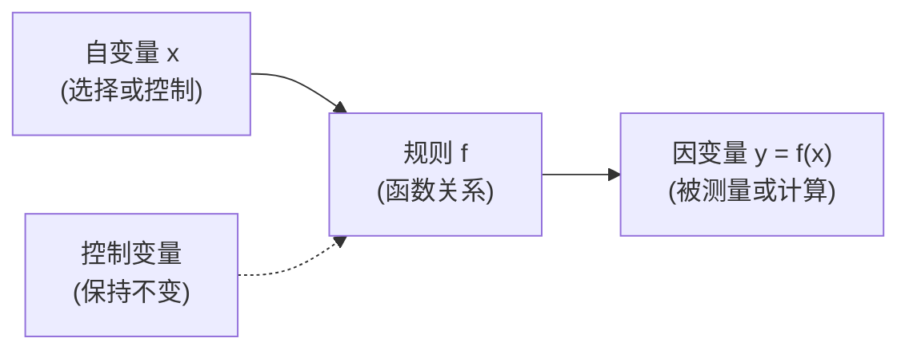
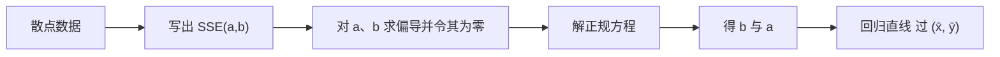
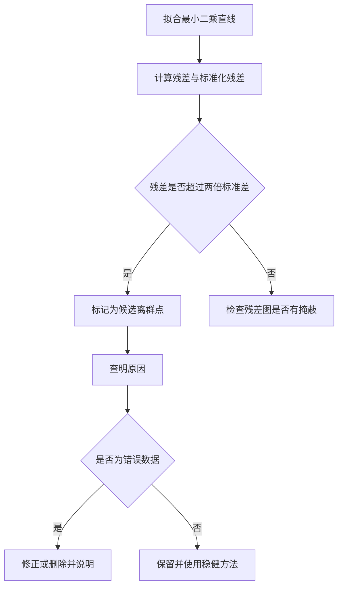
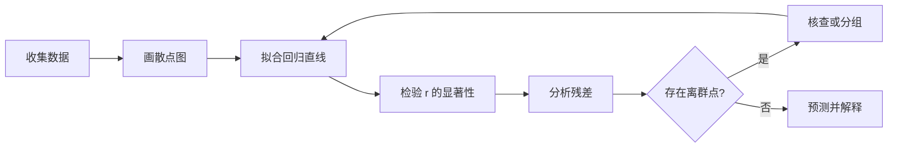

# SPL Run: build_concept_book

- **Adapter:** claude_cli
- **Model:** claude-sonnet-5-5
- **Tokens:** 2727 in / 1139 out
- **Latency:** 60115ms
- **Timestamp:** 2026-11-24 08:31:10

## Output

```output


---

## 自变量与因变量

**定义。** 在两个数值变量的关系中,**自变量**(independent variable,常记作 $x$)是被选定或被控制的量;**因变量**(dependent variable,常记作 $y$)是其取值随 $x$ 而变化的量。若 $y$ 由 $x$ 唯一确定,则可写成函数关系
$$y = f(x),$$
其中 $x$ 的所有允许取值构成**定义域**,$y$ 的所有对应取值构成**值域**。

需要注意:"自变量"与"因变量"描述的是变量在*问题中的角色*,而不是变量本身的性质。同一个量在不同问题中可以扮演不同角色。判断时可问自己:"我在改变或选择哪个量?哪个量是被测量或被计算出来的结果?"

**例题。** 一辆出租车起步价为 10 元,之后每行驶 1 公里加收 3 元。设行驶距离为 $x$ 公里($x \ge 0$),车费为 $y$ 元。

1. 距离由乘客的行程决定,因此 $x$ 是自变量;车费随距离变化,因此 $y$ 是因变量。
2. 建立关系:
$$y = 10 + 3x.$$
3. 当 $x = 4$ 时,$y = 10 + 3\times 4 = 22$(元);当 $x = 7$ 时,$y = 31$(元)。
4. 定义域为 $x \ge 0$,值域为 $y \ge 10$。

**问题求解应用。** 在实验设计中,正确识别两类变量是第一步。

*情境:* 某同学想研究弹簧挂上砝码后的伸长量。他依次挂上 $50,100,150,200$ g 的砝码,并用尺子测得弹簧总长度 $L$(cm)分别为 $12.1,\ 14.0,\ 16.1,\ 18.0$。

- **自变量:** 砝码质量 $m$(由实验者主动选择)。
- **因变量:** 弹簧长度 $L$(被测量的结果)。
- **控制变量:** 同一根弹簧、同一把尺子、同一温度,保证只有 $m$ 在改变。

作图时,通常把自变量放在横轴、因变量放在纵轴。由数据可估计斜率:
$$k=\frac{18.0-12.1}{200-50}\approx 0.039\ \text{cm/g},$$
于是 $L \approx 10.2 + 0.039\,m$。据此可预测:挂 $120$ g 时,$L \approx 10.2 + 0.039\times120 \approx 14.9$ cm。


*图示:自变量经过函数关系 $f$ 得到因变量;控制变量保持不变,以保证 $y$ 的变化只来自 $x$。*

**小结。** 解题时先明确"谁在被改变、谁在被测量",再写出 $y=f(x)$,并留意定义域的限制(如距离、质量不能为负)。这样才能正确作图、拟合并做出预测。

---

## 散点图

**定义。** 散点图(scatter plot)把成对观测值 $(x_i, y_i)$ 画成平面上的点:横轴表示变量 $x$,纵轴表示变量 $y$。它不假设任何函数形式,只让数据"自己说话",用来观察两个变量之间关系的**方向**、**强度**和**形状**。

- **方向**:点群从左下向右上倾斜为正相关;从左上向右下倾斜为负相关。
- **强度**:点越紧密地聚集在一条线或曲线附近,关系越强;越分散,关系越弱。
- **形状**:线性、曲线(如二次、指数)或无明显模式;此外还要留意离群点和分组结构。

强度可用样本相关系数 $r$ 量化:

$$r=\frac{\sum_{i=1}^{n}(x_i-\bar x)(y_i-\bar y)}{\sqrt{\sum_{i=1}^{n}(x_i-\bar x)^2}\,\sqrt{\sum_{i=1}^{n}(y_i-\bar y)^2}},\qquad -1\le r\le 1.$$

$r$ 接近 $\pm1$ 表示线性关系强,接近 $0$ 表示线性关系弱。注意:$r$ 只度量**线性**关系,因此必须先看图,再算数。

**例题。** 五名学生每周学习时数 $x$ 与测验分数 $y$:

| $x$ | 1 | 2 | 3 | 4 | 5 |
|---|---|---|---|---|---|
| $y$ | 55 | 62 | 70 | 74 | 84 |

描点后,点从左下向右上排列,近似成一条直线,故为正相关。计算:$\bar x=3$,$\bar y=69$。

- $\sum(x_i-\bar x)(y_i-\bar y)=(-2)(-14)+(-1)(-7)+0\cdot1+1\cdot5+2\cdot15=28+7+0+5+30=70$
- $\sum(x_i-\bar x)^2=10$
- $\sum(y_i-\bar y)^2=196+49+1+25+225=496$

$$r=\frac{70}{\sqrt{10}\sqrt{496}}=\frac{70}{\sqrt{4960}}\approx\frac{70}{70.43}\approx 0.994.$$

这是很强的正线性关系。最小二乘直线斜率为 $b=70/10=7$,即每多学 1 小时,预测分数约增加 7 分;截距为 $a=69-7\cdot3=48$,所以 $\hat y=48+7x$。

**问题求解应用。** 面对新数据集,可按以下步骤分析:

1. **先画图。** 判断形状是否近似线性。若点呈"U"形,即使 $r\approx0$,两变量也可能有很强的二次关系。
2. **检查离群点。** 一个远离群体的点可以显著拉高或拉低 $r$,应核查它是测量错误还是真实现象。
3. **考虑分组。** 若点分成几簇,合并计算的 $r$ 可能掩盖各组内部相反的趋势(辛普森悖论)。
4. **谨慎解释。** 相关不等于因果:冰淇淋销量与溺水人数正相关,是因为共同的"气温"这一潜在变量。
5. **限制外推。** 上例中用 $\hat y=48+7x$ 预测 $x=20$ 小时显然荒谬(分数会超过 100),直线只在观测范围内可靠。

**小结。** 散点图是数据分析的第一步:先用眼睛判断方向、强度与形状,再用 $r$ 和回归直线做定量描述,最后结合背景知识判断结论是否合理。

---

## 线性方程

**定义。** 线性方程是只含有变量的加法以及变量与常数相乘的方程,其一般形式为

$$a_1x_1 + a_2x_2 + \cdots + a_nx_n = b,$$

其中 $a_1,\dots,a_n$ 是常数(称为系数),$b$ 是常数项,$x_1,\dots,x_n$ 是未知量。"线性"的含义是:每个变量都只以一次幂出现,变量之间没有乘积,也没有指数、根号或超越函数(如 $\sin x$、$e^x$、$\ln x$)。

下面几个例子可以帮助判断:

- $3x - 2y = 7$ 是线性方程。
- $x^2 + y = 1$ 不是线性方程,因为含有 $x^2$。
- $xy + z = 4$ 不是线性方程,因为含有变量的乘积 $xy$。
- $\sin x + y = 0$ 不是线性方程,因为含有超越函数。

**几何意义。** 含两个未知量的线性方程 $ax+by=c$($a,b$ 不全为零)的解集是平面上的一条直线。含三个未知量时,解集是空间中的一个平面。一般地,$n$ 个未知量的线性方程的解集是 $n$ 维空间中的一个"超平面"。

**例题。** 求方程 $2x + 3y = 12$ 的所有解。

解:把 $y$ 用 $x$ 表示出来:

$$y = \frac{12 - 2x}{3} = 4 - \frac{2}{3}x.$$

$x$ 可以任取。令 $x = t$($t$ 为任意实数),则解可写成

$$(x, y) = \left(t,\; 4 - \tfrac{2}{3}t\right).$$

例如 $t=0$ 得 $(0,4)$,$t=3$ 得 $(3,2)$。代入验证:$2\cdot 3 + 3\cdot 2 = 12$,成立。这说明单个线性方程若含两个未知量,就有无穷多个解,它们恰好落在一条直线上。其中的 $t$ 称为自由参数。

**应用问题。** 某咖啡店用甲、乙两种豆子拌成配方。甲豆每千克 40 元,乙豆每千克 60 元。现有预算 600 元,最多能买多少乙豆?有哪些购买方案?

建模:设买甲豆 $x$ 千克,乙豆 $y$ 千克,则

$$40x + 60y = 600.$$

化简(两边除以 20)得 $2x + 3y = 30$。由于重量不能为负,需要 $x \ge 0,\ y \ge 0$。

- 若只买乙豆,令 $x=0$,得 $y=10$,所以乙豆最多 10 千克。
- 若只买甲豆,令 $y=0$,得 $x=15$。
- 若要求两种豆子重量相等,令 $x=y$,得 $5x=30$,所以 $x=y=6$ 千克。

可见,线性方程的解集在实际问题中通常还要受到现实约束(这里是非负性)的限制,最后得到的是直线上的一段线段,而不是整条直线。

**要点小结。** 判断是否线性,只需检查三点:变量是否都是一次幂、变量之间是否无乘积、是否无超越函数。求解时,先选出若干个变量作为自由参数,再用它们表示其余变量。这一思路正是后面求解线性方程组的基础。

---

## 线性回归

**定义。** 线性回归用一条直线来描述自变量 $x$ 与因变量 $y$ 之间的关系：

$$\hat{y} = \beta_0 + \beta_1 x$$

其中 $\beta_0$ 是截距，$\beta_1$ 是斜率，$\hat{y}$ 是模型的预测值。第 $i$ 个样本的**残差**为 $e_i = y_i - \hat{y}_i$。**最小二乘法**选取使残差平方和最小的参数：

$$\min_{\beta_0,\beta_1} \; \sum_{i=1}^{n}\left(y_i-\beta_0-\beta_1 x_i\right)^2$$

令偏导数为零，可得闭式解：

$$\beta_1=\frac{\sum_{i=1}^{n}(x_i-\bar{x})(y_i-\bar{y})}{\sum_{i=1}^{n}(x_i-\bar{x})^2},\qquad \beta_0=\bar{y}-\beta_1\bar{x}$$

由此可见，回归直线一定经过样本均值点 $(\bar{x},\bar{y})$。

**例题。** 某学生记录每周学习时长 $x$（小时）与考试成绩 $y$（分）：

| $x$ | 1 | 2 | 3 | 4 | 5 |
|---|---|---|---|---|---|
| $y$ | 55 | 65 | 70 | 80 | 90 |

第一步，求均值：$\bar{x}=3$，$\bar{y}=72$。

第二步，计算分子与分母：

$$\sum (x_i-\bar{x})(y_i-\bar{y}) = (-2)(-17)+(-1)(-7)+0\cdot(-2)+(1)(8)+(2)(18)=85$$

$$\sum (x_i-\bar{x})^2 = 4+1+0+1+4=10$$

第三步，$\beta_1 = 85/10 = 8.5$，$\beta_0 = 72 - 8.5\times 3 = 46.5$。

所以回归方程为 $\hat{y}=46.5+8.5x$。含义是：每多学习 1 小时，平均成绩约提高 8.5 分。

**问题求解应用。**

*(1) 预测。* 若学习 6 小时，则 $\hat{y}=46.5+8.5\times 6=97.5$ 分。注意 6 已超出数据范围 $[1,5]$，这属于**外推**，可靠性较低；成绩还有 100 分的上限，直线在此处很可能失效。

*(2) 评估拟合优度。* 各点的预测值为 $55,\,63.5,\,72,\,80.5,\,89$，残差为 $0,\,1.5,\,-2,\,-0.5,\,1$。于是

$$SS_{res}=0+2.25+4+0.25+1=7.5,\qquad SS_{tot}=\sum(y_i-\bar{y})^2=289+49+4+64+324=730$$

$$R^2 = 1-\frac{SS_{res}}{SS_{tot}} = 1-\frac{7.5}{730}\approx 0.990$$

即学习时长解释了成绩约 99% 的变异，说明线性模型拟合很好。

*(3) 检验前提。* 使用线性回归前，应画出残差图并检查：关系是否大致线性、残差是否无明显规律且方差大致恒定、是否存在对斜率影响过大的离群点。相关不等于因果：即使斜率显著，也不能仅凭此断定“多学习必然导致高分”，因为基础水平、睡眠等混杂因素可能同时影响两者。


*图：线性回归建模的基本流程，从数据检查、参数估计到残差诊断与预测。*

---

## 残差

**定义。** 对回归分析中的每个数据点 $(x_i, y_i)$,**残差**(residual)是观测值与回归线预测值之间的竖直差:

$$e_i = y_i - \hat{y}_i,\qquad \hat{y}_i = b_0 + b_1 x_i .$$

残差为正,说明点在回归线上方,模型低估了真实值;残差为负,说明点在回归线下方,模型高估了真实值。注意,残差是在 $y$ 方向上度量的,而不是点到直线的垂直距离。

最小二乘回归线正是使残差平方和 $\sum e_i^2$ 最小的那条直线。由此可得两条性质:只要模型含截距项,就有 $\sum e_i = 0$;并且残差与 $x$ 不相关。

**例题。** 某班级记录了学习时间 $x$(小时)与测验成绩 $y$(分):$(1, 55),\ (2, 65),\ (3, 70),\ (4, 80),\ (5, 85)$。

先计算均值:$\bar{x}=3,\ \bar{y}=71$。斜率为

$$b_1=\frac{\sum (x_i-\bar x)(y_i-\bar y)}{\sum (x_i-\bar x)^2}=\frac{(-2)(-16)+(-1)(-6)+0+(1)(9)+(2)(14)}{10}=\frac{75}{10}=7.5,$$

截距为 $b_0=71-7.5\times 3=48.5$,所以 $\hat{y}=48.5+7.5x$。

各点的预测值与残差如下:

| $x$ | $y$ | $\hat y$ | $e=y-\hat y$ |
|---|---|---|---|
| 1 | 55 | 56 | $-1$ |
| 2 | 65 | 63.5 | $1.5$ |
| 3 | 70 | 71 | $-1$ |
| 4 | 80 | 78.5 | $1.5$ |
| 5 | 85 | 86 | $-1$ |

验证:$-1+1.5-1+1.5-1=0$,与性质一致。

**问题求解应用。** 残差的主要用途是检验线性模型是否合适。

1. **作残差图。** 以 $x$(或 $\hat y$)为横轴、$e$ 为纵轴作图。若线性模型合适,残差应无规律地散布在 $0$ 附近。
2. **识别系统性结构。** 若残差呈 U 形或倒 U 形,说明真实关系是曲线,应考虑加入二次项或做变换。若残差随 $x$ 增大而变得更分散(漏斗形),说明方差不齐,预测的精度会随 $x$ 变化。
3. **发现异常点。** 某点的残差远大于其他点时,应检查是数据录入错误,还是确有特殊情形。
4. **衡量拟合优劣。** 残差标准误 $s=\sqrt{\dfrac{\sum e_i^2}{n-2}}$ 刻画预测的典型误差。本例中 $\sum e_i^2 = 1+2.25+1+2.25+1=7.5$,所以 $s=\sqrt{7.5/3}\approx 1.58$ 分。也就是说,用学习时间预测成绩,典型误差约为 1.6 分。

**小结。** 残差 $e = y-\hat y$ 是模型没能解释的部分。如果残差中仍有可见的规律,说明模型遗漏了信息;如果残差看起来只是随机噪声,线性模型才算令人信服。

---

## 误差平方和

**定义。** 给定数据点 $(x_i, y_i)$，$i=1,\dots,n$，以及一条预测直线 $\hat y = b_0 + b_1 x$，第 $i$ 个点的**残差**为 $e_i = y_i - \hat y_i$，即观测值与预测值之差。**误差平方和**（Sum of Squared Errors，SSE）定义为

$$
\mathrm{SSE}(b_0,b_1)=\sum_{i=1}^{n} e_i^2=\sum_{i=1}^{n}\bigl(y_i-b_0-b_1x_i\bigr)^2 .
$$

为什么要平方？残差有正有负，直接相加会相互抵消；平方使每一项非负，并且对大偏差给予更重的惩罚。**最小二乘回归线**就是使 SSE 取最小值的那条直线。

**最小化的结果。** SSE 是 $b_0,b_1$ 的二次函数。令偏导数为零：

$$
\frac{\partial\,\mathrm{SSE}}{\partial b_0}=-2\sum e_i=0,\qquad
\frac{\partial\,\mathrm{SSE}}{\partial b_1}=-2\sum x_ie_i=0 .
$$

解得

$$
b_1=\frac{\sum (x_i-\bar x)(y_i-\bar y)}{\sum (x_i-\bar x)^2},\qquad b_0=\bar y-b_1\bar x .
$$

由第一个方程可知，最小二乘线的残差之和恒为 $0$，且直线必过点 $(\bar x,\bar y)$。

**例题。** 数据点为 $(1,2),\,(2,3),\,(3,5)$。

先求均值：$\bar x=2$，$\bar y=\tfrac{10}{3}$。

$$
\sum (x_i-\bar x)(y_i-\bar y)=(-1)\left(-\tfrac43\right)+0+(1)\left(\tfrac53\right)=3,\qquad \sum (x_i-\bar x)^2=2 .
$$

所以 $b_1=\tfrac32$，$b_0=\tfrac{10}{3}-3=\tfrac13$，回归线为 $\hat y=\tfrac13+\tfrac32x$。

预测值依次为 $\tfrac{11}{6},\ \tfrac{10}{3},\ \tfrac{29}{6}$。残差依次为 $\tfrac16,\ -\tfrac13,\ \tfrac16$。残差之和为 $0$，与上面的结论一致。于是

$$
\mathrm{SSE}=\tfrac1{36}+\tfrac19+\tfrac1{36}=\tfrac16\approx 0.167 .
$$

**应用：比较两条直线。** 取另一条直线 $\hat y=x+1$，它的残差为 $1,0,1$，所以 $\mathrm{SSE}=2$。这远大于 $\tfrac16$，说明这条直线拟合得更差。任何其他直线的 SSE 都不会小于 $\tfrac16$。

**应用：衡量模型好坏。** SSE 的大小取决于数据的尺度，所以单独看它不容易解读。通常把它与总平方和 $\mathrm{SST}=\sum (y_i-\bar y)^2$ 相比，得到决定系数

$$
R^2=1-\frac{\mathrm{SSE}}{\mathrm{SST}} .
$$

本例中 $\mathrm{SST}=\tfrac{16}{9}+\tfrac19+\tfrac{25}{9}=\tfrac{14}{3}$，因此 $R^2=1-\tfrac{1/6}{14/3}=\tfrac{27}{28}\approx 0.964$。这表示回归线解释了 $y$ 的约 $96.4\%$ 的变异。

**要点。** SSE 衡量一条直线整体偏离数据的程度。最小二乘法选取使 SSE 最小的直线，而 SSE 与 SST 的比值则用来评价这条直线拟合得有多好。

---

## 最小二乘回归直线

**定义。** 给定 $n$ 个数据点 $(x_i, y_i)$,对直线 $\hat y = a + bx$ 的**残差**为 $e_i = y_i - \hat y_i$。**最小二乘回归直线**是使误差平方和

$$
\text{SSE}(a,b)=\sum_{i=1}^{n}\bigl(y_i-a-bx_i\bigr)^2
$$

取最小值的那条唯一直线。

**公式推导。** SSE 是关于 $a,b$ 的二次函数,令偏导数为零:

$$
\frac{\partial\,\text{SSE}}{\partial a}=-2\sum (y_i-a-bx_i)=0,\qquad
\frac{\partial\,\text{SSE}}{\partial b}=-2\sum x_i(y_i-a-bx_i)=0 .
$$

整理得到**正规方程**,解为

$$
b=\frac{\sum (x_i-\bar x)(y_i-\bar y)}{\sum (x_i-\bar x)^2}=r\,\frac{s_y}{s_x},\qquad
a=\bar y-b\,\bar x .
$$

只要 $x_i$ 不全相同,分母大于 0,解唯一;SSE 的二阶导数矩阵正定,因此这是最小值而非鞍点。由 $a=\bar y-b\bar x$ 可知,**回归直线必过点 $(\bar x,\bar y)$**。

**例题。** 某学生每周学习时间 $x$(小时)与测验成绩 $y$:

| $x$ | 1 | 2 | 3 | 4 | 5 |
|---|---|---|---|---|---|
| $y$ | 55 | 65 | 70 | 80 | 85 |

计算得 $\bar x=3$,$\bar y=71$。
$\sum (x_i-\bar x)(y_i-\bar y)=(-2)(-16)+(-1)(-6)+0+(1)(9)+(2)(14)=32+6+0+9+28=75$,
$\sum (x_i-\bar x)^2=4+1+0+1+4=10$。

于是 $b=75/10=7.5$,$a=71-7.5\times 3=48.5$,即

$$
\hat y = 48.5+7.5x .
$$

**问题求解应用。**

1. **解释斜率:** 每周多学 1 小时,平均成绩预计提高约 7.5 分;截距 48.5 是 $x=0$ 时的预测值(此处仅为外推,意义有限)。
2. **预测:** $x=3.5$ 时,$\hat y=48.5+26.25=74.75$。
3. **残差:** $x=4$ 时 $\hat y=78.5$,残差 $e=80-78.5=1.5$。全部残差为 $-1,\,1.5,\,-1,\,1.5,\,-1$ 再核对:$x=1$ 时 $\hat y=56$,$e=-1$;$x=2$ 时 $\hat y=63.5$,$e=1.5$;$x=3$ 时 $\hat y=71$,$e=-1$;$x=5$ 时 $\hat y=86$,$e=-1$。其和为 $-1+1.5-1+1.5-1=0$,符合最小二乘残差之和恒为 0 的性质。
4. **SSE:** $1+2.25+1+2.25+1=7.5$。任何其他直线(如 $\hat y=50+7x$)的 SSE 都更大。

**使用提醒。** 直线只在数据范围内可靠,避免盲目外推;离群点和高杠杆点会显著拉动直线;$r$ 或 $r^2$ 衡量线性拟合程度,但相关不等于因果。


*图:由最小化 SSE 到得出回归直线的推导流程。*

---

## 相关性

**定义。** 相关性(correlation)描述两个数值变量之间线性关系的强弱与方向。在散点图上,若点随 $x$ 增大而整体上升,称为**正相关**;整体下降,称为**负相关**;若看不出直线趋势,则称**无相关**。衡量它的常用指标是皮尔逊相关系数:

$$r=\frac{\sum_{i=1}^{n}(x_i-\bar{x})(y_i-\bar{y})}{\sqrt{\sum_{i=1}^{n}(x_i-\bar{x})^2}\,\sqrt{\sum_{i=1}^{n}(y_i-\bar{y})^2}}$$

它满足 $-1\le r\le 1$。$r$ 的符号表示方向,$|r|$ 越接近 $1$,点越紧密地围绕一条直线;$r\approx 0$ 表示没有线性关系。

**几点要领。**
- $r$ 无单位,改变 $x$ 或 $y$ 的单位(如厘米改为米)不会改变它。
- $r$ 只衡量**线性**关系。例如 $y=x^2$ 在 $x$ 关于 $0$ 对称取值时 $r=0$,但两者显然有关。
- **相关不等于因果**:冰淇淋销量与溺水人数正相关,是因为两者都受气温影响。

**例题。** 某班 5 名学生的每周学习时间 $x$(小时)与测验成绩 $y$ 如下:

| $x$ | 1 | 2 | 3 | 4 | 5 |
|---|---|---|---|---|---|
| $y$ | 55 | 60 | 70 | 75 | 85 |

求 $r$。

1. 均值:$\bar{x}=3$,$\bar{y}=69$。
2. 离差:$x_i-\bar{x}$ 为 $-2,-1,0,1,2$;$y_i-\bar{y}$ 为 $-14,-9,1,6,16$。
3. 分子:$(-2)(-14)+(-1)(-9)+0\cdot1+1\cdot6+2\cdot16=28+9+0+6+32=75$。
4. 分母:$\sum(x_i-\bar{x})^2=10$,$\sum(y_i-\bar{y})^2=196+81+1+36+256=570$,故分母为 $\sqrt{10\cdot570}\approx75.5$。
5. $r\approx75/75.5\approx0.993$。

这是非常强的正相关,散点几乎落在一条上升的直线上。

**问题求解应用。** 假设在一项调查中发现 $r=-0.85$,这说明什么?

- 方向:$r<0$,两变量呈负相关。
- 强度:$|r|=0.85$ 接近 $1$,线性关系较强。
- 解释力:$r^2=0.7225$,即 $y$ 的变化中约 $72\%$ 可由 $x$ 的线性关系解释。
- 谨慎结论:只能说二者"伴随变化",不能直接断言 $x$ 导致 $y$ 变化。

**检验步骤。** 拿到数据后,应当(1)先画散点图,确认关系大致呈直线,并留意离群点,因为单个离群点就可能使 $r$ 大幅改变;(2)再计算 $r$;(3)最后结合背景判断是否存在混杂变量。只看数字而不看图,是初学者最常见的错误。

---

## 相关系数 R

**定义。** 对 $n$ 个成对数据 $(x_i, y_i)$，样本相关系数（皮尔逊相关系数）定义为

$$
r=\frac{1}{n-1}\sum_{i=1}^{n}\left(\frac{x_i-\bar x}{s_x}\right)\left(\frac{y_i-\bar y}{s_y}\right)=\frac{\sum (x_i-\bar x)(y_i-\bar y)}{\sqrt{\sum (x_i-\bar x)^2\,\sum (y_i-\bar y)^2}}
$$

其中 $s_x, s_y$ 为样本标准差。$r$ 是两个变量标准化后（$z$ 分数）乘积的平均，因此没有单位，且恒有 $-1\le r\le 1$（由柯西–施瓦茨不等式可证）。

**性质与解释。**
- $r>0$：正线性关系；$r<0$：负线性关系；$r=\pm1$：所有点恰好落在一条直线上；$r\approx 0$：没有线性关系（但可能存在非线性关系）。
- 最小二乘回归直线的斜率为 $b=r\,\dfrac{s_y}{s_x}$。因为 $s_x,s_y>0$，所以 $b$ 的符号与 $r$ 相同。
- $r^2$ 表示 $y$ 的变异中能被 $x$ 的线性关系解释的比例。
- $r$ 对离群点敏感，且相关不等于因果。

**例题。** 五名学生的学习时间 $x$（小时）与测验成绩 $y$（分）为：$(1,60),(2,65),(3,75),(4,80),(5,90)$。

1. 均值：$\bar x=3,\ \bar y=74$。
2. 离差：$x_i-\bar x=-2,-1,0,1,2$；$y_i-\bar y=-14,-9,1,6,16$。
3. 求和：
$\sum(x_i-\bar x)(y_i-\bar y)=28+9+0+6+32=75$，
$\sum(x_i-\bar x)^2=10$，
$\sum(y_i-\bar y)^2=196+81+1+36+256=570$。
4. 代入：
$$r=\frac{75}{\sqrt{10\times570}}=\frac{75}{\sqrt{5700}}\approx\frac{75}{75.50}\approx0.993.$$

这说明二者有很强的正线性关系。回归斜率为 $b=\dfrac{75}{10}=7.5$，即每多学 1 小时，预测成绩约提高 7.5 分，符号与 $r$ 一致。又 $r^2\approx0.987$，约 98.7% 的成绩变异可由学习时间的线性关系解释。

**问题求解应用。** 某数据集中 $s_x=2$，$s_y=10$，$r=-0.6$，求回归斜率，并判断 $x=\bar x+2$ 时 $y$ 的预测值相对 $\bar y$ 的变化。

- 斜率：$b=r\dfrac{s_y}{s_x}=-0.6\times\dfrac{10}{2}=-3$。
- 回归线过点 $(\bar x,\bar y)$，所以 $x$ 增加 2 时，预测 $y$ 变化 $-3\times2=-6$。
- 用 $z$ 分数理解：$x$ 比均值高 1 个标准差，预测 $y$ 仅比均值低 $|r|=0.6$ 个标准差，即 $-0.6\times10=-6$。这与上面的结果一致。

**常见陷阱。** 若 $y=x^2$，$x$ 在 $-3$ 到 $3$ 上对称取值，则 $r=0$，但两者有完全确定的关系。因此在计算 $r$ 之前，务必先画散点图，确认关系大致呈线性，并检查离群点。

---

## 离群点

**定义。** 在最小二乘回归中,第 $i$ 个观测的**残差**为 $e_i = y_i - \hat y_i$。**离群点**(outlier)是指其残差异常大的数据点,通常指 $|e_i|$ 超过残差标准差 $s_e$ 约两倍的点,即

$$
\left|\frac{e_i}{s_e}\right| > 2, \qquad s_e=\sqrt{\frac{\sum e_i^2}{n-2}} .
$$

离群点在竖直方向上远离回归直线。它与"高杠杆点"不同。高杠杆点的 $x$ 值极端,但不一定远离直线。

**例题。** 有 6 组数据 $(x,y)$:$(1,3),(2,5),(3,7),(4,9),(5,11),(6,25)$。

1. 拟合最小二乘直线。$\bar x = 3.5$,$\bar y = 10$,$S_{xx}=17.5$,$S_{xy}=\sum (x_i-\bar x)(y_i-\bar y)=2.5\cdot15+1.5\cdot 5+0.5\cdot(-3)\ldots$ 逐项计算得 $S_{xy}=\,$ 
$(-2.5)(-7)+(-1.5)(-5)+(-0.5)(-3)+(0.5)(-1)+(1.5)(1)+(2.5)(15)=17.5+7.5+1.5-0.5+1.5+37.5=65$。
于是 $b_1 = 65/17.5\approx 3.714$,$b_0=10-3.714\times3.5=-3.0$。

2. 计算残差。$\hat y = -3+3.714x$,各点预测值为 $0.71,\,4.43,\,8.14,\,11.86,\,15.57,\,19.29$。残差依次为 $2.29,\,0.57,\,-1.14,\,-2.86,\,-4.57,\,5.71$。

3. 求标准差。$\sum e_i^2\approx 5.22+0.33+1.31+8.16+20.9+32.6\approx 68.5$,所以 $s_e=\sqrt{68.5/4}\approx4.14$。最后一点的标准化残差为 $5.71/4.14\approx1.38<2$。

这个结果出乎意料:$(6,25)$ 明显偏离其余五点的线性趋势,却没有被判为离群点。原因在于它自己把直线"拉"向了它,同时也抬高了 $s_e$。这种现象称为**掩蔽**(masking)。

**问题求解应用。** 这类问题的处理流程如下。

1. **先作图。** 画散点图和残差图,不要只依赖单一阈值。
2. **标记候选点。** 计算 $e_i/s_e$。更稳妥的做法是用"留一法":去掉该点重新拟合,再检验它的残差。
3. **查明原因。** 判断它是录入错误、测量故障,还是真实的特殊个案。
4. **比较有无该点的结果。** 去掉 $(6,25)$ 后,前五点恰好满足 $y=2x+1$,斜率从 $3.71$ 降到 $2$,说明它对模型影响极大。
5. **如实报告。** 只有找到合理原因才能删除数据,并且要说明删除了什么、为什么删除。若点是真实的,可改用稳健回归(如 Huber 回归),或另行建模。

**要点。** 离群点会扭曲斜率、截距和 $R^2$。判断时要结合图形、残差和专业背景,不能机械套用"两倍标准差"的规则。


*离群点的识别与处理流程:先标记,再查因,最后决定修正、删除或保留。*

---

## 回归实验:距离、教材与燃油效率

**定义。** 简单线性回归用直线 $\hat y=a+bx$ 拟合 $n$ 组数据 $(x_i,y_i)$,并使残差平方和最小。最小二乘解为

$$b=r\,\frac{s_y}{s_x},\qquad a=\bar y-b\bar x,$$

其中 $r$ 为相关系数,$s_x,s_y$ 为样本标准差。斜率 $b$ 表示 $x$ 每增加一个单位时 $y$ 的平均变化量。三个实验的变量设置如下:

- **实验 A**:学校到供应商的距离 $x$(公里)与供应成本 $y$(元)。
- **实验 B**:教材页数 $x$ 与售价 $y$(元)。
- **实验 C**:汽车重量 $x$(百公斤)与油耗 $y$(升/百公里)。

**相关性显著性检验。** 检验 $H_0:\rho=0$,统计量为

$$t=\frac{r\sqrt{n-2}}{\sqrt{1-r^2}},\qquad \text{自由度 } n-2.$$

若 $|t|$ 大于临界值(或 $p<0.05$),则认为线性关系显著。

**例题(实验 B)。** 收集 $n=10$ 本教材的数据,算得 $\bar x=400$ 页,$\bar y=80$ 元,$s_x=100$,$s_y=20$,$r=0.90$。

1. 斜率 $b=0.90\times\frac{20}{100}=0.18$ 元/页。
2. 截距 $a=80-0.18\times400=8$ 元。
3. 回归方程为 $\hat y=8+0.18x$。
4. 检验:$t=\dfrac{0.90\sqrt8}{\sqrt{1-0.81}}=\dfrac{2.546}{0.436}\approx5.84$。自由度为 8 时,双侧 5% 临界值约为 2.306,所以相关显著。
5. 决定系数 $r^2=0.81$,即页数解释了价格 81% 的变异。

预测 500 页的教材:$\hat y=8+0.18\times500=98$ 元。

**问题解决应用:离群点检测。** 计算残差 $e_i=y_i-\hat y_i$,再计算标准化残差 $e_i/s_e$,其中

$$s_e=\sqrt{\frac{\sum e_i^2}{n-2}}.$$

若 $|e_i/s_e|>2$(严格检验常用 3),该点需要检查。

在实验 C 中,若多数轿车满足"越重越费油",而某辆混合动力车的油耗远低于直线预测值,它的标准化残差会很大。处理步骤如下:

1. 核对记录是否有误,例如单位或录入错误。
2. 若数据无误,说明该车属于另一类总体(动力系统不同)。此时应分组拟合,不应直接删点。
3. 对比删除前后的 $r$ 与 $b$,判断该点的影响力。

**实验注意事项。**

- 外推要谨慎:实验 A 中距离只测了 1–20 公里,不能预测 200 公里的成本。
- 相关不等于因果:页数与价格同增,可能源于纸张、装帧等共同因素。
- 先画散点图再计算,因为 $r$ 只衡量线性关系。
- 残差图应无明显规律。若呈弧形,说明需要非线性模型,例如实验 C 中油耗随重量可能加速上升。


*图:回归实验的标准流程。离群点经核查或分组后,需重新拟合并再次检验。*

---

## Payoff(终点与回报)

### 为什么这是自然的终点

`regression_labs_distance_textbook_fuel` 是一个完整的回归实验:用**教科书的价格**随**距离**变化、**燃油消耗**随**行驶里程**变化这两个看似无关的数据集,走完同一条建模流程。它把前面所有的工具汇集到一处:

1. 写出线性模型 $y_i = \beta_0 + \beta_1 x_i + \varepsilon_i$;
2. 用最小二乘最小化残差平方和
$$S(\beta_0,\beta_1)=\sum_{i=1}^{n}\bigl(y_i-\beta_0-\beta_1 x_i\bigr)^2 ;$$
3. 解出闭式解
$$\hat\beta_1=\frac{\sum_i (x_i-\bar x)(y_i-\bar y)}{\sum_i (x_i-\bar x)^2},\qquad \hat\beta_0=\bar y-\hat\beta_1\bar x ;$$
4. 用 $R^2 = 1-\dfrac{\sum_i (y_i-\hat y_i)^2}{\sum_i (y_i-\bar y)^2}$ 与残差图检验模型是否合理;
5. 用拟合直线做预测,并解释斜率的实际含义。

之所以说它是终点,是因为它要求你**独立完成整条链路**,而不是只做其中一步。斜率 $\hat\beta_1$ 在两个情境中含义不同:在燃油例子中,它是“每多行驶一公里多消耗多少升油”;在教科书例子中,它是“每远一单位距离,价格变化多少”。同一套数学,不同的单位与解释,这正是回归的通用性。

### 一个小型综合例子

设某车行驶 $x$(百公里)与耗油 $y$(升)的数据为 $(1,7),(2,15),(3,22),(4,29)$。则 $\bar x=2.5,\ \bar y=18.25$,
$$\hat\beta_1=\frac{(-1.5)(-11.25)+(-0.5)(-3.25)+(0.5)(3.75)+(1.5)(10.75)}{5}=\frac{36.5}{5}=7.3,$$
$$\hat\beta_0=18.25-7.3\times 2.5=0.$$
于是 $\hat y=7.3x$:每百公里约耗油 $7.3$ 升,截距接近零,符合物理直觉(不行驶就不耗油)。若截距明显偏离零,你就应当追问模型或数据哪里出了问题。

### 它如何连接到应用领域

本节未列出具体的应用领域,因此这里给出这一实验天然通向的几个方向:

- **运输与能源**:用燃油回归估算路线成本、比较车型效率。
- **定价与供应链**:用距离—价格回归理解运费与区域差价。
- **机器学习**:线性回归是最简单的监督学习模型;多元回归、正则化与梯度下降都由它推广而来。
- **科学数据分析**:任何“测量—拟合—检验—预测”的实验流程,都与本实验同构。

### 邀请

请选择其中一个方向深入:收集一份真实数据(例如你自己的加油记录,或网上书店按配送距离的价格),拟合直线,画出残差图,并回答:模型在哪个范围内可信?哪些点是异常值?当你能为这些问题给出有依据的回答时,你就已经把回归当作解决问题的工具,而不只是一个公式。
```
