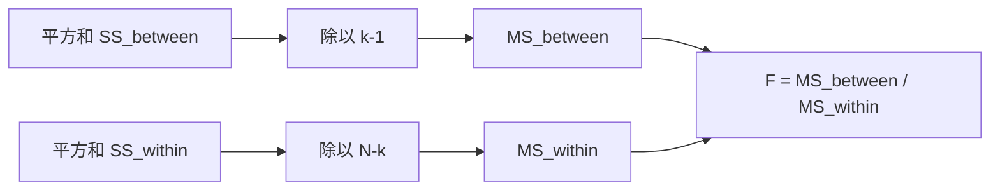
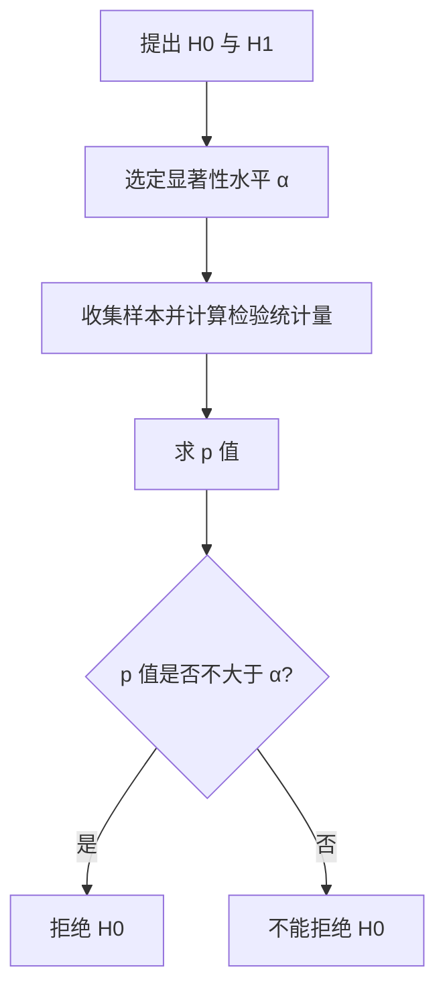

# SPL Run: build_concept_book

- **Adapter:** claude_cli
- **Model:** claude-sonnet-5-5
- **Tokens:** 1647 in / 755 out
- **Latency:** 44957ms
- **Timestamp:** 2026-11-24 08:33:52

## Output

```output


---

## 自由度

**定义。** 自由度(degrees of freedom,记作 $df$)是决定卡方分布曲线形状的唯一参数。直观地说,它是数据中"可以自由变动的独立信息个数":当样本受到若干约束(例如各类别频数之和必须等于总数 $n$)时,真正自由的数据个数就要减去约束数。$df$ 越小,曲线越偏斜、集中在左侧;$df$ 越大,曲线越对称,并逐渐接近正态形状。卡方分布的均值等于 $df$,方差等于 $2\,df$。

不同的卡方检验,$df$ 的算法不同:

- **拟合优度检验**($k$ 个类别):
$$df = k - 1$$
若分布中还有 $m$ 个参数是由样本估计出来的,则 $df = k - 1 - m$。
- **独立性检验 / 同质性检验**($r$ 行 $c$ 列的列联表):
$$df = (r-1)(c-1)$$

**为什么是这些公式?** 拟合优度检验中,$k$ 个频数之和固定为 $n$,所以只有 $k-1$ 个可以自由取值,最后一个由差值决定。列联表中,行合计与列合计都已固定,因此每行只有 $c-1$ 个格子自由、只有 $r-1$ 行自由,其余格子都被边际合计"锁定"。

**例 1(拟合优度)。** 掷一枚骰子 120 次,检验它是否均匀。类别数 $k=6$,所以
$$df = 6 - 1 = 5.$$
若算得 $\chi^2 = 9.2$,查 $df=5$ 的临界值 $\chi^2_{0.05}=11.07$。因为 $9.2 < 11.07$,不能拒绝"骰子均匀"的原假设。

**例 2(独立性)。** 调查 3 个年级(行)与 4 种课外活动偏好(列)是否相关,列联表为 $3\times4$:
$$df = (3-1)(4-1) = 2\times 3 = 6.$$
若算得 $\chi^2 = 15.8$,而 $df=6$ 时 $\chi^2_{0.05}=12.59$,则 $15.8 > 12.59$,拒绝原假设,认为年级与活动偏好有关。

**问题求解应用。** 一位研究者检验某地每天的交通事故数是否服从泊松分布。数据分成 $k=7$ 个类别,而泊松参数 $\lambda$ 由样本均值估计得到($m=1$)。于是
$$df = 7 - 1 - 1 = 5.$$
如果错误地使用 $df=6$,临界值会偏大($\chi^2_{0.05}=12.59$ 而非正确的 $11.07$),使检验过于保守,可能漏掉真实的偏离。

**解题步骤:**
1. 判断检验类型(拟合优度还是列联表)。
2. 数清类别数 $k$,或行数 $r$ 与列数 $c$。
3. 减去被样本估计的参数个数(如有)。
4. 用所得 $df$ 查表或计算 $p$ 值。

**常见错误:** 用样本量 $n$ 代替类别数;把列联表的 $df$ 误写成 $rc-1$;忘记扣除估计参数。记住:$df$ 反映的是**类别结构**,而不是样本有多大。

---

## 方差

**定义。** 方差(variance)衡量数据围绕均值的离散程度。设一组数据 $x_1, x_2, \dots, x_n$,均值为 $\bar{x}$,则

$$
\sigma^2 = \frac{1}{n}\sum_{i=1}^{n}(x_i-\bar{x})^2 \quad(\text{总体方差})
$$

当数据是来自总体的样本时,通常使用

$$
s^2 = \frac{1}{n-1}\sum_{i=1}^{n}(x_i-\bar{x})^2 \quad(\text{样本方差})
$$

为什么要平方?若直接把偏差 $x_i-\bar{x}$ 相加,正负偏差会相互抵消,结果恒为 $0$。平方既消除了符号,又使远离均值的点贡献更大。方差的单位是原数据单位的平方,其算术平方根 $\sigma$ 称为**标准差**,单位与原数据一致。

分母取 $n-1$ 的原因是:用样本均值 $\bar{x}$ 代替未知的总体均值后,偏差平方和会系统性偏小。除以 $n-1$ 可以修正这一偏差,使 $s^2$ 成为总体方差的无偏估计。

**例题。** 某同学五次测验成绩为 $70, 80, 80, 90, 100$。把它看作样本,求方差。

1. 均值:$\bar{x} = \dfrac{70+80+80+90+100}{5} = 84$。
2. 偏差平方:$(-14)^2=196,\ (-4)^2=16,\ 16,\ 6^2=36,\ 16^2=256$。
3. 求和:$196+16+16+36+256 = 520$。
4. 样本方差:$s^2 = \dfrac{520}{5-1} = 130$,标准差 $s \approx 11.4$ 分。

这说明成绩平均偏离均值约 $11$ 分。

**解题应用。** 方差常用于比较稳定性。甲、乙两名射手各射击五次,环数如下:

- 甲:$8, 9, 9, 9, 10$,均值 $9$
- 乙:$6, 8, 9, 10, 12$,均值 $9$

两人平均环数相同。甲的偏差平方和为 $1+0+0+0+1=2$,乙为 $9+1+0+1+9=20$。按总体方差计算,$\sigma_{\text{甲}}^2 = 0.4$,$\sigma_{\text{乙}}^2 = 4$。甲的方差更小,所以发挥更稳定。

方差还有两条常用性质,可简化计算:

$$
\sigma^2 = \frac{1}{n}\sum x_i^2 - \bar{x}^2, \qquad \operatorname{Var}(aX+b) = a^2\operatorname{Var}(X)
$$

第一式表示“平方的均值减去均值的平方”,免去了逐项求偏差。第二式表明:所有数据加上常数 $b$ 不改变离散程度,而乘以 $a$ 会使方差变为 $a^2$ 倍。例如把百分制成绩换算成满分 $50$ 的成绩($a=0.5$),方差变为原来的 $0.25$ 倍。

**小结。** 方差用“偏差平方的平均”刻画离散程度。计算时要先判断数据是总体还是样本,以决定分母取 $n$ 还是 $n-1$。

---

## 正态分布

**定义。** 若连续型随机变量 $X$ 的概率密度函数为

$$
f(x)=\frac{1}{\sigma\sqrt{2\pi}}\exp\!\left(-\frac{(x-\mu)^2}{2\sigma^2}\right),\quad -\infty<x<\infty,
$$

则称 $X$ 服从正态分布,记作 $X\sim N(\mu,\sigma^2)$。参数 $\mu$ 是均值(曲线对称轴),$\sigma>0$ 是标准差(决定曲线的"胖瘦")。曲线下总面积为 1,概率等于面积:$P(a<X<b)=\int_a^b f(x)\,dx$。

当 $\mu=0,\sigma=1$ 时称为**标准正态分布**,记作 $Z\sim N(0,1)$。任何正态变量都可以标准化:

$$
Z=\frac{X-\mu}{\sigma}.
$$

经验法则:约 68%、95%、99.7% 的概率分别落在 $\mu\pm\sigma$、$\mu\pm2\sigma$、$\mu\pm3\sigma$ 之内。


*图:用标准化把任意正态问题转化为标准正态问题的流程。*

**例题。** 某考试成绩 $X\sim N(70,\,10^2)$,求成绩高于 85 分的概率。

标准化:

$$
z=\frac{85-70}{10}=1.5,\qquad P(X>85)=P(Z>1.5)=1-\Phi(1.5)\approx 1-0.9332=0.0668.
$$

即约 6.7% 的考生超过 85 分。

**在假设检验中的应用。** 正态分布之所以成为检验的核心,是因为**中心极限定理**:当样本量 $n$ 足够大时,无论总体形状如何,样本均值 $\bar X$ 近似服从

$$
\bar X\sim N\!\left(\mu,\ \frac{\sigma^2}{n}\right),
$$

于是检验统计量为

$$
z=\frac{\bar x-\mu_0}{\sigma/\sqrt n}.
$$

对比例 $p$,当 $np_0\ge10$ 且 $n(1-p_0)\ge10$ 时,样本比例 $\hat p$ 近似服从 $N\!\left(p_0,\ \dfrac{p_0(1-p_0)}{n}\right)$,统计量为

$$
z=\frac{\hat p-p_0}{\sqrt{p_0(1-p_0)/n}}.
$$

**例:** 某零件长度已知 $\sigma=2$ mm,声称均值 $\mu_0=50$ mm。抽取 $n=64$ 个,得 $\bar x=50.6$。检验 $H_0:\mu=50$ 与 $H_1:\mu\ne50$,显著性水平 $\alpha=0.05$。

$$
z=\frac{50.6-50}{2/\sqrt{64}}=\frac{0.6}{0.25}=2.4.
$$

双侧临界值为 $\pm1.96$。因 $|2.4|>1.96$,拒绝 $H_0$。$p$ 值为 $2\,[1-\Phi(2.4)]\approx 2(0.0082)=0.0164<0.05$,结论一致:样本均值与声称值之间存在统计上显著的差异。

**解题要点。**
1. 先确认条件:$\sigma$ 已知(均值检验)或样本足够大(比例检验)。
2. 写出统计量并标准化。
3. 比较临界值或计算 $p$ 值,再用问题的语言写出结论。

注意:若 $\sigma$ 未知,需用样本标准差并改用 $t$ 分布;正态分布在此仅适用于 $\sigma$ 已知的情形。

---

## 平方和

**定义。** 平方和(sum of squares)用来度量一组数据的总变异程度。对数据 $x_1,\dots,x_n$,其均值为 $\bar{x}$,总平方和为

$$SS_{\text{total}}=\sum_{i=1}^{n}(x_i-\bar{x})^2 .$$

若各观测带有权重 $w_i$,则加权形式为 $\sum_i w_i (x_i-\bar{x}_w)^2$,其中 $\bar{x}_w=\dfrac{\sum_i w_i x_i}{\sum_i w_i}$。取平方有两个作用:一是避免正负偏差相互抵消,二是使大偏差得到更重的惩罚。

**分组分解。** 设数据分为 $k$ 组,第 $j$ 组有 $n_j$ 个观测,组均值为 $\bar{x}_j$,总均值为 $\bar{x}$。则

$$SS_{\text{total}}=\underbrace{\sum_{j=1}^{k} n_j(\bar{x}_j-\bar{x})^2}_{SS_{\text{between}}}+\underbrace{\sum_{j=1}^{k}\sum_{i=1}^{n_j}(x_{ij}-\bar{x}_j)^2}_{SS_{\text{within}}}.$$

$SS_{\text{between}}$ 衡量各组均值相对总均值的离散程度,$SS_{\text{within}}$ 衡量组内个体相对本组均值的离散程度。

**证明要点。** 把 $x_{ij}-\bar{x}$ 写成 $(x_{ij}-\bar{x}_j)+(\bar{x}_j-\bar{x})$ 后展开平方,交叉项为
$$2\sum_j(\bar{x}_j-\bar{x})\sum_i(x_{ij}-\bar{x}_j).$$
由于组内偏差之和 $\sum_i(x_{ij}-\bar{x}_j)=0$,交叉项恒为零,分解因此成立。

**例题。** 两组数据:A 组为 $2,4,6$,B 组为 $8,10,12$。

- 组均值 $\bar{x}_A=4$,$\bar{x}_B=10$,总均值 $\bar{x}=7$。
- $SS_{\text{total}}=25+9+1+1+9+25=70$。
- $SS_{\text{between}}=3(4-7)^2+3(10-7)^2=27+27=54$。
- $SS_{\text{within}}=(4+0+4)+(4+0+4)=16$。

验证:$54+16=70$,与总平方和一致。

**问题求解应用。** 比较各组均值是否有差异时,关键是看变异主要来自组间还是组内。ANOVA 中的 $F$ 统计量就是据此构造的:

$$F=\frac{SS_{\text{between}}/(k-1)}{SS_{\text{within}}/(N-k)} .$$

上例中 $k=2$,$N=6$,所以
$$F=\frac{54/1}{16/4}=13.5 .$$

$F$ 越大,说明组间差异相对于组内噪声越显著。对应的 $p$ 值需要查 $F(1,4)$ 分布得到。另外,组间所占比例
$$\eta^2=\frac{SS_{\text{between}}}{SS_{\text{total}}}=\frac{54}{70}\approx 0.77$$
表示分组可以解释约 77% 的总变异,这就是效应量。

**练习。** 三组数据为 $\{1,3\}$、$\{5,7\}$、$\{9,11\}$。请计算 $SS_{\text{between}}$ 和 $SS_{\text{within}}$,并验证二者之和等于 $SS_{\text{total}}$。(答案:$SS_{\text{between}}=64$,$SS_{\text{within}}=6$,$SS_{\text{total}}=70$。)

---

## F 分布

**定义。** 设 $U \sim \chi^2_{d_1}$,$V \sim \chi^2_{d_2}$,且二者相互独立,则比值

$$F = \frac{U/d_1}{V/d_2} \sim F(d_1, d_2)$$

服从自由度为 $d_1$(分子自由度)和 $d_2$(分母自由度)的 **F 分布**。它的直观含义是:两个"方差估计量"之比。若两者估计的是同一个总体方差,比值应接近 1。

主要性质:

- $F \ge 0$,密度曲线**右偏**;$d_1, d_2$ 增大时,分布逐渐向 1 附近集中、趋于对称。
- 当 $d_2 > 2$ 时,$E[F] = \dfrac{d_2}{d_2-2}$,略大于 1。
- 分子、分母自由度不可互换:$F(d_1,d_2)$ 与 $F(d_2,d_1)$ 不同,且 $F_{1-\alpha}(d_1,d_2) = 1/F_{\alpha}(d_2,d_1)$。
- 若 $T \sim t_{d}$,则 $T^2 \sim F(1, d)$。

**与 ANOVA 的联系。** 单因素方差分析中有 $k$ 个组、共 $N$ 个观测。若各组总体均值相等(原假设 $H_0$),则

$$F = \frac{MS_B}{MS_W} = \frac{SS_B/(k-1)}{SS_W/(N-k)} \sim F(k-1,\; N-k).$$

组间均方 $MS_B$ 反映组均值的差异,组内均方 $MS_W$ 反映随机噪声。若 $H_0$ 不成立,$MS_B$ 偏大,$F$ 落在右尾,所以 ANOVA 采用**右尾检验**。

**例题。** 三种教学方法(各 5 名学生,$k=3$,$N=15$)的成绩得到 $SS_B = 84$,$SS_W = 108$。

1. 自由度:$d_1 = k-1 = 2$,$d_2 = N-k = 12$。
2. 均方:$MS_B = 84/2 = 42$,$MS_W = 108/12 = 9$。
3. 统计量:$F = 42/9 \approx 4.67$。
4. 显著性水平 $\alpha = 0.05$ 时,查表得临界值 $F_{0.05}(2,12) \approx 3.89$。

因为 $4.67 > 3.89$,落入拒绝域,所以拒绝 $H_0$:三种教学方法的平均成绩并不全相同。

**问题求解应用。** 用软件可直接求 $p$ 值:

```python
from scipy import stats
F, df1, df2 = 4.67, 2, 12
p = stats.f.sf(F, df1, df2)   # 右尾概率
crit = stats.f.ppf(0.95, df1, df2)
print(p, crit)   # p ≈ 0.032, crit ≈ 3.89
```

$p \approx 0.032 < 0.05$,与查表结论一致。

**注意事项。**

- F 检验只说明"至少有一对均值不同",不指出具体哪一对,需要事后检验(如 Tukey HSD)。
- 使用前应检查前提:各组近似正态、方差齐性、观测相互独立。
- 若只比较两个总体的方差,可用 $F = s_1^2/s_2^2 \sim F(n_1-1, n_2-1)$,习惯上把较大的方差放在分子。

**小结。** F 分布是两个独立卡方变量(各除以自由度)之比的分布。它右偏且由 $(d_1,d_2)$ 决定,是 ANOVA 判断"组间差异是否大于随机噪声"的基础。

---

## 均方(Mean Square)

**定义。** 均方是用平方和除以其自由度得到的方差估计量:

$$
MS=\frac{SS}{df}
$$

其中 $SS$ 为平方和,$df$ 为对应的自由度。除以自由度,是为了把"总的波动量"变成"每个独立信息单位上的平均波动",这样不同规模的平方和才能公平比较。在单因素方差分析(ANOVA)中,设有 $k$ 组、总样本量为 $N$,则有两个均方:

$$
MS_{\text{between}}=\frac{SS_{\text{between}}}{k-1},\qquad
MS_{\text{within}}=\frac{SS_{\text{within}}}{N-k}
$$

其中 $SS_{\text{between}}=\sum_{i=1}^{k} n_i(\bar{x}_i-\bar{x})^2$ 衡量组均值之间的离散程度,$SS_{\text{within}}=\sum_{i=1}^{k}\sum_{j=1}^{n_i}(x_{ij}-\bar{x}_i)^2$ 衡量组内个体的离散程度。

**为什么这样除?** 当各组总体均值相等($H_0$ 成立)时,$MS_{\text{within}}$ 与 $MS_{\text{between}}$ 都是公共方差 $\sigma^2$ 的无偏估计,即 $E(MS_{\text{within}})=\sigma^2$。若各组均值不等,$MS_{\text{between}}$ 会偏大,于是比值

$$
F=\frac{MS_{\text{between}}}{MS_{\text{within}}}\sim F(k-1,\,N-k)\quad(H_0\text{ 成立时})
$$

显著大于 1 就是拒绝 $H_0$ 的证据。

**例题。** 三种教学方法($k=3$),每组 5 名学生($N=15$),测验成绩如下:

- 方法 A:70, 72, 68, 74, 66(均值 70)
- 方法 B:75, 77, 73, 79, 71(均值 75)
- 方法 C:80, 82, 78, 84, 76(均值 80)

总均值 $\bar{x}=75$。计算:

$$
SS_{\text{between}}=5\left[(70-75)^2+(75-75)^2+(80-75)^2\right]=5(25+0+25)=250
$$

每组组内平方和均为 $16+4+4+16+16\cdot0+\ldots$,逐项核对:A 组偏差为 $0,2,-2,4,-4$,平方和 $=0+4+4+16+16=40$;B、C 组同理各为 40,故 $SS_{\text{within}}=120$。于是

$$
MS_{\text{between}}=\frac{250}{3-1}=125,\qquad
MS_{\text{within}}=\frac{120}{15-3}=10
$$

**问题求解应用。** 计算 $F=125/10=12.5$。查 $F(2,12)$ 分布,$\alpha=0.05$ 的临界值约为 $3.89$,而 $12.5>3.89$,因此拒绝 $H_0$,认为三种教学方法的平均成绩存在显著差异。

**常见错误。** 不能直接比较 $SS_{\text{between}}=250$ 与 $SS_{\text{within}}=120$:二者自由度不同(2 对 12)。只有化为均方之后,才是在同一"每自由度"尺度上的比较。


*图:由平方和除以自由度得到两个均方,二者之比构成 $F$ 统计量。*

---

## F 比率

**定义。** F 比率是两个方差估计量之比,用来检验"两组(或多组)数据的变异是否有显著差异"。它有两种常见形式:

- 两个总体方差的检验:$F=\dfrac{s_1^2}{s_2^2}$,其中 $s_1^2,\,s_2^2$ 为两个独立样本的样本方差。
- 单因素方差分析(ANOVA):$F=\dfrac{MS_{\text{between}}}{MS_{\text{within}}}=\dfrac{SS_B/(k-1)}{SS_W/(N-k)}$,其中 $k$ 为组数,$N$ 为总样本量。

当原假设成立(各总体均值相等,或两总体方差相等)且数据来自正态总体时,$F$ 服从 F 分布,自由度为分子自由度 $d_1$ 和分母自由度 $d_2$,记作 $F\sim F(d_1,d_2)$。若 $F$ 远大于 1,说明分子的变异远超"纯随机波动"所能解释的范围,因而拒绝原假设。F 分布只取非负值且右偏,所以单因素 ANOVA 只看右尾。

**直观理解。** 组内均方 $MS_{\text{within}}$ 度量的是个体随机误差,无论均值是否相等都是 $\sigma^2$ 的无偏估计。组间均方 $MS_{\text{between}}$ 只在各组均值相等时才估计 $\sigma^2$;若均值不同,它会被"放大"。因此 $F\approx 1$ 支持原假设,$F\gg 1$ 提示组间差异真实存在。

**例题。** 三种肥料各种植 5 块地($k=3,\ N=15$),测得 $SS_B=48$,$SS_W=60$。检验 $H_0:\mu_1=\mu_2=\mu_3$,取 $\alpha=0.05$。

1. 自由度:$d_1=k-1=2$,$d_2=N-k=12$。
2. 均方:$MS_B=48/2=24$,$MS_W=60/12=5$。
3. 统计量:$F=24/5=4.8$。
4. 临界值:查表得 $F_{0.05}(2,12)=3.89$。

因为 $4.8>3.89$,拒绝 $H_0$:三种肥料的平均产量不全相同。

**问题求解应用。** 某工厂比较两条生产线零件长度的稳定性:甲线 $n_1=11$,$s_1^2=0.036$;乙线 $n_2=9$,$s_2^2=0.015$。检验 $H_0:\sigma_1^2=\sigma_2^2$(双侧,$\alpha=0.05$)。

- 习惯上把较大的方差放在分子:$F=0.036/0.015=2.4$,自由度 $(10,8)$。
- 双侧检验时右尾面积取 $\alpha/2=0.025$,查得 $F_{0.025}(10,8)=4.30$。
- 因 $2.4<4.30$,不能拒绝 $H_0$:没有足够证据表明两条线的稳定性不同。

**注意事项。**
1. F 检验对正态性假设较敏感,尤其是两方差检验;数据明显偏离正态时结果可能不可靠。
2. ANOVA 的 F 显著只说明"至少有一对均值不同",要找出具体哪几组不同,需进一步做事后比较(如 Tukey 检验)。
3. 两方差检验中,若分子分母互换,则 $F\to 1/F$,自由度也随之互换,结论不变。

**小结。** F 比率把"信号"(组间变异)与"噪声"(组内变异)放在同一尺度上比较:比值接近 1 属于随机波动,明显大于临界值则是有统计意义的证据。

---

## 假设检验

**定义。** 假设检验是利用样本数据判断关于总体参数的某个声明是否可信的方法。我们先设立**原假设** $H_0$(默认"没有变化/没有差异",含等号)和**备择假设** $H_1$(我们怀疑成立的结论)。再选定**显著性水平** $\alpha$(常取 $0.05$),它是"$H_0$ 实际为真却被我们拒绝"(第一类错误)所能容忍的最大概率。

**检验统计量与 $p$ 值。** 检验统计量衡量样本结果偏离 $H_0$ 的程度。以总体标准差 $\sigma$ 已知的均值检验为例:

$$z=\frac{\bar{x}-\mu_0}{\sigma/\sqrt{n}}$$

$p$ 值是"假设 $H_0$ 为真时,得到至少与当前样本一样极端的结果的概率"。判断规则:

- 若 $p\le\alpha$,拒绝 $H_0$(数据提供了足够证据支持 $H_1$);
- 若 $p>\alpha$,不能拒绝 $H_0$(证据不足,但这并不等于证明 $H_0$ 为真)。

**例题。** 某工厂声称灯泡平均寿命为 $\mu_0=1000$ 小时,已知 $\sigma=60$ 小时。质检员随机抽取 $n=36$ 个灯泡,测得 $\bar{x}=980$ 小时。问在 $\alpha=0.05$ 下,能否认为平均寿命低于声称值?

1. 设立假设:$H_0:\mu=1000$,$H_1:\mu<1000$(左尾检验)。
2. 计算统计量:
$$z=\frac{980-1000}{60/\sqrt{36}}=\frac{-20}{10}=-2$$
3. 计算 $p$ 值:$p=P(Z\le -2)\approx 0.0228$。
4. 作出决策:因为 $0.0228<0.05$,拒绝 $H_0$。

结论:在 $5\%$ 显著性水平下,样本提供了足够证据表明灯泡平均寿命低于 $1000$ 小时。

**问题求解应用。** 解题时可按固定流程:(1)判断检验类型(单尾还是双尾,由 $H_1$ 的方向决定);(2)选择统计量($\sigma$ 已知用 $z$,未知用 $t$);(3)求 $p$ 值;(4)与 $\alpha$ 比较并用问题的语境陈述结论。

若上例改为双尾检验($H_1:\mu\ne1000$),则 $p=2\times0.0228=0.0456$,仍小于 $0.05$,依然拒绝;但若取 $\alpha=0.01$,则两种检验都不能拒绝 $H_0$。可见结论依赖于 $\alpha$,而 $\alpha$ 必须在看数据**之前**确定,否则会人为"挑选"结论。

**常见误区。**
- $p$ 值**不是** $H_0$ 为真的概率,而是在 $H_0$ 成立的前提下数据出现的概率。
- "不能拒绝 $H_0$"不等于"接受 $H_0$"。
- 统计显著不等于实际重要:样本很大时,微小的差异也可能得到很小的 $p$ 值,应同时考察效应大小。


*图:假设检验的决策流程——先设定 $H_0$、$H_1$ 与 $\alpha$,再由样本计算统计量和 $p$ 值,最后比较 $p$ 与 $\alpha$ 作出决策。*

---

## P 值

### 定义

**P 值**(p-value)是在原假设 $H_0$ 成立的前提下,得到与观测样本结果**一样极端或更极端**的结果的概率。设检验统计量为 $T$,观测值为 $t_{\text{obs}}$,则对右尾检验:

$$p = P(T \ge t_{\text{obs}} \mid H_0)$$

对双尾检验,则要把两侧的极端情形都计入。P 值越小,说明"如果 $H_0$ 为真,却观察到这样的数据"越不寻常,因而越有理由怀疑 $H_0$。

需要特别注意:P 值**不是** $H_0$ 为真的概率,也不是效应大小的度量。它只回答一个问题:数据与 $H_0$ 的相容程度如何。

### 例题

某硬币被怀疑偏向正面。抛掷 100 次,得到 60 次正面。检验 $H_0: p_0 = 0.5$,$H_a: p_0 \ne 0.5$。

**第 1 步:构造检验统计量。** 在 $H_0$ 下,正面次数近似服从均值 $np_0 = 50$、标准差 $\sqrt{np_0(1-p_0)} = 5$ 的正态分布。于是

$$z = \frac{60 - 50}{5} = 2.00$$

**第 2 步:计算尾部概率。** 查标准正态分布表得 $P(Z \ge 2.00) \approx 0.0228$。

**第 3 步:双尾检验。** 偏向反面同样算"极端",故

$$p = 2 \times 0.0228 = 0.0456$$

**第 4 步:下结论。** 若显著性水平为 $\alpha = 0.05$,则 $p < \alpha$,拒绝 $H_0$;若取 $\alpha = 0.01$,则不能拒绝 $H_0$。

### 问题求解应用

**问题:** 某药厂声称药片平均含量为 $\mu_0 = 500$ mg。质检员抽取 $n = 36$ 片,得 $\bar{x} = 497$ mg,已知 $\sigma = 9$ mg。在 $\alpha = 0.05$ 下检验含量是否偏低。

**解:** 这是左尾检验,$H_0: \mu = 500$,$H_a: \mu < 500$。

$$z = \frac{497 - 500}{9/\sqrt{36}} = \frac{-3}{1.5} = -2.00$$

$$p = P(Z \le -2.00) \approx 0.0228$$

因 $0.0228 < 0.05$,拒绝 $H_0$,有证据表明平均含量偏低。

**常见误区:**

1. **"$p = 0.0228$ 意味着 $H_0$ 有 2.28% 的概率为真。"** 错误。P 值是在假定 $H_0$ 为真时计算的条件概率,并不给出 $H_0$ 本身的概率。
2. **"$p > \alpha$ 证明 $H_0$ 为真。"** 错误。这只说明证据不足以拒绝 $H_0$。
3. **"$p$ 很小说明效应很大。"** 错误。样本量很大时,微不足道的差异也可能得到极小的 P 值,所以需要同时报告效应大小和置信区间。


*P 值检验流程:将尾部概率 $p$ 与显著性水平 $\alpha$ 比较,得出拒绝或不拒绝原假设的结论。*

---

## 双方差检验

### 定义

**双方差检验**(test of two variances)是一种 $F$ 检验,用来判断两个相互独立、服从正态分布的总体,其方差是否相等。设两个总体分别为 $N(\mu_1,\sigma_1^2)$ 和 $N(\mu_2,\sigma_2^2)$,从中各取独立样本,样本容量为 $n_1,n_2$,样本方差为 $s_1^2,s_2^2$。

原假设为 $H_0:\sigma_1^2=\sigma_2^2$。在 $H_0$ 成立时,检验统计量

$$F=\frac{s_1^2}{s_2^2}\sim F(n_1-1,\;n_2-1),$$

即服从分子自由度为 $n_1-1$、分母自由度为 $n_2-1$ 的 $F$ 分布。其依据是 $\dfrac{(n_i-1)s_i^2}{\sigma_i^2}\sim\chi^2(n_i-1)$,而两个相互独立的卡方变量除以各自自由度后再作比,就得到 $F$ 分布。

备择假设可取三种形式:$\sigma_1^2\neq\sigma_2^2$(双侧)、$\sigma_1^2>\sigma_2^2$ 或 $\sigma_1^2<\sigma_2^2$(单侧)。

**使用要点:**
- $F$ 分布不对称,且 $F>0$。
- 双侧检验的临界值需要分别查上、下两个分位数。下分位数满足 $F_{1-\alpha/2}(d_1,d_2)=\dfrac{1}{F_{\alpha/2}(d_2,d_1)}$。
- 该检验对正态性假设很敏感。数据明显偏离正态时,结论不可靠。

### 例题

两台机器灌装饮料。机器 A 抽取 $n_1=16$ 瓶,$s_1^2=4.8$;机器 B 抽取 $n_2=13$ 瓶,$s_2^2=2.0$。在 $\alpha=0.05$ 下,检验两台机器的灌装方差是否不同。

1. 假设:$H_0:\sigma_1^2=\sigma_2^2$,$H_1:\sigma_1^2\neq\sigma_2^2$。
2. 统计量:$F=\dfrac{4.8}{2.0}=2.4$,自由度为 $(15,12)$。
3. 临界值:查表得 $F_{0.025}(15,12)\approx 3.18$。下临界值为 $1/F_{0.025}(12,15)\approx 1/2.96\approx 0.34$。
4. 判断:$0.34<2.4<3.18$,落在接受域内,故**不拒绝** $H_0$。

结论:在 5% 的显著性水平下,没有足够证据说明两台机器的方差不同。

### 解题应用

**技巧:把较大的样本方差放在分子。** 这样 $F\ge1$,双侧检验只需比较上临界值 $F_{\alpha/2}(d_{\text{大}},d_{\text{小}})$,其中 $d_{\text{大}}$ 是较大方差所在样本的自由度。

**实际场景:** 做两样本均值的 $t$ 检验之前,常要先判断能否假设方差相等(合并 $t$ 检验)。用双方差检验做预检验,可以决定使用合并方差还是 Welch 法。

**用代码验证上面的例子:**

```python
from scipy import stats
F = 4.8 / 2.0
d1, d2 = 15, 12
p = 2 * min(stats.f.cdf(F, d1, d2), stats.f.sf(F, d1, d2))
print(F, p)   # F = 2.4, p ≈ 0.145 > 0.05
```

$p\approx0.145>0.05$,与临界值法的结论一致。

**常见错误:**
- 把 $F$ 比值的自由度顺序写反。分子、分母的自由度不能互换。
- 双侧检验时只查一个尾部,却仍以 $\alpha$ 而不是 $\alpha/2$ 作比较。
- 忽略正态性前提。若数据有明显偏态或离群点,应改用 Levene 检验或 Brown–Forsythe 检验。

**小结:** 双方差检验通过比较 $s_1^2/s_2^2$ 与 $F$ 分布的临界值,判断两个正态总体的方差是否有显著差异。

---

## 收益(Payoff)

### 两方差检验为何是自然的终点

回顾整条主线:我们先学习了抽样分布、点估计与区间估计,再学习了单个均值与单个比例的假设检验,然后是比较两个均值。这些方法几乎都在回答"中心在哪里"。**两方差检验**(test of two variances)回答的是另一个同样重要的问题:"**波动有多大,两组的波动是否相同?**"

设两个独立的正态总体,样本方差分别为 $s_1^2$、$s_2^2$,样本量分别为 $n_1$、$n_2$。检验

$$H_0:\ \sigma_1^2=\sigma_2^2 \quad\text{对}\quad H_1:\ \sigma_1^2\neq\sigma_2^2$$

所用的统计量为

$$F=\frac{s_1^2}{s_2^2}\ \sim\ F(n_1-1,\ n_2-1)\quad(\text{在 }H_0\text{ 下})$$

它把卡方分布(方差的分布)、比值构造和自由度这几条线索汇集在一起,所以是自然的收尾。更重要的是,它是许多后续方法的"前提检查":两样本合并 $t$ 检验是否可用,取决于方差是否相等。

### 一个简短的例子

两条生产线各抽取样本:$n_1=16,\ s_1^2=9.0$;$n_2=21,\ s_2^2=4.5$。

$$F=\frac{9.0}{4.5}=2.0,\qquad \text{自由度}\ (15,\,20)$$

在 $\alpha=0.05$ 的双侧检验中,临界值约为 $F_{0.975}(15,20)\approx 2.57$。因为 $2.0<2.57$,不能拒绝 $H_0$:没有充分证据表明两条生产线的波动不同。

### 与各应用领域的联系

本节未列出具体的应用清单,下面按两方差检验最常见的几类用途说明它的价值:

- **质量控制与制造**:一致性往往比平均值更重要。零件尺寸的方差越小,废品越少。用 $F$ 检验可以比较新旧工艺、不同机器或不同班次的稳定性。
- **金融与风险**:方差(波动率)就是风险的度量。比较两只基金或两个时期的收益方差,正是检验"风险是否改变"。
- **实验与测量科学**:比较两台仪器的精度,实质上是比较它们测量误差的方差。
- **统计建模**:合并 $t$ 检验的等方差假设、方差分析(ANOVA)中的方差齐性,以及回归中的异方差问题,都以"方差是否相等"为出发点。

**使用时须注意**:$F$ 检验对正态性假设非常敏感,数据明显偏离正态时,结论可能不可靠,应考虑 Levene 检验等更稳健的方法。

### 邀请:选择一个方向深入

现在你已掌握从描述波动到检验波动的完整工具。建议选择上面一个领域,找一组真实数据:

1. 先用图形检查正态性;
2. 计算 $F$ 统计量与 $p$ 值;
3. 再用稳健方法对照结果;
4. 用一句话写出结论的实际含义。

在这个过程中,你会发现统计推断的真正力量,不在于套用公式,而在于把数据中的不确定性转化为可靠的决策。
```
