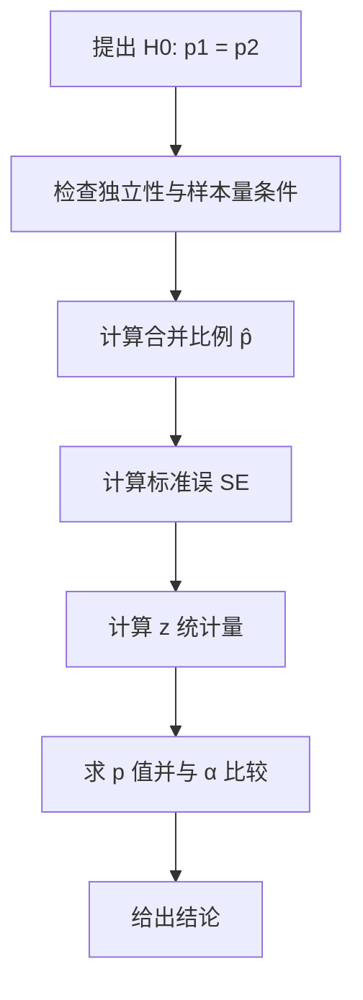
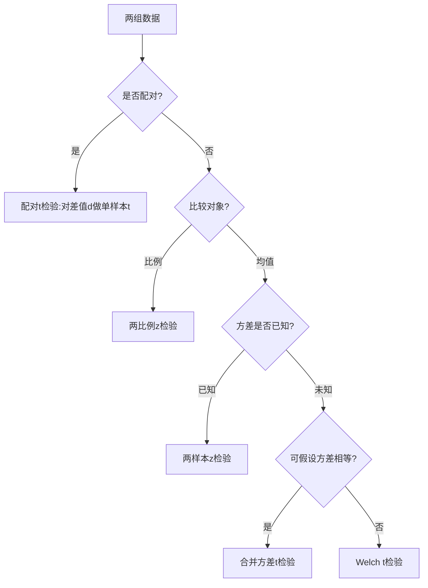

# SPL Run: build_concept_book

- **Adapter:** claude_cli
- **Model:** claude-sonnet-5-5
- **Tokens:** 0 in / 0 out
- **Latency:** 14560ms
- **Timestamp:** 2026-11-24 23:59:39

## Output

```output


---

## 独立样本

**定义。** 如果从一个总体中抽取的观测值与从另一个总体中抽取的观测值之间没有任何关联,则称这两个样本为**独立样本**(independent samples)。此时,样本 1 中的任何一个个体都不会影响样本 2 中选取哪些个体,也不会决定它们取什么值。典型情形是:随机把受试者分成两组,或分别从两所学校各自随机抽样。

与之相对的是**配对样本**(paired samples):同一批对象测量两次(如治疗前、后),或两组对象一一匹配(如双胞胎)。配对数据中的观测值彼此相关,必须按差值 $d_i = x_i - y_i$ 处理;独立样本则不能这样处理。

**数学表述。** 设样本 $X_1,\dots,X_{n_1}$ 来自总体 1,样本 $Y_1,\dots,Y_{n_2}$ 来自总体 2。独立意味着两组之间任意一对变量都独立,且 $n_1$ 与 $n_2$ 不必相等。由独立性可知

$$\operatorname{Var}(\bar X-\bar Y)=\frac{\sigma_1^2}{n_1}+\frac{\sigma_2^2}{n_2}.$$

若两组相关,上式还会多出一项协方差。这是独立样本所特有的结论,也是双样本 $t$ 检验的基础。

**例题。** 一位老师想比较两种教学方法。她随机抽取 $n_1=36$ 名学生使用方法 A,另外随机抽取 $n_2=49$ 名学生使用方法 B,两组学生互不重叠。结果为:

| 方法 | 样本均值 | 样本标准差 |
|---|---|---|
| A | $\bar x = 78$ | $s_1 = 12$ |
| B | $\bar y = 72$ | $s_2 = 14$ |

求均值之差的标准误:

$$SE=\sqrt{\frac{12^2}{36}+\frac{14^2}{49}}=\sqrt{4+4}\approx 2.83.$$

检验统计量为

$$t=\frac{78-72}{2.83}\approx 2.12.$$

在样本量较大时,这个值超过了约 $1.96$ 的临界值,因此在 $5\%$ 的显著性水平下,有证据表明两种方法的平均成绩不同。

**问题求解应用。** 遇到实际问题时,先问两个问题,再选方法:

1. **同一个个体是否被测量了不止一次?** 若是,则为配对样本,应使用配对 $t$ 检验。
2. **两组个体是否由彼此无关的随机过程产生?** 若是,则为独立样本,应使用双样本 $t$ 检验或双样本比例检验。

*判断练习:* 20 名运动员训练前后各测一次百米成绩,这是配对样本;随机选 20 名运动员用新鞋、另外 20 名用旧鞋,这是独立样本。

若误把配对数据当作独立样本,会忽略协方差项,从而使检验效力降低。若误把独立数据当作配对数据,则没有意义,因为根本不存在可以相减的一一对应关系。

**小结。** 独立样本的核心是"两组之间无关联"。这一条件使方差可以直接相加,也决定了我们该用哪种检验来比较两个总体。

---

## 两样本均值之差的标准误

**定义。** 设两个独立样本的容量分别为 $n_1,n_2$，样本均值为 $\bar{x}_1,\bar{x}_2$，样本标准差为 $s_1,s_2$。差 $\bar{x}_1-\bar{x}_2$ 的标准差（即标准误）的估计值为

$$
SE_{\bar{x}_1-\bar{x}_2}=\sqrt{\frac{s_1^2}{n_1}+\frac{s_2^2}{n_2}}.
$$

它衡量：如果重复抽样，均值之差会围绕真实差 $\mu_1-\mu_2$ 波动多大。

**公式从何而来。** 独立随机变量之差的方差等于方差之和：

$$
\operatorname{Var}(\bar{X}_1-\bar{X}_2)=\operatorname{Var}(\bar{X}_1)+\operatorname{Var}(\bar{X}_2)=\frac{\sigma_1^2}{n_1}+\frac{\sigma_2^2}{n_2}.
$$

总体标准差 $\sigma_i$ 未知，所以用 $s_i$ 代替。注意这里是方差相加，而不是标准差相加，也不是相减。即使我们计算的是"差"，不确定性也会累积，不会抵消。

**例题。** 某班级比较两种教学方法。方法 A：$n_1=36$，$\bar{x}_1=78$，$s_1=12$。方法 B：$n_2=49$，$\bar{x}_2=72$，$s_2=14$。

先算各自的方差项：

$$
\frac{s_1^2}{n_1}=\frac{144}{36}=4,\qquad \frac{s_2^2}{n_2}=\frac{196}{49}=4.
$$

于是

$$
SE=\sqrt{4+4}=\sqrt{8}\approx 2.83.
$$

观测到的差为 $78-72=6$，约为 $2.12$ 个标准误。

**问题求解应用。** 标准误是构造置信区间和检验统计量的基础。

1. *置信区间。* 样本较大时，近似 95% 区间为 $6\pm 1.96(2.83)\approx(0.45,\,11.55)$。区间不含 0，说明两种方法可能确有差异。
2. *假设检验。* 检验 $H_0:\mu_1-\mu_2=0$，统计量为
$$
t=\frac{(\bar{x}_1-\bar{x}_2)-0}{SE}=\frac{6}{2.83}\approx 2.12.
$$
对应的双侧 $p$ 值约为 $0.04$（此处用正态近似）。在 $\alpha=0.05$ 下拒绝 $H_0$。
3. *样本量规划。* 公式表明，要把 $SE$ 减半，每组样本量需增至约四倍，因为 $SE\propto 1/\sqrt{n}$。

**常见错误。**
- 把 $s_1/\sqrt{n_1}+s_2/\sqrt{n_2}$ 直接相加，这会高估误差。
- 用于配对（非独立）数据。配对数据应先求差值，再对差值计算单样本标准误。
- 样本很小且总体明显偏态时，正态近似不可靠，应使用 $t$ 分布，并采用 Welch 自由度近似。

**小结。** 两样本均值之差的标准误等于两个均值方差估计之和的平方根。这个量把"观测到的差"转化为可以和随机波动相比较的尺度。

---

## 双样本自由度(不合并方差)

### 定义

比较两个独立总体的均值时,若不假定两总体方差相等,检验统计量为

$$
t=\frac{\bar x_1-\bar x_2}{\sqrt{\dfrac{s_1^2}{n_1}+\dfrac{s_2^2}{n_2}}}.
$$

该统计量并不严格服从 t 分布,但可以用某个 t 分布很好地近似。这个近似分布的**自由度**由 Welch–Satterthwaite 公式给出:

$$
\nu=\frac{\left(\dfrac{s_1^2}{n_1}+\dfrac{s_2^2}{n_2}\right)^2}{\dfrac{\left(s_1^2/n_1\right)^2}{n_1-1}+\dfrac{\left(s_2^2/n_2\right)^2}{n_2-1}}.
$$

由于 $\nu$ 由样本数据算出,通常**不是整数**。它具有如下性质:

- $\min(n_1-1,\,n_2-1)\le \nu\le n_1+n_2-2$;
- 两样本方差相近且样本量相等时,$\nu$ 接近 $n_1+n_2-2$(合并检验的自由度);
- 方差或样本量悬殊时,$\nu$ 会明显变小,使临界值变大,检验更保守。

### 直观理由

$s_1^2/n_1+s_2^2/n_2$ 是两个独立方差估计的加权和。Satterthwaite 的思路是:让这个加权和的均值与方差,与某个缩放的卡方变量一致,由此解出等效的自由度 $\nu$。

### 例题

样本 1:$n_1=10,\ s_1^2=4$;样本 2:$n_2=15,\ s_2^2=9$。

先计算各自的方差贡献:

$$
\frac{s_1^2}{n_1}=0.4,\qquad \frac{s_2^2}{n_2}=0.6.
$$

分子为 $(0.4+0.6)^2=1$。分母为

$$
\frac{0.4^2}{9}+\frac{0.6^2}{14}=\frac{0.16}{9}+\frac{0.36}{14}\approx 0.01778+0.02571=0.04349.
$$

所以

$$
\nu\approx\frac{1}{0.04349}\approx 23.0.
$$

它位于 $9$ 与 $23$ 之间,符合上述范围(此处恰好接近上界 $n_1+n_2-2=23$)。

### 问题求解应用

某实验比较两种肥料的作物产量。A 组 $n_1=8,\ \bar x_1=52,\ s_1^2=25$;B 组 $n_2=20,\ \bar x_2=47,\ s_2^2=4$。检验 $H_0:\mu_1=\mu_2$。

1. 方差贡献:$s_1^2/n_1=3.125$,$s_2^2/n_2=0.2$,和为 $3.325$。
2. 统计量:$t=\dfrac{5}{\sqrt{3.325}}\approx 2.74$。
3. 自由度:

$$
\nu=\frac{3.325^2}{\dfrac{3.125^2}{7}+\dfrac{0.2^2}{19}}=\frac{11.056}{1.3951+0.0021}\approx 7.91.
$$

4. 判断:合并检验会使用 $df=26$,而这里 $\nu\approx 7.9$ 远小于 26,因为小样本 A 组的方差大,主导了不确定性。取 $df\approx 7.9$,双侧 $5\%$ 临界值约为 $2.31$。由于 $2.74>2.31$,拒绝 $H_0$。

**要点**:若误用 $df=26$(临界值约 $2.06$),会低估不确定性。使用 $\nu$ 时,软件常直接用非整数值;手算时可向下取整($\nu=7$)以保持保守。

---

## 配对样本(Matched Paired Samples)

**定义。** 配对样本是两组相互依赖的测量值:每一对数据来自同一个体(如同一名患者治疗前后的血压),或来自经过匹配的一对个体(如同卵双胞胎、年龄性别相同的受试者)。配对使两组数据之间存在一一对应关系,因此不能当作两个独立样本处理。

分析的核心思想是:**先对每一对求差值,再把差值当作单个样本来分析**。记第 $i$ 对数据为 $(x_i, y_i)$,差值为

$$d_i = x_i - y_i,\quad i=1,\dots,n$$

差值的样本均值为 $\bar d$,样本标准差为 $s_d$。要检验的假设是总体平均差 $\mu_d$ 是否为 0:

$$H_0:\ \mu_d = 0,\qquad t=\frac{\bar d-\mu_{d,0}}{s_d/\sqrt n},\quad \text{自由度 } n-1.$$

配对的好处在于:个体之间固有的差异(体质、基础水平)在做差时被抵消,噪声变小,检验更灵敏。

**例题。** 8 名学生参加某辅导班,前后测验成绩如下:

| 学生 | 1 | 2 | 3 | 4 | 5 | 6 | 7 | 8 |
|---|---|---|---|---|---|---|---|---|
| 辅导前 | 62 | 70 | 55 | 80 | 68 | 74 | 59 | 66 |
| 辅导后 | 68 | 75 | 58 | 84 | 70 | 82 | 62 | 71 |

差值(后 − 前)为 $6,5,3,4,2,8,3,5$,故

$$\bar d=\frac{36}{8}=4.5,\qquad s_d=\sqrt{\frac{\sum (d_i-\bar d)^2}{7}}=\sqrt{\frac{25.5}{7}}\approx 1.91.$$

检验统计量为

$$t=\frac{4.5}{1.91/\sqrt8}\approx 6.67,\quad df=7.$$

查表,双侧 $\alpha=0.05$ 的临界值为 $t_{0.025,7}=2.365$。由于 $6.67>2.365$,拒绝 $H_0$,说明辅导班使成绩显著提高。

**问题求解应用。** 95% 置信区间为

$$\bar d \pm t_{0.025,7}\frac{s_d}{\sqrt n}=4.5\pm 2.365\times 0.675\approx(2.9,\ 6.1).$$

即平均提高约 3 到 6 分。

**对比提醒。** 若错误地把两组成绩当作独立样本,学生之间成绩的差异很大(辅导前标准差约 7.5),两样本 $t$ 统计量只有约 1.1,会得出"无显著差异"的错误结论。这正是配对设计的价值:它去除了个体差异,只保留处理效应。

**使用条件。**
1. 数据确实成对(同一对象重复测量或合理匹配);
2. 差值 $d_i$ 近似服从正态分布(样本量小时尤其重要),否则可改用符号秩检验(Wilcoxon);
3. 各对之间相互独立。

**判断口诀:** 如果打乱某一组的顺序会破坏数据含义,就是配对样本;如果可以随意打乱,就是独立样本。

---

## 合并比例(Pooled Proportion)

### 定义

在检验两个总体比例是否相等时,原假设为 $H_0: p_1 = p_2$。此时两个总体共享同一个未知的"公共比例" $p$。**合并比例**就是对这个公共值 $p$ 的估计:把两个样本的成功次数相加,再除以两个样本容量之和:

$$\hat{p}_c = \frac{x_1 + x_2}{n_1 + n_2}$$

其中 $x_1, x_2$ 分别是两个样本中的成功次数,$n_1, n_2$ 是样本容量。它等价于样本比例 $\hat p_1 = x_1/n_1$ 与 $\hat p_2 = x_2/n_2$ 的**加权平均**:

$$\hat{p}_c = \frac{n_1\hat p_1 + n_2\hat p_2}{n_1+n_2}$$

样本容量越大的一组,对合并比例的影响越大。

### 为什么要合并?

两样本比例差 $\hat p_1-\hat p_2$ 的标准误依赖于 $p$。在 $H_0$ 成立时 $p_1=p_2=p$,于是

$$SE = \sqrt{\hat p_c(1-\hat p_c)\left(\frac{1}{n_1}+\frac{1}{n_2}\right)}$$

检验统计量为

$$z = \frac{\hat p_1 - \hat p_2}{SE}.$$

注意:这一做法只适用于假设检验(因为我们假定 $H_0$ 为真)。构造置信区间时不假设两比例相等,应使用各自的 $\hat p_1,\hat p_2$ 分别计算标准误。

### 例题

某学校比较两种复习方式。方式 A:$n_1=120$ 名学生中 $x_1=90$ 人通过测验;方式 B:$n_2=80$ 名学生中 $x_2=48$ 人通过。问两种方式的通过率是否不同($\alpha=0.05$)?

**第一步:** $\hat p_1 = 0.75$,$\hat p_2 = 0.60$。

**第二步:** 合并比例

$$\hat p_c = \frac{90+48}{120+80} = \frac{138}{200} = 0.69$$

**第三步:** 标准误

$$SE = \sqrt{0.69\times0.31\left(\tfrac{1}{120}+\tfrac{1}{80}\right)} = \sqrt{0.2139\times 0.020833} \approx 0.0668$$

**第四步:** 检验统计量

$$z = \frac{0.75-0.60}{0.0668}\approx 2.25$$

双侧检验的 $p$ 值约为 $2\times0.0122 = 0.024 < 0.05$,因此拒绝 $H_0$:有证据表明两种方式的通过率不同。

### 问题解决中的应用

使用前先检查大样本条件:用合并比例计算 $n_1\hat p_c,\ n_1(1-\hat p_c),\ n_2\hat p_c,\ n_2(1-\hat p_c)$ 是否都不小于 10。本例中分别为 82.8、37.2、55.2、24.8,条件满足,正态近似可用。

**常见错误:**
1. 把 $\hat p_c$ 算成 $(\hat p_1+\hat p_2)/2$。只有 $n_1=n_2$ 时二者才相等;本例中简单平均为 0.675,与 0.69 不同。
2. 在置信区间中误用合并比例。
3. 检验 $H_0: p_1-p_2 = d_0$($d_0\neq 0$)时,两比例并不相等,不能合并。

**小结:** 合并比例是"假设两总体相同"时对公共比例的最佳估计,按样本容量加权,专用于两比例相等的假设检验。

---

## 配对检验(Matched Pairs Test)

**定义。** 当两组观测值并非相互独立,而是天然成对出现(同一个人治疗前后的血压、同一块地使用两种肥料的产量、双胞胎中的两人)时,应使用配对检验。其核心思想是:先对每一对数据作差

$$d_i = x_i - y_i,\quad i=1,\dots,n,$$

再把 $d_1,\dots,d_n$ 当作**一个**样本,做单样本 $t$ 检验。设总体平均差为 $\mu_d$,检验

$$H_0:\mu_d=\mu_0\ (\text{通常 }\mu_0=0)\quad\text{对}\quad H_a:\mu_d\neq\mu_0 .$$

检验统计量为

$$t=\frac{\bar d-\mu_0}{s_d/\sqrt n},\qquad df=n-1,$$

其中 $\bar d$ 与 $s_d$ 分别是差值的样本均值与样本标准差。条件:各对之间相互独立,且差值近似服从正态分布(或 $n$ 较大)。

**为什么要配对?** 同一对象的两次测量往往高度相关,个体差异(如基础血压高低)在作差时被抵消,$s_d$ 通常远小于两个独立样本的合并波动,检验因此更灵敏。

**例题。** 8 名受试者服用降压药前后的收缩压(mmHg)如下:

| 受试者 | 1 | 2 | 3 | 4 | 5 | 6 | 7 | 8 |
|---|---|---|---|---|---|---|---|---|
| 服药前 | 150 | 142 | 160 | 138 | 155 | 148 | 165 | 152 |
| 服药后 | 144 | 140 | 151 | 139 | 147 | 145 | 156 | 146 |

取 $d_i=$ 服药前 $-$ 服药后:$6,\,2,\,9,\,-1,\,8,\,3,\,9,\,6$。

1. $\bar d = 42/8 = 5.25$。
2. $s_d^2=\dfrac{\sum (d_i-\bar d)^2}{7}=\dfrac{80.5}{7}=11.5$,故 $s_d\approx 3.39$。
3. $t=\dfrac{5.25-0}{3.39/\sqrt 8}=\dfrac{5.25}{1.199}\approx 4.38$,$df=7$。

在 $\alpha=0.05$、双侧检验下,临界值 $t_{0.025,7}\approx 2.365$。因 $4.38>2.365$(双侧 $p\approx 0.003$),拒绝 $H_0$,认为药物确实改变了血压。

**问题求解应用。** 同样可给出 95% 置信区间:

$$\bar d\pm t_{0.025,7}\frac{s_d}{\sqrt n}=5.25\pm2.365\times1.199\approx(2.4,\ 8.1).$$

区间不含 0,与检验结论一致,并进一步说明平均降压幅度约为 2.4 至 8.1 mmHg。

**常见误区与判断步骤。**

- 先问:两组数据是否来自同一对象或被刻意匹配?是 $\to$ 配对检验;否 $\to$ 双样本 $t$ 检验。
- 若误用双样本检验,本例中个体间血压差异大(138 到 165),会使标准误偏大,从而可能漏掉真实效应。
- 检验前应画出差值的直方图或正态概率图,确认没有严重偏态或极端异常值。
- 若是单侧问题(如"药物是否降低血压"),只需把 $H_a$ 改为 $\mu_d>0$,并使用单侧 $p$ 值。

**小结:** 配对检验 = 作差 + 单样本 $t$ 检验,关键在于识别数据的"成对"结构。

---

## 双总体均值检验(总体标准差已知)

### 定义

设有两个相互独立的总体:总体 1 服从均值为 $\mu_1$、标准差为 $\sigma_1$ 的分布,总体 2 服从均值为 $\mu_2$、标准差为 $\sigma_2$ 的分布,且 $\sigma_1,\sigma_2$ **已知**。从两个总体中分别抽取容量为 $n_1,n_2$ 的独立样本,样本均值为 $\bar X_1,\bar X_2$。

若两个总体近似正态,或样本容量足够大(中心极限定理),则

$$
\bar X_1-\bar X_2 \sim N\!\left(\mu_1-\mu_2,\ \frac{\sigma_1^2}{n_1}+\frac{\sigma_2^2}{n_2}\right).
$$

在原假设 $H_0:\mu_1-\mu_2=\Delta_0$(通常 $\Delta_0=0$)成立时,检验统计量为

$$
z=\frac{(\bar x_1-\bar x_2)-\Delta_0}{\sqrt{\dfrac{\sigma_1^2}{n_1}+\dfrac{\sigma_2^2}{n_2}}}\ \sim N(0,1).
$$

注意:两个样本方差相加,因为独立随机变量之差的方差等于方差之和,而不是相减。

备择假设决定拒绝域:

- 双侧 $H_1:\mu_1\neq\mu_2$:当 $|z|>z_{\alpha/2}$ 时拒绝;
- 右侧 $H_1:\mu_1>\mu_2$:当 $z>z_\alpha$ 时拒绝;
- 左侧 $H_1:\mu_1<\mu_2$:当 $z<-z_\alpha$ 时拒绝。

### 例题

某工厂比较两条生产线所产螺栓的平均长度。已知总体标准差 $\sigma_1=0.8$ mm,$\sigma_2=1.0$ mm。抽样结果:$n_1=40$,$\bar x_1=50.6$ mm;$n_2=50$,$\bar x_2=50.2$ mm。在 $\alpha=0.05$ 下检验两条线平均长度是否不同。

**步骤 1:** $H_0:\mu_1-\mu_2=0$,$H_1:\mu_1-\mu_2\neq0$。

**步骤 2:** 计算标准误:

$$
SE=\sqrt{\frac{0.8^2}{40}+\frac{1.0^2}{50}}=\sqrt{0.016+0.020}=\sqrt{0.036}\approx0.1897.
$$

**步骤 3:** 计算统计量:

$$
z=\frac{50.6-50.2}{0.1897}\approx 2.11.
$$

**步骤 4:** 双侧临界值 $z_{0.025}=1.96$。因为 $2.11>1.96$,拒绝 $H_0$。$p$ 值为 $2\,[1-\Phi(2.11)]\approx 0.035<0.05$。

**结论:** 在 5% 显著性水平下,有证据表明两条生产线的平均螺栓长度不同。

### 问题求解应用

**1. 置信区间的对应关系。** 同一数据的 95% 置信区间为

$$
(\bar x_1-\bar x_2)\pm z_{0.025}\,SE = 0.4\pm1.96(0.1897)\approx(0.028,\ 0.772).
$$

区间不含 0,与拒绝 $H_0$ 一致。

**2. 单侧检验。** 若问"第 1 条线是否更长?",取 $H_1:\mu_1>\mu_2$,临界值 $z_{0.05}=1.645$。因为 $2.11>1.645$,同样拒绝,单侧 $p\approx0.0174$。

**3. 样本量设计。** 若希望两组样本量相等($n_1=n_2=n$),并能检测 $0.4$ mm 的差异,可由 $SE=\sqrt{(\sigma_1^2+\sigma_2^2)/n}$ 反推所需 $n$。

**常见错误:**

- 将标准误写成 $\sqrt{\sigma_1^2+\sigma_2^2}/\sqrt{n_1+n_2}$,这是错误的;应分别除以各自的样本量;
- 配对数据(如同一对象前后测量)不独立,应使用配对检验;
- 实际中 $\sigma$ 很少已知。若未知且样本较小,应改用 $t$ 检验。

**小结:** 当总体标准差已知且样本独立时,用 $z$ 统计量比较两个均值;核心是 $SE=\sqrt{\sigma_1^2/n_1+\sigma_2^2/n_2}$,再将 $z$ 与临界值(或 $p$ 值与 $\alpha$)比较。

---

## 双总体均值检验(总体标准差未知,Aspin-Welch t 检验)

### 定义

当比较两个**独立**总体的均值 $\mu_1,\mu_2$,而两个总体标准差 $\sigma_1,\sigma_2$ 都未知,且**不能假定二者相等**(不合并方差)时,使用 Aspin-Welch t 检验。检验假设为

$$H_0:\ \mu_1-\mu_2=\delta_0\quad(\text{通常 }\delta_0=0),\qquad H_a:\ \mu_1-\mu_2\ne\delta_0\ \text{(或 }<,>\text{)}.$$

用样本标准差 $s_1,s_2$ 代替未知的 $\sigma_1,\sigma_2$,检验统计量为 t 分数:

$$t=\frac{(\bar x_1-\bar x_2)-\delta_0}{\sqrt{\dfrac{s_1^2}{n_1}+\dfrac{s_2^2}{n_2}}}.$$

由于不合并方差,$t$ 只近似服从 t 分布,其**自由度需要计算**(Welch–Satterthwaite 公式):

$$df=\frac{\left(\dfrac{s_1^2}{n_1}+\dfrac{s_2^2}{n_2}\right)^2}{\dfrac{1}{n_1-1}\left(\dfrac{s_1^2}{n_1}\right)^2+\dfrac{1}{n_2-1}\left(\dfrac{s_2^2}{n_2}\right)^2}.$$

计算结果通常不是整数,软件直接使用,手算时可向下取整以保守处理。适用条件:两组样本为简单随机样本且相互独立;总体近似正态,或样本量足够大。

### 例题

某老师比较两种教学方法的考试成绩。方法 A:$n_1=15$,$\bar x_1=78$,$s_1=8$;方法 B:$n_2=12$,$\bar x_2=71$,$s_2=12$。在 $\alpha=0.05$ 下检验两种方法平均成绩是否不同。

1. 假设:$H_0:\mu_1=\mu_2$,$H_a:\mu_1\ne\mu_2$。
2. 标准误:$\dfrac{64}{15}=4.267$,$\dfrac{144}{12}=12$,故 $SE=\sqrt{16.267}=4.033$。
3. 检验统计量:$t=\dfrac{78-71}{4.033}=1.74$。
4. 自由度:
$$df=\frac{(16.267)^2}{\frac{(4.267)^2}{14}+\frac{(12)^2}{11}}=\frac{264.6}{1.300+13.091}\approx 18.4.$$
5. 判断:双尾检验的临界值约为 $t_{0.025,18}\approx2.101$,$|1.74|<2.101$(对应 $p\approx0.10$),故**不拒绝** $H_0$。

结论:在 5% 显著性水平下,没有足够证据表明两种方法的平均成绩不同。

### 问题求解应用

实际操作流程:

- **判断是否用本检验**:两组独立?$\sigma$ 未知?没有充分理由认为方差相等?若是,优先选 Welch 检验,它在方差相等时也几乎不损失功效。
- **软件实现**(Python):

```python
from scipy import stats
t, p = stats.ttest_ind(a, b, equal_var=False)  # Welch 检验
```

- **常见错误**:把配对数据(如同一学生前后测)当作独立样本;或直接用合并方差公式 $df=n_1+n_2-2$,当 $s_1,s_2$ 和样本量悬殊时会使结论失真。
- **解读**:$p$ 值较大只表示证据不足,不代表两总体均值相等;可再构造置信区间 $(\bar x_1-\bar x_2)\pm t^*\cdot SE$ 来评估差异的大小。本例区间为 $7\pm2.10\times4.03\approx(-1.5,\,15.5)$,包含 0,与检验结论一致。

---

## 双比例检验

### 定义

当我们想比较两个**独立总体**的比例 $p_1$ 与 $p_2$(例如两种教学方法的及格率、两种药物的有效率)时,使用**双比例 $z$ 检验**。

检验的假设为

$$H_0:\ p_1=p_2 \qquad \text{对} \qquad H_a:\ p_1\neq p_2\ (\text{或} <,\ >).$$

设样本量为 $n_1,n_2$,成功次数为 $x_1,x_2$,样本比例为 $\hat p_1=x_1/n_1$,$\hat p_2=x_2/n_2$。当 $n_1,n_2$ 足够大时,差 $\hat p_1-\hat p_2$ 近似服从正态分布,均值为 $p_1-p_2$。

**关键思想:合并比例。** 若 $H_0$ 成立,两个总体共享同一个比例 $p$,因此用全部数据来估计它:

$$\hat p=\frac{x_1+x_2}{n_1+n_2}.$$

于是在 $H_0$ 下,差的标准误为

$$SE=\sqrt{\hat p(1-\hat p)\left(\frac1{n_1}+\frac1{n_2}\right)},$$

检验统计量为

$$z=\frac{\hat p_1-\hat p_2}{SE}.$$

**使用条件:** ① 两个样本为独立随机样本;② 在合并比例下,$n_1\hat p,\ n_1(1-\hat p),\ n_2\hat p,\ n_2(1-\hat p)$ 均不小于 10。

### 例题

某学校比较两种复习方式。方式 A:$n_1=200$ 名学生中 $x_1=130$ 人通过考试;方式 B:$n_2=250$ 名学生中 $x_2=145$ 人通过。在 $\alpha=0.05$ 下,检验两者通过率是否不同。

**第 1 步:样本比例。** $\hat p_1=0.65$,$\hat p_2=0.58$。

**第 2 步:合并比例。**
$$\hat p=\frac{130+145}{200+250}=\frac{275}{450}\approx0.611.$$

**第 3 步:标准误。**
$$SE=\sqrt{0.611\times0.389\times\left(\tfrac1{200}+\tfrac1{250}\right)}=\sqrt{0.2377\times0.009}\approx0.0463.$$

**第 4 步:统计量与 $p$ 值。**
$$z=\frac{0.65-0.58}{0.0463}\approx1.51,\qquad p\text{ 值}=2P(Z>1.51)\approx0.131.$$

**结论:** $p$ 值 $0.131>0.05$,不能拒绝 $H_0$。现有数据不足以证明两种方式的通过率存在差异。

### 解题应用


*双比例 $z$ 检验的标准流程:先合并估计,再计算标准误与统计量,最后下结论。*

**常见陷阱与技巧:**

1. **检验与置信区间用不同的标准误。** 检验时假设 $p_1=p_2$,所以使用合并比例;而估计差 $p_1-p_2$ 的置信区间时不做此假设,应使用 $\sqrt{\frac{\hat p_1(1-\hat p_1)}{n_1}+\frac{\hat p_2(1-\hat p_2)}{n_2}}$。
2. **单侧检验。** 若问"方式 A 的通过率是否*高于* B",取 $H_a:p_1>p_2$,$p$ 值为 $P(Z>z)\approx0.066$,在 $\alpha=0.05$ 下仍不显著。
3. **统计显著不等于实际重要。** 样本量极大时,微小差异也可能显著;应同时报告差值 $\hat p_1-\hat p_2$ 及其置信区间。
4. **独立性。** 同一批学生"前后测"属于配对数据,不能使用本检验。

**练习:** 若样本量均扩大为原来的 3 倍而比例不变(即 $n_1=600,n_2=750$),$SE$ 缩小为原来的 $1/\sqrt3$,则 $z\approx1.51\times\sqrt3\approx2.61$,$p\approx0.009$,此时拒绝 $H_0$。这说明:相同的观测差异,样本量越大,证据越强。

---

## 双样本检验的分类

**定义。** 面对两组数据,第一步不是计算,而是*分类*:检验统计量的形式完全取决于数据的结构。判断顺序如下:

1. 两组观测是否**配对**(同一对象前后测量、匹配对子)?若是,用**配对样本检验**。
2. 若相互独立,比较的是**均值**还是**比例**?
3. 比较均值时,总体方差 $\sigma_1^2,\sigma_2^2$ 是**已知**还是**未知**?未知时,再判断能否假设方差相等。


*图:双样本检验的决策流程,从数据结构出发选出对应的检验。*

各情形的统计量:

- 方差已知:$z=\dfrac{\bar x_1-\bar x_2}{\sqrt{\sigma_1^2/n_1+\sigma_2^2/n_2}}$
- 方差未知且相等:$t=\dfrac{\bar x_1-\bar x_2}{s_p\sqrt{1/n_1+1/n_2}}$,其中 $s_p^2=\dfrac{(n_1-1)s_1^2+(n_2-1)s_2^2}{n_1+n_2-2}$,自由度 $n_1+n_2-2$
- 方差未知且不等(Welch):$t=\dfrac{\bar x_1-\bar x_2}{\sqrt{s_1^2/n_1+s_2^2/n_2}}$,自由度由 Welch–Satterthwaite 公式近似
- 两比例:$z=\dfrac{\hat p_1-\hat p_2}{\sqrt{\hat p(1-\hat p)(1/n_1+1/n_2)}}$,$\hat p$ 为合并比例
- 配对:令 $d_i=x_{i}-y_{i}$,则 $t=\dfrac{\bar d}{s_d/\sqrt n}$,自由度 $n-1$

**例题(分类练习)。** 判断下列情形各用哪种检验:

(a) 某班 12 名学生在培训前后各测一次成绩,比较平均分是否提高。
(b) 两种教学法分别用于两组互不相关的学生,总体标准差未知,样本标准差分别为 8.1 与 7.9,比较平均分。
(c) 药物组 200 人中 130 人有效,安慰剂组 200 人中 105 人有效,比较有效率。

*解答。* (a) 同一批学生测两次,数据配对,用配对 $t$ 检验,$df=11$。(b) 两组独立、比较均值、方差未知;$s_1\approx s_2$,可合理假设方差相等,用合并方差 $t$ 检验(若不放心,Welch 检验更稳妥)。(c) 独立样本、比较比例,用两比例 $z$ 检验。

**问题求解应用。** 完成 (c):$\hat p_1=0.65,\ \hat p_2=0.525$,合并比例 $\hat p=\dfrac{130+105}{400}=0.5875$。
$$z=\frac{0.65-0.525}{\sqrt{0.5875\times0.4125\times(2/200)}}=\frac{0.125}{0.0492}\approx 2.54$$
双侧 $p\approx0.011<0.05$,拒绝原假设:药物有效率显著高于安慰剂。

**常见错误。** 把配对数据当作独立样本处理,会忽略对子间的相关性,通常使标准误偏大、检验功效下降;反之,把独立样本误当作配对则毫无依据。总是先问:"第一组的每个观测,是否在第二组中有唯一对应的伙伴?"

---

## 收益(Payoff)

### 双样本检验分类:终点所在

在整本书中,我们反复面对同一个问题:**两组数据的差异,是真实效应还是抽样噪声?** 双样本检验分类(two_sample_test_classification)给出了一张"决策地图":先根据数据的性质,选出正确的检验方法,再据此下结论。它之所以是自然的终点,是因为前面所有概念都在这里汇合:抽样分布、标准误、置信区间、$p$ 值、第一类与第二类错误,以及独立/配对、方差齐性、正态性等前提条件。

分类的核心判断路径可概括为:

1. **样本是否配对?** 配对(同一对象前后测量)→ 配对 $t$ 检验,对差值 $d_i$ 做单样本检验;独立 → 继续。
2. **数据是否近似正态(或样本量足够大)?** 否 → 非参数检验(如 Mann–Whitney $U$ 检验)。
3. **方差是否相等?** 相等 → 合并方差 $t$ 检验;不等 → Welch 检验。
4. **结果是比例?** → 双比例 $z$ 检验。

Welch 统计量为
$$
t=\frac{\bar{x}_1-\bar{x}_2}{\sqrt{\dfrac{s_1^2}{n_1}+\dfrac{s_2^2}{n_2}}},
$$
自由度由 Welch–Satterthwaite 公式近似给出。

### 工作示例

某学校比较两种教学方法。方法 A:$n_1=30$,$\bar{x}_1=78$,$s_1=8$;方法 B:$n_2=35$,$\bar{x}_2=73$,$s_2=12$。学生随机分组(独立),成绩近似正态,但 $s_1\neq s_2$,故选 Welch 检验:
$$
t=\frac{78-73}{\sqrt{64/30+144/35}}=\frac{5}{\sqrt{2.133+4.114}}\approx\frac{5}{2.50}=2.00 .
$$
自由度约 $60$,双侧 $p\approx 0.05$。结论取决于显著性水平:在 $\alpha=0.05$ 下处于临界边缘,应同时报告效应量与置信区间,而不能只说"显著"或"不显著"。这正是分类的价值:**方法选错,$p$ 值本身就失去意义。**

### 与应用领域的联系:real_world_two_group_comparisons

- **医学试验**:治疗组与对照组的疗效比较。独立、随机分组,结局为连续指标用 Welch 检验;结局为"治愈/未治愈"用双比例 $z$ 检验;同一患者治疗前后则用配对 $t$ 检验。
- **A/B 测试**:两个网页版本的转化率比较,属于比例检验;样本量常常很大,关键在于预先确定样本量,避免反复"偷看"结果造成假阳性。
- **工程与质量控制**:两条生产线零件尺寸的比较。若数据偏态或含异常值,选用 Mann–Whitney 检验更稳健。
- **社会科学与教育**:如上例,强调效应量与实际意义,而不仅是 $p<0.05$。

在每个场景中,你做的第一件事都不是计算,而是**分类**:配对还是独立?正态还是偏态?连续还是比例?

### 邀请

选择一个你最感兴趣的领域,找一组真实数据(例如公开的临床试验摘要,或你自己设计的 A/B 实验),完整走一遍流程:陈述假设、依据分类选择检验、检查前提条件、计算统计量与置信区间,并用一句非专业人士也能理解的话解释结论。当你能为"为什么选这个检验"给出理由时,你就真正掌握了这门课。
```
