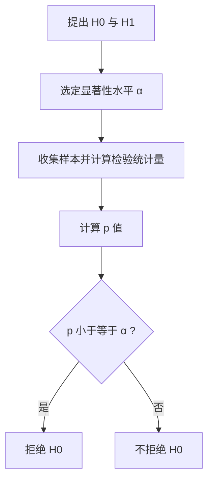
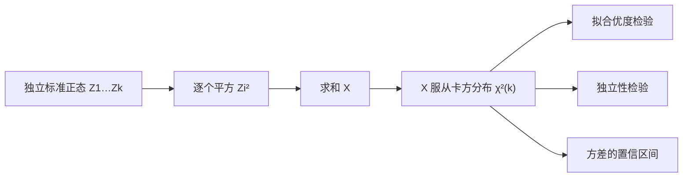
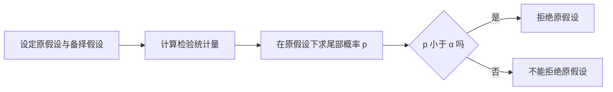
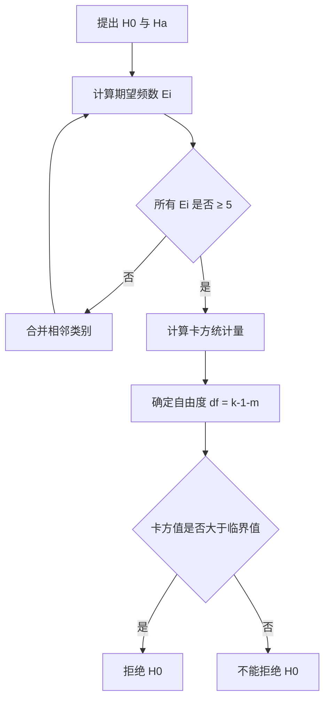
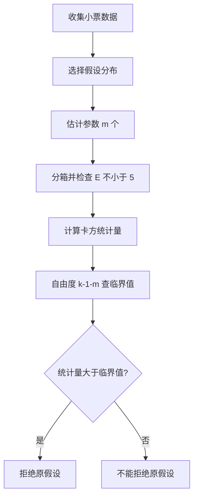

# SPL Run: build_concept_book

- **Adapter:** claude_cli
- **Model:** claude-sonnet-5-5
- **Tokens:** 0 in / 0 out
- **Latency:** 12719ms
- **Timestamp:** 2026-11-25 00:00:10

## Output

```output


---

## 自由度

**定义。** 自由度(degrees of freedom,记作 $df$)是决定卡方分布曲线形状的唯一参数。直观地说,它是数据中"可以自由变动的独立信息个数":当样本受到若干约束(例如各类别频数之和必须等于总数 $n$)时,真正自由的数据个数就要减去约束数。$df$ 越小,曲线越偏斜、集中在左侧;$df$ 越大,曲线越对称,并逐渐接近正态形状。卡方分布的均值等于 $df$,方差等于 $2\,df$。

不同的卡方检验,$df$ 的算法不同:

- **拟合优度检验**($k$ 个类别):
$$df = k - 1$$
若分布中还有 $m$ 个参数是由样本估计出来的,则 $df = k - 1 - m$。
- **独立性检验 / 同质性检验**($r$ 行 $c$ 列的列联表):
$$df = (r-1)(c-1)$$

**为什么是这些公式?** 拟合优度检验中,$k$ 个频数之和固定为 $n$,所以只有 $k-1$ 个可以自由取值,最后一个由差值决定。列联表中,行合计与列合计都已固定,因此每行只有 $c-1$ 个格子自由、只有 $r-1$ 行自由,其余格子都被边际合计"锁定"。

**例 1(拟合优度)。** 掷一枚骰子 120 次,检验它是否均匀。类别数 $k=6$,所以
$$df = 6 - 1 = 5.$$
若算得 $\chi^2 = 9.2$,查 $df=5$ 的临界值 $\chi^2_{0.05}=11.07$。因为 $9.2 < 11.07$,不能拒绝"骰子均匀"的原假设。

**例 2(独立性)。** 调查 3 个年级(行)与 4 种课外活动偏好(列)是否相关,列联表为 $3\times4$:
$$df = (3-1)(4-1) = 2\times 3 = 6.$$
若算得 $\chi^2 = 15.8$,而 $df=6$ 时 $\chi^2_{0.05}=12.59$,则 $15.8 > 12.59$,拒绝原假设,认为年级与活动偏好有关。

**问题求解应用。** 一位研究者检验某地每天的交通事故数是否服从泊松分布。数据分成 $k=7$ 个类别,而泊松参数 $\lambda$ 由样本均值估计得到($m=1$)。于是
$$df = 7 - 1 - 1 = 5.$$
如果错误地使用 $df=6$,临界值会偏大($\chi^2_{0.05}=12.59$ 而非正确的 $11.07$),使检验过于保守,可能漏掉真实的偏离。

**解题步骤:**
1. 判断检验类型(拟合优度还是列联表)。
2. 数清类别数 $k$,或行数 $r$ 与列数 $c$。
3. 减去被样本估计的参数个数(如有)。
4. 用所得 $df$ 查表或计算 $p$ 值。

**常见错误:** 用样本量 $n$ 代替类别数;把列联表的 $df$ 误写成 $rc-1$;忘记扣除估计参数。记住:$df$ 反映的是**类别结构**,而不是样本有多大。

---

## 假设检验

**定义。** 假设检验是用样本数据判断关于总体的某个断言是否可信的程序。它包含四个要素:

- **原假设** $H_0$:默认成立的"无效应"断言,例如 $\mu=\mu_0$。
- **备择假设** $H_1$:我们希望用证据支持的断言,例如 $\mu\neq\mu_0$(双侧)或 $\mu>\mu_0$(单侧)。
- **检验统计量**:把样本与 $H_0$ 的偏离程度压缩成一个数。总体标准差未知时,均值检验使用
$$t=\frac{\bar x-\mu_0}{s/\sqrt n},\qquad \text{自由度 } n-1.$$
- **$p$ 值**:*假设 $H_0$ 为真*时,得到至少与当前观测同样极端的统计量的概率。

决策规则:预先设定显著性水平 $\alpha$(常取 $0.05$)。若 $p\le\alpha$,拒绝 $H_0$;否则"不拒绝 $H_0$"。注意:$p$ 值**不是** $H_0$ 为真的概率,"不拒绝"也不等于"证明 $H_0$ 成立"。

**完整流程:**


*假设检验的决策流程:先设定假设与 α,再由数据得到统计量和 p 值,最后比较 p 与 α。*

**例题。** 某饮料标注每瓶净含量为 $500\,\text{mL}$。随机抽取 $n=25$ 瓶,测得 $\bar x=496\,\text{mL}$,$s=8\,\text{mL}$。在 $\alpha=0.05$ 下,能否认为平均含量低于标注值?

1. 假设:$H_0:\mu=500$,$H_1:\mu<500$(单侧)。
2. 统计量:
$$t=\frac{496-500}{8/\sqrt{25}}=\frac{-4}{1.6}=-2.5.$$
3. 自由度为 $24$。查表或软件得 $p=P(T_{24}\le -2.5)\approx 0.010$。
4. 因为 $0.010<0.05$,拒绝 $H_0$。有较强证据表明平均净含量低于 $500\,\text{mL}$。

**问题求解应用。** 用 Python 一步完成同样的检验(`alternative='less'` 对应单侧):

```python
from scipy import stats
t, p = stats.ttest_1samp(data, popmean=500, alternative='less')
print(t, p)   # p < 0.05 则拒绝 H0
```

解题时要避免三个常见错误:

- **单双侧选错。** 若问"是否不同于 $500$",应取双侧,此时 $p\approx 0.020$,是单侧的两倍。
- **事后改 $\alpha$。** 必须在看数据之前确定 $\alpha$,否则 $p\le\alpha$ 的结论没有意义。
- **混淆统计显著与实际重要。** 样本量极大时,微小的偏差也能得到很小的 $p$ 值,所以还要结合效应大小(如 $\bar x-\mu_0$ 与置信区间)判断。

另外要知道两类错误:**第一类错误**是 $H_0$ 为真却拒绝它,其概率恰为 $\alpha$。**第二类错误**是 $H_0$ 为假却未拒绝它,其概率记为 $\beta$,检验功效为 $1-\beta$。增大样本量可以在 $\alpha$ 不变的情况下降低 $\beta$。

---

## 正态分布

**定义。** 若连续型随机变量 $X$ 的概率密度函数为

$$
f(x)=\frac{1}{\sigma\sqrt{2\pi}}\exp\!\left(-\frac{(x-\mu)^2}{2\sigma^2}\right),\quad -\infty<x<\infty,
$$

则称 $X$ 服从正态分布,记作 $X\sim N(\mu,\sigma^2)$。参数 $\mu$ 是均值(曲线对称轴),$\sigma>0$ 是标准差(决定曲线的"胖瘦")。曲线下总面积为 1,概率等于面积:$P(a<X<b)=\int_a^b f(x)\,dx$。

当 $\mu=0,\sigma=1$ 时称为**标准正态分布**,记作 $Z\sim N(0,1)$。任何正态变量都可以标准化:

$$
Z=\frac{X-\mu}{\sigma}.
$$

经验法则:约 68%、95%、99.7% 的概率分别落在 $\mu\pm\sigma$、$\mu\pm2\sigma$、$\mu\pm3\sigma$ 之内。


*图:用标准化把任意正态问题转化为标准正态问题的流程。*

**例题。** 某考试成绩 $X\sim N(70,\,10^2)$,求成绩高于 85 分的概率。

标准化:

$$
z=\frac{85-70}{10}=1.5,\qquad P(X>85)=P(Z>1.5)=1-\Phi(1.5)\approx 1-0.9332=0.0668.
$$

即约 6.7% 的考生超过 85 分。

**在假设检验中的应用。** 正态分布之所以成为检验的核心,是因为**中心极限定理**:当样本量 $n$ 足够大时,无论总体形状如何,样本均值 $\bar X$ 近似服从

$$
\bar X\sim N\!\left(\mu,\ \frac{\sigma^2}{n}\right),
$$

于是检验统计量为

$$
z=\frac{\bar x-\mu_0}{\sigma/\sqrt n}.
$$

对比例 $p$,当 $np_0\ge10$ 且 $n(1-p_0)\ge10$ 时,样本比例 $\hat p$ 近似服从 $N\!\left(p_0,\ \dfrac{p_0(1-p_0)}{n}\right)$,统计量为

$$
z=\frac{\hat p-p_0}{\sqrt{p_0(1-p_0)/n}}.
$$

**例:** 某零件长度已知 $\sigma=2$ mm,声称均值 $\mu_0=50$ mm。抽取 $n=64$ 个,得 $\bar x=50.6$。检验 $H_0:\mu=50$ 与 $H_1:\mu\ne50$,显著性水平 $\alpha=0.05$。

$$
z=\frac{50.6-50}{2/\sqrt{64}}=\frac{0.6}{0.25}=2.4.
$$

双侧临界值为 $\pm1.96$。因 $|2.4|>1.96$,拒绝 $H_0$。$p$ 值为 $2\,[1-\Phi(2.4)]\approx 2(0.0082)=0.0164<0.05$,结论一致:样本均值与声称值之间存在统计上显著的差异。

**解题要点。**
1. 先确认条件:$\sigma$ 已知(均值检验)或样本足够大(比例检验)。
2. 写出统计量并标准化。
3. 比较临界值或计算 $p$ 值,再用问题的语言写出结论。

注意:若 $\sigma$ 未知,需用样本标准差并改用 $t$ 分布;正态分布在此仅适用于 $\sigma$ 已知的情形。

---

## 标准正态变量

**定义。** 若随机变量 $Z$ 服从均值为 $0$、标准差为 $1$ 的正态分布,则称 $Z$ 为**标准正态变量**,记作 $Z\sim N(0,1)$。其概率密度函数为

$$\varphi(z)=\frac{1}{\sqrt{2\pi}}\,e^{-z^{2}/2},\qquad -\infty<z<\infty .$$

密度曲线关于 $z=0$ 对称,呈钟形。累积分布函数记为 $\Phi(z)=P(Z\le z)$,由对称性有 $\Phi(-z)=1-\Phi(z)$。常用的经验数据是:$P(|Z|<1)\approx 0.683$,$P(|Z|<2)\approx 0.954$,$P(|Z|<3)\approx 0.997$。

**标准化。** 任何正态变量 $X\sim N(\mu,\sigma^{2})$ 都可以通过

$$Z=\frac{X-\mu}{\sigma}$$

化为标准正态变量。$Z$ 表示 $X$ 偏离均值多少个标准差。因此只需一张标准正态分布表,就能处理所有正态分布问题。

**例题。** 某次考试成绩 $X\sim N(70,\,10^{2})$。求 $P(X>85)$。

第一步,标准化:
$$z=\frac{85-70}{10}=1.5 .$$

第二步,转化为标准正态概率:
$$P(X>85)=P(Z>1.5)=1-\Phi(1.5)\approx 1-0.9332=0.0668 .$$

即约有 $6.7\%$ 的考生成绩超过 85 分。

**问题求解应用。** 假设某零件长度 $L\sim N(50,\,0.4^{2})$(单位:mm),规格要求为 $49.2\le L\le 50.8$。求合格率。

标准化两端:
$$z_1=\frac{49.2-50}{0.4}=-2,\qquad z_2=\frac{50.8-50}{0.4}=2 .$$

于是
$$P(49.2\le L\le 50.8)=P(-2\le Z\le 2)=2\Phi(2)-1\approx 2(0.9772)-1=0.9544 .$$

合格率约为 $95.4\%$。

**与卡方变量的联系。** 标准正态变量的平方 $Z^{2}$ 是最简单的非负随机变量。若 $Z_1,Z_2,\dots,Z_k$ 相互独立且都服从 $N(0,1)$,则

$$\chi^{2}=Z_1^{2}+Z_2^{2}+\cdots+Z_k^{2}$$

服从自由度为 $k$ 的卡方分布。此外,因为 $E[Z]=0$、$\operatorname{Var}(Z)=1$,所以 $E[Z^{2}]=1$,由此立即得到 $E[\chi^{2}]=k$。可见,标准正态变量正是构造卡方分布的基本单元。


*图示:从一般正态变量出发,经标准化得到标准正态变量,再通过平方并求和构造卡方变量。*

---

## 卡方分布

**定义。** 设 $Z_1, Z_2, \dots, Z_k$ 是相互独立的标准正态随机变量,则
$$
X = Z_1^2 + Z_2^2 + \cdots + Z_k^2
$$
服从**自由度为 $k$ 的卡方分布**,记作 $X \sim \chi^2_k$。其基本性质如下:

- 取值范围为 $[0, \infty)$,因为平方和不可能为负。
- 均值 $E[X] = k$,方差 $\mathrm{Var}(X) = 2k$。
- 分布右偏。$k$ 较小时偏斜明显,$k$ 增大后逐渐趋近正态分布。
- 可加性:若 $X_1 \sim \chi^2_{k_1}$ 与 $X_2 \sim \chi^2_{k_2}$ 独立,则 $X_1 + X_2 \sim \chi^2_{k_1+k_2}$。

均值和方差的推导很直接。由 $E[Z^2]=\mathrm{Var}(Z)=1$ 得 $E[X]=k$。又 $E[Z^4]=3$,所以 $\mathrm{Var}(Z^2)=3-1=2$。各项独立,方差相加得 $2k$。

其概率密度函数为
$$
f(x;k)=\frac{1}{2^{k/2}\,\Gamma(k/2)}\,x^{k/2-1}e^{-x/2},\quad x>0.
$$
它是 Gamma 分布的特例,对应形状参数 $k/2$、尺度参数 $2$。


*图:卡方分布由标准正态变量的平方和构成,并成为多种假设检验的抽样分布。*

**例题。** 设 $Z_1, Z_2, Z_3$ 是独立的标准正态变量,求 $P(Z_1^2+Z_2^2+Z_3^2 > 7.815)$。

这里 $X\sim\chi^2_3$。查卡方分布表,自由度 3 时的上 5% 临界值为 $7.815$,所以概率为 $0.05$。该分布的均值为 $3$,方差为 $6$,标准差约为 $2.45$。因此 $7.815$ 高于均值约 $2$ 个标准差,与右偏分布的长尾相符。

**问题求解应用。** 卡方分布的主要用途是检验方差和分类数据,下面用一个拟合优度检验说明。

某骰子掷 $60$ 次,各点数出现次数为 $5, 8, 9, 8, 10, 20$。若骰子均匀,每个点数的期望次数为 $E_i=10$。检验统计量为
$$
\chi^2=\sum_{i=1}^{6}\frac{(O_i-E_i)^2}{E_i}.
$$
代入计算:
$$
\chi^2=\frac{25+4+1+4+0+100}{10}=13.4.
$$
在原假设"骰子均匀"下,该统计量近似服从 $\chi^2_{5}$,自由度为类别数减一,即 $6-1=5$。查表得 $\chi^2_{5}$ 的上 5% 临界值为 $11.07$。由于 $13.4>11.07$,在 $\alpha=0.05$ 下拒绝原假设,认为骰子不均匀。主要偏差来自点数 6,它单独贡献了 $10$ 的统计量。

**要点。** 样本方差也与卡方分布相关:对正态总体,$(n-1)S^2/\sigma^2\sim\chi^2_{n-1}$,据此可以构造方差的置信区间并检验方差。使用时要始终确认自由度,因为同一个观测值在不同自由度下对应的 $p$ 值完全不同。

---

## 观测值与期望值

**定义。** 在卡方检验中,**观测值**(observed value)$O_i$ 是样本中第 $i$ 个类别实际统计到的频数。**期望值**(expected value)$E_i$ 是在原假设 $H_0$ 成立时,该类别理论上应出现的频数。若总样本量为 $n$,类别 $i$ 在 $H_0$ 下的概率为 $p_i$,则

$$E_i = n\,p_i .$$

对于列联表(独立性检验),若 $H_0$ 为"两个变量相互独立",则第 $i$ 行第 $j$ 列的期望值为

$$E_{ij} = \frac{(\text{第 } i \text{ 行合计})(\text{第 } j \text{ 列合计})}{n}.$$

观测值与期望值之间的差异 $O_i - E_i$ 是卡方统计量的基础:

$$\chi^2 = \sum_i \frac{(O_i - E_i)^2}{E_i}.$$

除以 $E_i$ 的作用是按尺度标准化:期望频数为 5 时偏差 10 很大,期望频数为 1000 时偏差 10 则微不足道。通常要求每个 $E_i \ge 5$,卡方近似才可靠。

**例题(拟合优度)。** 掷一枚骰子 $n=60$ 次,检验其是否均匀。$H_0$:每个点数概率为 $1/6$,故每个 $E_i = 60 \times \tfrac16 = 10$。观测结果如下:

| 点数 | 1 | 2 | 3 | 4 | 5 | 6 |
|---|---|---|---|---|---|---|
| $O_i$ | 8 | 12 | 9 | 11 | 6 | 14 |
| $E_i$ | 10 | 10 | 10 | 10 | 10 | 10 |

各项 $(O_i-E_i)^2/E_i$ 为 $0.4,\ 0.4,\ 0.1,\ 0.1,\ 1.6,\ 1.6$,因此

$$\chi^2 = 4.2 .$$

自由度为 $6-1=5$,显著性水平 $\alpha=0.05$ 的临界值为 $11.07$。由于 $4.2<11.07$,不能拒绝 $H_0$,没有充分证据表明骰子不均匀。

**问题求解应用(独立性检验)。** 调查 100 名学生,考察"是否使用学习软件"与"成绩是否达标"是否相关:

| | 达标 | 未达标 | 行合计 |
|---|---|---|---|
| 使用 | 40 | 10 | 50 |
| 不使用 | 30 | 20 | 50 |
| 列合计 | 70 | 30 | 100 |

在独立假设下,$E_{11} = \frac{50\times 70}{100} = 35$,$E_{12} = 15$,$E_{21} = 35$,$E_{22} = 15$。于是

$$\chi^2 = \frac{(40-35)^2}{35}+\frac{(10-15)^2}{15}+\frac{(30-35)^2}{35}+\frac{(20-15)^2}{15} \approx 0.714+1.667+0.714+1.667 = 4.76 .$$

自由度为 $(2-1)(2-1)=1$,临界值为 $3.84$。因为 $4.76>3.84$,在 5% 水平下拒绝独立性假设,说明使用软件与成绩达标之间存在统计关联。

**要点。** 解题的稳定流程是:①写出 $H_0$;②由 $H_0$ 计算每个 $E_i$,并检查是否都不小于 5;③逐项计算 $(O_i-E_i)^2/E_i$ 并求和;④与对应自由度的临界值比较。注意:期望值必须由 $H_0$ 推出,而不是由样本"拟合"出的任意数;同时,$O_i$ 与 $E_i$ 之和都应等于 $n$,这是检查计算是否出错的快速办法。

---

## P 值

### 定义

**P 值**(p-value)是在原假设 $H_0$ 成立的前提下,得到与观测样本结果**一样极端或更极端**的结果的概率。设检验统计量为 $T$,观测值为 $t_{\text{obs}}$,则对右尾检验:

$$p = P(T \ge t_{\text{obs}} \mid H_0)$$

对双尾检验,则要把两侧的极端情形都计入。P 值越小,说明"如果 $H_0$ 为真,却观察到这样的数据"越不寻常,因而越有理由怀疑 $H_0$。

需要特别注意:P 值**不是** $H_0$ 为真的概率,也不是效应大小的度量。它只回答一个问题:数据与 $H_0$ 的相容程度如何。

### 例题

某硬币被怀疑偏向正面。抛掷 100 次,得到 60 次正面。检验 $H_0: p_0 = 0.5$,$H_a: p_0 \ne 0.5$。

**第 1 步:构造检验统计量。** 在 $H_0$ 下,正面次数近似服从均值 $np_0 = 50$、标准差 $\sqrt{np_0(1-p_0)} = 5$ 的正态分布。于是

$$z = \frac{60 - 50}{5} = 2.00$$

**第 2 步:计算尾部概率。** 查标准正态分布表得 $P(Z \ge 2.00) \approx 0.0228$。

**第 3 步:双尾检验。** 偏向反面同样算"极端",故

$$p = 2 \times 0.0228 = 0.0456$$

**第 4 步:下结论。** 若显著性水平为 $\alpha = 0.05$,则 $p < \alpha$,拒绝 $H_0$;若取 $\alpha = 0.01$,则不能拒绝 $H_0$。

### 问题求解应用

**问题:** 某药厂声称药片平均含量为 $\mu_0 = 500$ mg。质检员抽取 $n = 36$ 片,得 $\bar{x} = 497$ mg,已知 $\sigma = 9$ mg。在 $\alpha = 0.05$ 下检验含量是否偏低。

**解:** 这是左尾检验,$H_0: \mu = 500$,$H_a: \mu < 500$。

$$z = \frac{497 - 500}{9/\sqrt{36}} = \frac{-3}{1.5} = -2.00$$

$$p = P(Z \le -2.00) \approx 0.0228$$

因 $0.0228 < 0.05$,拒绝 $H_0$,有证据表明平均含量偏低。

**常见误区:**

1. **"$p = 0.0228$ 意味着 $H_0$ 有 2.28% 的概率为真。"** 错误。P 值是在假定 $H_0$ 为真时计算的条件概率,并不给出 $H_0$ 本身的概率。
2. **"$p > \alpha$ 证明 $H_0$ 为真。"** 错误。这只说明证据不足以拒绝 $H_0$。
3. **"$p$ 很小说明效应很大。"** 错误。样本量很大时,微不足道的差异也可能得到极小的 P 值,所以需要同时报告效应大小和置信区间。


*P 值检验流程:将尾部概率 $p$ 与显著性水平 $\alpha$ 比较,得出拒绝或不拒绝原假设的结论。*

---

## 拟合优度检验

**定义。** 拟合优度检验(goodness-of-fit test)用卡方分布检验一组观测数据是否服从某个假定的分布。设数据分为 $k$ 个类别(单元),第 $i$ 个类别的观测频数为 $O_i$,在原假设成立时的期望频数为 $E_i$(要求每个 $E_i \ge 5$)。检验统计量为

$$
\chi^2=\sum_{i=1}^{k}\frac{(O_i-E_i)^2}{E_i},
$$

在 $H_0$ 成立时近似服从自由度为 $df=k-1$ 的卡方分布。若分布的参数需由样本估计,则自由度还要再减去被估计参数的个数 $m$,即 $df=k-1-m$。该检验是**右尾检验**:偏差越大,$\chi^2$ 越大,越倾向于拒绝 $H_0$。

**例题。** 一枚骰子掷 $120$ 次,点数 $1$ 到 $6$ 的观测频数为 $15,\ 25,\ 18,\ 22,\ 12,\ 28$。在显著性水平 $\alpha=0.05$ 下,检验骰子是否均匀。

- $H_0$:各点数概率均为 $\tfrac16$;$H_a$:至少有一个点数的概率不是 $\tfrac16$。
- 期望频数:$E_i = 120\times\tfrac16 = 20$(均满足 $\ge 5$)。
- 计算统计量:

$$
\chi^2=\frac{(15-20)^2+(25-20)^2+(18-20)^2+(22-20)^2+(12-20)^2+(28-20)^2}{20}
=\frac{25+25+4+4+64+64}{20}=9.3 .
$$

- 自由度 $df=6-1=5$,临界值 $\chi^2_{0.05,5}=11.07$。
- 因为 $9.3<11.07$(对应 $p\approx0.098>0.05$),不能拒绝 $H_0$。

结论:没有足够证据表明这枚骰子不均匀。注意,这不等于"证明骰子是均匀的",只是样本偏差还在随机波动可以解释的范围内。

**问题解决应用。** 遗传学中,孟德尔预测某杂交后代表型比例为 $9:3:3:1$。若观测 $160$ 株,则 $E=(90,\ 30,\ 30,\ 10)$。解题可按以下步骤进行:

1. 写出 $H_0$(比例符合 $9:3:3:1$)与 $H_a$。
2. 用理论比例乘以总数得到 $E_i$,并检查每个 $E_i\ge5$。
3. 计算 $\chi^2$,取 $df=k-1=3$。
4. 查表或求 $p$ 值,与 $\alpha$ 比较,作出结论。

若检验"数据是否服从泊松分布"等需先用样本估计 $\lambda$ 的情形,别忘了使用 $df=k-1-m$($m=1$)。若某些类别的 $E_i<5$,应先合并相邻类别,再重新计算 $k$ 和自由度。


*图:拟合优度检验的决策流程,包括期望频数检查与自由度确定。*

---

## 拟合优度实验

**定义。** 拟合优度检验用来判断一组观测数据是否与某个假设的分布相容。把数据分成 $k$ 个区间,记第 $i$ 个区间的观测频数为 $O_i$,在原假设 $H_0$ 下的期望频数为 $E_i=n\,p_i$,则检验统计量为

$$\chi^2=\sum_{i=1}^{k}\frac{(O_i-E_i)^2}{E_i}.$$

当 $H_0$ 成立且各 $E_i\ge 5$ 时,$\chi^2$ 近似服从自由度为 $k-1-m$ 的卡方分布,其中 $m$ 是由数据估计出的参数个数。若 $\chi^2$ 大于临界值(或 $p$ 值小于 $\alpha=0.05$),就拒绝 $H_0$。

**实验设计。** 收集 $n=100$ 张杂货店小票,记录每张的消费金额(单位:元)。我们检验两个假设:

1. 金额在 $[0,100)$ 上服从均匀分布;
2. 金额服从指数分布,$f(x)=\lambda e^{-\lambda x}$。

**例题。** 把金额分成 5 个区间:$[0,20),[20,40),[40,60),[60,80),[80,100)$,观测频数为 $O=(41,27,16,9,7)$。

*均匀假设。* 每个区间 $p_i=0.2$,所以 $E_i=20$。

$$\chi^2=\frac{21^2+7^2+4^2+11^2+13^2}{20}=\frac{441+49+16+121+169}{20}=39.8.$$

自由度为 $5-1=4$,临界值 $\chi^2_{0.05,4}=9.49$。因为 $39.8>9.49$,拒绝均匀分布。

*指数假设。* 样本均值 $\bar x=30$,估计 $\hat\lambda=1/30$。区间概率 $p_i=e^{-a_i/30}-e^{-b_i/30}$。前四个区间依次为 $0.4866,\,0.2499,\,0.1283,\,0.0659$。最后一个区间并入右尾,$p_5=e^{-80/30}=0.0695$。由此得 $E\approx(48.7,\,25.0,\,12.8,\,6.6,\,6.9)$。

$$\chi^2\approx\frac{(-7.7)^2}{48.7}+\frac{2^2}{25.0}+\frac{3.2^2}{12.8}+\frac{2.4^2}{6.6}+\frac{0.1^2}{6.9}\approx1.22+0.16+0.80+0.87+0.00\approx3.05.$$

这里 $m=1$(估计了 $\lambda$),所以自由度为 $5-1-1=3$,临界值为 $7.81$。因为 $3.05<7.81$,不能拒绝指数分布。

**问题求解应用。** 做实验时按下面的步骤检查:

1. **分箱**:保证每个 $E_i\ge5$,否则合并相邻区间(本例的末区间已合并右尾)。
2. **估计参数**:用样本估计的参数每个减少 1 个自由度。上例若忘记减去 $m$,会误用临界值 9.49,使检验过于宽松。
3. **判断与解释**:“不能拒绝”不等于“证明是指数分布”,只说明数据与该模型没有显著矛盾。
4. **诊断**:查看各区间 $(O_i-E_i)^2/E_i$ 的贡献。均匀假设中,第一个区间(小额消费)和最后一个区间的偏差最大,这说明小额消费占多数,与指数分布的右偏形态吻合。


*图:拟合优度实验的完整流程,从数据收集到判断结论。*

**练习。** 自己收集 50 张以上的小票,用本节方法分别检验均匀与指数分布,比较两个 $\chi^2$ 值,并用各区间的贡献解释差异来源。

---

## 收获

经过前面各章的铺垫,我们终于来到本书的终点:**拟合优度实验**(goodness_of_fit_lab)。它把“模型与数据究竟吻合到什么程度”这个问题,从直觉判断变成了可计算、可检验、可复现的完整流程。

### 一、它达成了什么,为什么是自然的终点

拟合优度实验把四个前置概念串成一条流水线:

1. **残差**:观测值与模型预测值之差,$e_i = y_i - \hat y_i$;
2. **平方和分解**:$\mathrm{SST}=\mathrm{SSR}+\mathrm{SSE}$,即总变差等于被模型解释的部分加上残差部分;
3. **决定系数**:$R^2 = 1-\dfrac{\mathrm{SSE}}{\mathrm{SST}}$,衡量模型解释了多大比例的变差;
4. **卡方检验**:对分类数据,统计量 $\chi^2=\sum_{i}\dfrac{(O_i-E_i)^2}{E_i}$ 在原假设下近似服从自由度为 $k-1-p$ 的卡方分布($p$ 为估计的参数个数)。

**简要示例。** 掷一枚骰子 120 次,若骰子均匀,每个点数的期望频数为 $E_i=20$。设观测频数为 $(18,22,16,25,19,20)$,则
$$\chi^2=\frac{(-2)^2+2^2+(-4)^2+5^2+(-1)^2+0^2}{20}=\frac{50}{20}=2.5.$$
自由度为 $5$,临界值 $\chi^2_{0.05,5}\approx 11.07$。因为 $2.5<11.07$,没有证据否定“骰子均匀”。

它之所以是自然的终点,是因为一次完整的实验要求你同时做到:提出模型、量化偏差、判断偏差是否只是随机波动、再根据残差图诊断模型的结构缺陷。这正是“从公式到解决问题”的全部能力。

### 二、与各应用领域的联系

本概念暂未列出具体的应用领域,但它的思路几乎适用于所有用数据检验模型的场景。下面给出三个典型方向,供你对号入座:

- **自然科学**:检验实验数据是否符合理论定律,例如放射性衰变是否服从指数规律,孟德尔遗传比例是否为 $9:3:3:1$。此时 $\chi^2$ 与 $R^2$ 决定理论是否被数据支持。
- **工程与质量控制**:检验零件尺寸是否服从正态分布,缺陷数是否服从泊松分布。拟合不佳往往提示生产过程出现了系统性漂移。
- **数据科学与机器学习**:比较回归模型、检查残差是否无结构。残差图中的曲线形态说明模型遗漏了非线性项,此时再高的 $R^2$ 也不可全信。

### 三、问题求解的要点

在任何应用中,都遵循同一套步骤:先画图,再计算统计量,然后查临界值或求 $p$ 值,最后回到残差检查假设。切记:**拟合良好不等于模型正确**,卡方检验也要求每个期望频数不小于约 $5$。

### 四、邀请

请选择上面的一个方向,找一组真实数据(例如一周的每日客流量,或一批实验测量值),亲手完成整个实验:设定模型、计算 $R^2$ 或 $\chi^2$、做出结论,并写下你对结论可信度的质疑。当你能说清“这个模型错在哪里”时,你就真正掌握了拟合优度。
```
