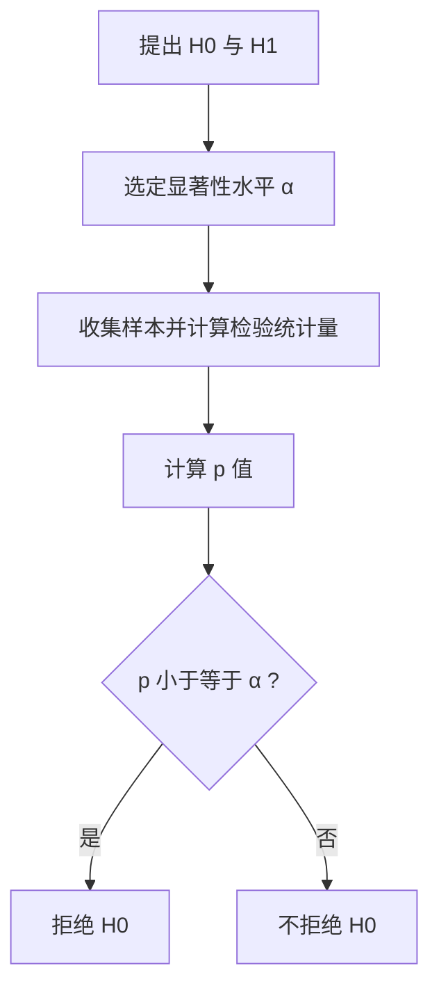
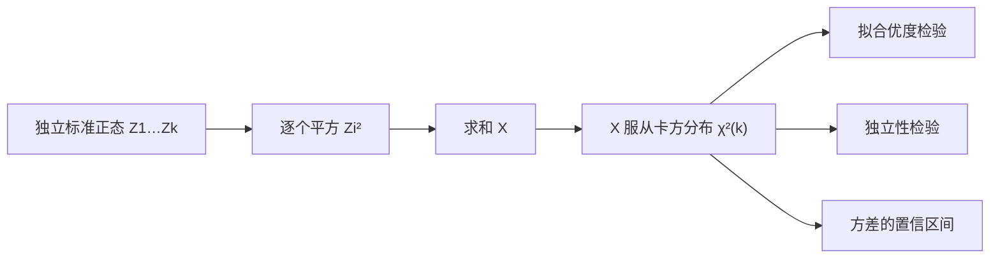
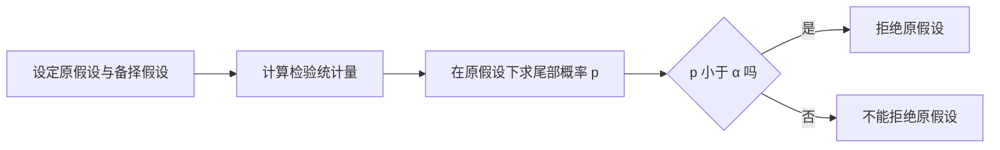
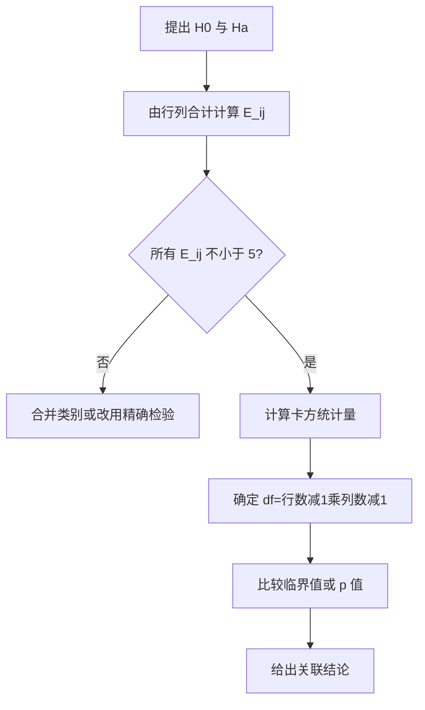

# SPL Run: build_concept_book

- **Adapter:** claude_cli
- **Model:** claude-sonnet-5-5
- **Tokens:** 0 in / 0 out
- **Latency:** 14202ms
- **Timestamp:** 2026-11-25 00:00:23

## Output

```output


---

## 自由度

**定义。** 自由度(degrees of freedom,记作 $df$)是决定卡方分布曲线形状的唯一参数。直观地说,它是数据中"可以自由变动的独立信息个数":当样本受到若干约束(例如各类别频数之和必须等于总数 $n$)时,真正自由的数据个数就要减去约束数。$df$ 越小,曲线越偏斜、集中在左侧;$df$ 越大,曲线越对称,并逐渐接近正态形状。卡方分布的均值等于 $df$,方差等于 $2\,df$。

不同的卡方检验,$df$ 的算法不同:

- **拟合优度检验**($k$ 个类别):
$$df = k - 1$$
若分布中还有 $m$ 个参数是由样本估计出来的,则 $df = k - 1 - m$。
- **独立性检验 / 同质性检验**($r$ 行 $c$ 列的列联表):
$$df = (r-1)(c-1)$$

**为什么是这些公式?** 拟合优度检验中,$k$ 个频数之和固定为 $n$,所以只有 $k-1$ 个可以自由取值,最后一个由差值决定。列联表中,行合计与列合计都已固定,因此每行只有 $c-1$ 个格子自由、只有 $r-1$ 行自由,其余格子都被边际合计"锁定"。

**例 1(拟合优度)。** 掷一枚骰子 120 次,检验它是否均匀。类别数 $k=6$,所以
$$df = 6 - 1 = 5.$$
若算得 $\chi^2 = 9.2$,查 $df=5$ 的临界值 $\chi^2_{0.05}=11.07$。因为 $9.2 < 11.07$,不能拒绝"骰子均匀"的原假设。

**例 2(独立性)。** 调查 3 个年级(行)与 4 种课外活动偏好(列)是否相关,列联表为 $3\times4$:
$$df = (3-1)(4-1) = 2\times 3 = 6.$$
若算得 $\chi^2 = 15.8$,而 $df=6$ 时 $\chi^2_{0.05}=12.59$,则 $15.8 > 12.59$,拒绝原假设,认为年级与活动偏好有关。

**问题求解应用。** 一位研究者检验某地每天的交通事故数是否服从泊松分布。数据分成 $k=7$ 个类别,而泊松参数 $\lambda$ 由样本均值估计得到($m=1$)。于是
$$df = 7 - 1 - 1 = 5.$$
如果错误地使用 $df=6$,临界值会偏大($\chi^2_{0.05}=12.59$ 而非正确的 $11.07$),使检验过于保守,可能漏掉真实的偏离。

**解题步骤:**
1. 判断检验类型(拟合优度还是列联表)。
2. 数清类别数 $k$,或行数 $r$ 与列数 $c$。
3. 减去被样本估计的参数个数(如有)。
4. 用所得 $df$ 查表或计算 $p$ 值。

**常见错误:** 用样本量 $n$ 代替类别数;把列联表的 $df$ 误写成 $rc-1$;忘记扣除估计参数。记住:$df$ 反映的是**类别结构**,而不是样本有多大。

---

## 假设检验

**定义。** 假设检验是用样本数据判断关于总体的某个断言是否可信的程序。它包含四个要素:

- **原假设** $H_0$:默认成立的"无效应"断言,例如 $\mu=\mu_0$。
- **备择假设** $H_1$:我们希望用证据支持的断言,例如 $\mu\neq\mu_0$(双侧)或 $\mu>\mu_0$(单侧)。
- **检验统计量**:把样本与 $H_0$ 的偏离程度压缩成一个数。总体标准差未知时,均值检验使用
$$t=\frac{\bar x-\mu_0}{s/\sqrt n},\qquad \text{自由度 } n-1.$$
- **$p$ 值**:*假设 $H_0$ 为真*时,得到至少与当前观测同样极端的统计量的概率。

决策规则:预先设定显著性水平 $\alpha$(常取 $0.05$)。若 $p\le\alpha$,拒绝 $H_0$;否则"不拒绝 $H_0$"。注意:$p$ 值**不是** $H_0$ 为真的概率,"不拒绝"也不等于"证明 $H_0$ 成立"。

**完整流程:**


*假设检验的决策流程:先设定假设与 α,再由数据得到统计量和 p 值,最后比较 p 与 α。*

**例题。** 某饮料标注每瓶净含量为 $500\,\text{mL}$。随机抽取 $n=25$ 瓶,测得 $\bar x=496\,\text{mL}$,$s=8\,\text{mL}$。在 $\alpha=0.05$ 下,能否认为平均含量低于标注值?

1. 假设:$H_0:\mu=500$,$H_1:\mu<500$(单侧)。
2. 统计量:
$$t=\frac{496-500}{8/\sqrt{25}}=\frac{-4}{1.6}=-2.5.$$
3. 自由度为 $24$。查表或软件得 $p=P(T_{24}\le -2.5)\approx 0.010$。
4. 因为 $0.010<0.05$,拒绝 $H_0$。有较强证据表明平均净含量低于 $500\,\text{mL}$。

**问题求解应用。** 用 Python 一步完成同样的检验(`alternative='less'` 对应单侧):

```python
from scipy import stats
t, p = stats.ttest_1samp(data, popmean=500, alternative='less')
print(t, p)   # p < 0.05 则拒绝 H0
```

解题时要避免三个常见错误:

- **单双侧选错。** 若问"是否不同于 $500$",应取双侧,此时 $p\approx 0.020$,是单侧的两倍。
- **事后改 $\alpha$。** 必须在看数据之前确定 $\alpha$,否则 $p\le\alpha$ 的结论没有意义。
- **混淆统计显著与实际重要。** 样本量极大时,微小的偏差也能得到很小的 $p$ 值,所以还要结合效应大小(如 $\bar x-\mu_0$ 与置信区间)判断。

另外要知道两类错误:**第一类错误**是 $H_0$ 为真却拒绝它,其概率恰为 $\alpha$。**第二类错误**是 $H_0$ 为假却未拒绝它,其概率记为 $\beta$,检验功效为 $1-\beta$。增大样本量可以在 $\alpha$ 不变的情况下降低 $\beta$。

---

## 正态分布

**定义。** 若连续型随机变量 $X$ 的概率密度函数为

$$
f(x)=\frac{1}{\sigma\sqrt{2\pi}}\exp\!\left(-\frac{(x-\mu)^2}{2\sigma^2}\right),\quad -\infty<x<\infty,
$$

则称 $X$ 服从正态分布,记作 $X\sim N(\mu,\sigma^2)$。参数 $\mu$ 是均值(曲线对称轴),$\sigma>0$ 是标准差(决定曲线的"胖瘦")。曲线下总面积为 1,概率等于面积:$P(a<X<b)=\int_a^b f(x)\,dx$。

当 $\mu=0,\sigma=1$ 时称为**标准正态分布**,记作 $Z\sim N(0,1)$。任何正态变量都可以标准化:

$$
Z=\frac{X-\mu}{\sigma}.
$$

经验法则:约 68%、95%、99.7% 的概率分别落在 $\mu\pm\sigma$、$\mu\pm2\sigma$、$\mu\pm3\sigma$ 之内。


*图:用标准化把任意正态问题转化为标准正态问题的流程。*

**例题。** 某考试成绩 $X\sim N(70,\,10^2)$,求成绩高于 85 分的概率。

标准化:

$$
z=\frac{85-70}{10}=1.5,\qquad P(X>85)=P(Z>1.5)=1-\Phi(1.5)\approx 1-0.9332=0.0668.
$$

即约 6.7% 的考生超过 85 分。

**在假设检验中的应用。** 正态分布之所以成为检验的核心,是因为**中心极限定理**:当样本量 $n$ 足够大时,无论总体形状如何,样本均值 $\bar X$ 近似服从

$$
\bar X\sim N\!\left(\mu,\ \frac{\sigma^2}{n}\right),
$$

于是检验统计量为

$$
z=\frac{\bar x-\mu_0}{\sigma/\sqrt n}.
$$

对比例 $p$,当 $np_0\ge10$ 且 $n(1-p_0)\ge10$ 时,样本比例 $\hat p$ 近似服从 $N\!\left(p_0,\ \dfrac{p_0(1-p_0)}{n}\right)$,统计量为

$$
z=\frac{\hat p-p_0}{\sqrt{p_0(1-p_0)/n}}.
$$

**例:** 某零件长度已知 $\sigma=2$ mm,声称均值 $\mu_0=50$ mm。抽取 $n=64$ 个,得 $\bar x=50.6$。检验 $H_0:\mu=50$ 与 $H_1:\mu\ne50$,显著性水平 $\alpha=0.05$。

$$
z=\frac{50.6-50}{2/\sqrt{64}}=\frac{0.6}{0.25}=2.4.
$$

双侧临界值为 $\pm1.96$。因 $|2.4|>1.96$,拒绝 $H_0$。$p$ 值为 $2\,[1-\Phi(2.4)]\approx 2(0.0082)=0.0164<0.05$,结论一致:样本均值与声称值之间存在统计上显著的差异。

**解题要点。**
1. 先确认条件:$\sigma$ 已知(均值检验)或样本足够大(比例检验)。
2. 写出统计量并标准化。
3. 比较临界值或计算 $p$ 值,再用问题的语言写出结论。

注意:若 $\sigma$ 未知,需用样本标准差并改用 $t$ 分布;正态分布在此仅适用于 $\sigma$ 已知的情形。

---

## 标准正态变量

**定义。** 若随机变量 $Z$ 服从均值为 $0$、标准差为 $1$ 的正态分布,则称 $Z$ 为**标准正态变量**,记作 $Z\sim N(0,1)$。其概率密度函数为

$$\varphi(z)=\frac{1}{\sqrt{2\pi}}\,e^{-z^{2}/2},\qquad -\infty<z<\infty .$$

密度曲线关于 $z=0$ 对称,呈钟形。累积分布函数记为 $\Phi(z)=P(Z\le z)$,由对称性有 $\Phi(-z)=1-\Phi(z)$。常用的经验数据是:$P(|Z|<1)\approx 0.683$,$P(|Z|<2)\approx 0.954$,$P(|Z|<3)\approx 0.997$。

**标准化。** 任何正态变量 $X\sim N(\mu,\sigma^{2})$ 都可以通过

$$Z=\frac{X-\mu}{\sigma}$$

化为标准正态变量。$Z$ 表示 $X$ 偏离均值多少个标准差。因此只需一张标准正态分布表,就能处理所有正态分布问题。

**例题。** 某次考试成绩 $X\sim N(70,\,10^{2})$。求 $P(X>85)$。

第一步,标准化:
$$z=\frac{85-70}{10}=1.5 .$$

第二步,转化为标准正态概率:
$$P(X>85)=P(Z>1.5)=1-\Phi(1.5)\approx 1-0.9332=0.0668 .$$

即约有 $6.7\%$ 的考生成绩超过 85 分。

**问题求解应用。** 假设某零件长度 $L\sim N(50,\,0.4^{2})$(单位:mm),规格要求为 $49.2\le L\le 50.8$。求合格率。

标准化两端:
$$z_1=\frac{49.2-50}{0.4}=-2,\qquad z_2=\frac{50.8-50}{0.4}=2 .$$

于是
$$P(49.2\le L\le 50.8)=P(-2\le Z\le 2)=2\Phi(2)-1\approx 2(0.9772)-1=0.9544 .$$

合格率约为 $95.4\%$。

**与卡方变量的联系。** 标准正态变量的平方 $Z^{2}$ 是最简单的非负随机变量。若 $Z_1,Z_2,\dots,Z_k$ 相互独立且都服从 $N(0,1)$,则

$$\chi^{2}=Z_1^{2}+Z_2^{2}+\cdots+Z_k^{2}$$

服从自由度为 $k$ 的卡方分布。此外,因为 $E[Z]=0$、$\operatorname{Var}(Z)=1$,所以 $E[Z^{2}]=1$,由此立即得到 $E[\chi^{2}]=k$。可见,标准正态变量正是构造卡方分布的基本单元。


*图示:从一般正态变量出发,经标准化得到标准正态变量,再通过平方并求和构造卡方变量。*

---

## 卡方分布

**定义。** 设 $Z_1, Z_2, \dots, Z_k$ 是相互独立的标准正态随机变量,则
$$
X = Z_1^2 + Z_2^2 + \cdots + Z_k^2
$$
服从**自由度为 $k$ 的卡方分布**,记作 $X \sim \chi^2_k$。其基本性质如下:

- 取值范围为 $[0, \infty)$,因为平方和不可能为负。
- 均值 $E[X] = k$,方差 $\mathrm{Var}(X) = 2k$。
- 分布右偏。$k$ 较小时偏斜明显,$k$ 增大后逐渐趋近正态分布。
- 可加性:若 $X_1 \sim \chi^2_{k_1}$ 与 $X_2 \sim \chi^2_{k_2}$ 独立,则 $X_1 + X_2 \sim \chi^2_{k_1+k_2}$。

均值和方差的推导很直接。由 $E[Z^2]=\mathrm{Var}(Z)=1$ 得 $E[X]=k$。又 $E[Z^4]=3$,所以 $\mathrm{Var}(Z^2)=3-1=2$。各项独立,方差相加得 $2k$。

其概率密度函数为
$$
f(x;k)=\frac{1}{2^{k/2}\,\Gamma(k/2)}\,x^{k/2-1}e^{-x/2},\quad x>0.
$$
它是 Gamma 分布的特例,对应形状参数 $k/2$、尺度参数 $2$。


*图:卡方分布由标准正态变量的平方和构成,并成为多种假设检验的抽样分布。*

**例题。** 设 $Z_1, Z_2, Z_3$ 是独立的标准正态变量,求 $P(Z_1^2+Z_2^2+Z_3^2 > 7.815)$。

这里 $X\sim\chi^2_3$。查卡方分布表,自由度 3 时的上 5% 临界值为 $7.815$,所以概率为 $0.05$。该分布的均值为 $3$,方差为 $6$,标准差约为 $2.45$。因此 $7.815$ 高于均值约 $2$ 个标准差,与右偏分布的长尾相符。

**问题求解应用。** 卡方分布的主要用途是检验方差和分类数据,下面用一个拟合优度检验说明。

某骰子掷 $60$ 次,各点数出现次数为 $5, 8, 9, 8, 10, 20$。若骰子均匀,每个点数的期望次数为 $E_i=10$。检验统计量为
$$
\chi^2=\sum_{i=1}^{6}\frac{(O_i-E_i)^2}{E_i}.
$$
代入计算:
$$
\chi^2=\frac{25+4+1+4+0+100}{10}=13.4.
$$
在原假设"骰子均匀"下,该统计量近似服从 $\chi^2_{5}$,自由度为类别数减一,即 $6-1=5$。查表得 $\chi^2_{5}$ 的上 5% 临界值为 $11.07$。由于 $13.4>11.07$,在 $\alpha=0.05$ 下拒绝原假设,认为骰子不均匀。主要偏差来自点数 6,它单独贡献了 $10$ 的统计量。

**要点。** 样本方差也与卡方分布相关:对正态总体,$(n-1)S^2/\sigma^2\sim\chi^2_{n-1}$,据此可以构造方差的置信区间并检验方差。使用时要始终确认自由度,因为同一个观测值在不同自由度下对应的 $p$ 值完全不同。

---

## 列联表

### 定义

**列联表**(contingency table,也称交叉表)是把同一批样本按两个分类变量同时分类、并记录每个组合出现次数的表格。设变量 $A$ 有 $r$ 个类别,变量 $B$ 有 $c$ 个类别,则表中第 $i$ 行第 $j$ 列的数 $n_{ij}$ 是同时属于 $A_i$ 与 $B_j$ 的样本个数。行合计 $n_{i\cdot}$、列合计 $n_{\cdot j}$ 称为**边际频数**,总样本量为 $n$。

由频数可以估计各类概率:

- 联合概率:$P(A_i\cap B_j)\approx \dfrac{n_{ij}}{n}$
- 边际概率:$P(A_i)\approx \dfrac{n_{i\cdot}}{n}$
- 条件概率:$P(B_j\mid A_i)=\dfrac{P(A_i\cap B_j)}{P(A_i)}\approx\dfrac{n_{ij}}{n_{i\cdot}}$

关键在于:**条件概率的分母是所选行(或列)的合计,而不是总数。**

### 例题

某校调查 200 名学生是否每天锻炼与是否近视:

| | 近视 | 不近视 | 合计 |
|---|---|---|---|
| 锻炼 | 30 | 70 | 100 |
| 不锻炼 | 50 | 50 | 100 |
| 合计 | 80 | 120 | 200 |

求:(1)$P(\text{近视})$;(2)$P(\text{近视}\mid\text{锻炼})$;(3)$P(\text{锻炼}\mid\text{近视})$。

**解:**

1. $P(\text{近视})=\dfrac{80}{200}=0.40$。
2. 限定在"锻炼"这一行:$P(\text{近视}\mid\text{锻炼})=\dfrac{30}{100}=0.30$。
3. 限定在"近视"这一列:$P(\text{锻炼}\mid\text{近视})=\dfrac{30}{80}=0.375$。

注意(2)与(3)不相等,条件的方向不能颠倒。

### 问题求解应用:判断两个变量是否独立

若 $A$ 与 $B$ 独立,则对所有 $i,j$ 有 $P(A_i\cap B_j)=P(A_i)P(B_j)$,即各格的**期望频数**为

$$E_{ij}=\frac{n_{i\cdot}\,n_{\cdot j}}{n}.$$

在上例中,"锻炼且近视"的期望频数为 $E_{11}=\dfrac{100\times 80}{200}=40$,而实际观测值为 30,二者有差距。同理 $E_{12}=60$,$E_{21}=40$,$E_{22}=60$。

用卡方统计量衡量总体偏离程度:

$$\chi^2=\sum_{i,j}\frac{(n_{ij}-E_{ij})^2}{E_{ij}}=\frac{100}{40}+\frac{100}{60}+\frac{100}{40}+\frac{100}{60}\approx 8.33.$$

自由度为 $(r-1)(c-1)=1$。显著性水平 $0.05$ 的临界值为 $3.84$,而 $8.33>3.84$,所以拒绝"独立"的假设:在该样本中,锻炼与近视之间存在统计关联。

另一种直观检验是比较条件概率:$P(\text{近视}\mid\text{锻炼})=0.30$,$P(\text{近视}\mid\text{不锻炼})=0.50$,两者与 $P(\text{近视})=0.40$ 都不同,同样说明二者不独立。

**需要注意:** 关联不等于因果。这个表只说明两者相关,并不能证明锻炼本身降低了近视率,也可能存在其他因素(如户外时间、家庭条件)同时影响二者。

### 小结

解题步骤:① 先确定条件是什么,选对行或列;② 用该行(列)合计作分母;③ 若要判断独立性,比较条件概率与边际概率,或计算 $\chi^2$。

---

## 观测值与期望值

**定义。** 在卡方检验中,**观测值**(observed value)$O_i$ 是样本中第 $i$ 个类别实际统计到的频数。**期望值**(expected value)$E_i$ 是在原假设 $H_0$ 成立时,该类别理论上应出现的频数。若总样本量为 $n$,类别 $i$ 在 $H_0$ 下的概率为 $p_i$,则

$$E_i = n\,p_i .$$

对于列联表(独立性检验),若 $H_0$ 为"两个变量相互独立",则第 $i$ 行第 $j$ 列的期望值为

$$E_{ij} = \frac{(\text{第 } i \text{ 行合计})(\text{第 } j \text{ 列合计})}{n}.$$

观测值与期望值之间的差异 $O_i - E_i$ 是卡方统计量的基础:

$$\chi^2 = \sum_i \frac{(O_i - E_i)^2}{E_i}.$$

除以 $E_i$ 的作用是按尺度标准化:期望频数为 5 时偏差 10 很大,期望频数为 1000 时偏差 10 则微不足道。通常要求每个 $E_i \ge 5$,卡方近似才可靠。

**例题(拟合优度)。** 掷一枚骰子 $n=60$ 次,检验其是否均匀。$H_0$:每个点数概率为 $1/6$,故每个 $E_i = 60 \times \tfrac16 = 10$。观测结果如下:

| 点数 | 1 | 2 | 3 | 4 | 5 | 6 |
|---|---|---|---|---|---|---|
| $O_i$ | 8 | 12 | 9 | 11 | 6 | 14 |
| $E_i$ | 10 | 10 | 10 | 10 | 10 | 10 |

各项 $(O_i-E_i)^2/E_i$ 为 $0.4,\ 0.4,\ 0.1,\ 0.1,\ 1.6,\ 1.6$,因此

$$\chi^2 = 4.2 .$$

自由度为 $6-1=5$,显著性水平 $\alpha=0.05$ 的临界值为 $11.07$。由于 $4.2<11.07$,不能拒绝 $H_0$,没有充分证据表明骰子不均匀。

**问题求解应用(独立性检验)。** 调查 100 名学生,考察"是否使用学习软件"与"成绩是否达标"是否相关:

| | 达标 | 未达标 | 行合计 |
|---|---|---|---|
| 使用 | 40 | 10 | 50 |
| 不使用 | 30 | 20 | 50 |
| 列合计 | 70 | 30 | 100 |

在独立假设下,$E_{11} = \frac{50\times 70}{100} = 35$,$E_{12} = 15$,$E_{21} = 35$,$E_{22} = 15$。于是

$$\chi^2 = \frac{(40-35)^2}{35}+\frac{(10-15)^2}{15}+\frac{(30-35)^2}{35}+\frac{(20-15)^2}{15} \approx 0.714+1.667+0.714+1.667 = 4.76 .$$

自由度为 $(2-1)(2-1)=1$,临界值为 $3.84$。因为 $4.76>3.84$,在 5% 水平下拒绝独立性假设,说明使用软件与成绩达标之间存在统计关联。

**要点。** 解题的稳定流程是:①写出 $H_0$;②由 $H_0$ 计算每个 $E_i$,并检查是否都不小于 5;③逐项计算 $(O_i-E_i)^2/E_i$ 并求和;④与对应自由度的临界值比较。注意:期望值必须由 $H_0$ 推出,而不是由样本"拟合"出的任意数;同时,$O_i$ 与 $E_i$ 之和都应等于 $n$,这是检查计算是否出错的快速办法。

---

## P 值

### 定义

**P 值**(p-value)是在原假设 $H_0$ 成立的前提下,得到与观测样本结果**一样极端或更极端**的结果的概率。设检验统计量为 $T$,观测值为 $t_{\text{obs}}$,则对右尾检验:

$$p = P(T \ge t_{\text{obs}} \mid H_0)$$

对双尾检验,则要把两侧的极端情形都计入。P 值越小,说明"如果 $H_0$ 为真,却观察到这样的数据"越不寻常,因而越有理由怀疑 $H_0$。

需要特别注意:P 值**不是** $H_0$ 为真的概率,也不是效应大小的度量。它只回答一个问题:数据与 $H_0$ 的相容程度如何。

### 例题

某硬币被怀疑偏向正面。抛掷 100 次,得到 60 次正面。检验 $H_0: p_0 = 0.5$,$H_a: p_0 \ne 0.5$。

**第 1 步:构造检验统计量。** 在 $H_0$ 下,正面次数近似服从均值 $np_0 = 50$、标准差 $\sqrt{np_0(1-p_0)} = 5$ 的正态分布。于是

$$z = \frac{60 - 50}{5} = 2.00$$

**第 2 步:计算尾部概率。** 查标准正态分布表得 $P(Z \ge 2.00) \approx 0.0228$。

**第 3 步:双尾检验。** 偏向反面同样算"极端",故

$$p = 2 \times 0.0228 = 0.0456$$

**第 4 步:下结论。** 若显著性水平为 $\alpha = 0.05$,则 $p < \alpha$,拒绝 $H_0$;若取 $\alpha = 0.01$,则不能拒绝 $H_0$。

### 问题求解应用

**问题:** 某药厂声称药片平均含量为 $\mu_0 = 500$ mg。质检员抽取 $n = 36$ 片,得 $\bar{x} = 497$ mg,已知 $\sigma = 9$ mg。在 $\alpha = 0.05$ 下检验含量是否偏低。

**解:** 这是左尾检验,$H_0: \mu = 500$,$H_a: \mu < 500$。

$$z = \frac{497 - 500}{9/\sqrt{36}} = \frac{-3}{1.5} = -2.00$$

$$p = P(Z \le -2.00) \approx 0.0228$$

因 $0.0228 < 0.05$,拒绝 $H_0$,有证据表明平均含量偏低。

**常见误区:**

1. **"$p = 0.0228$ 意味着 $H_0$ 有 2.28% 的概率为真。"** 错误。P 值是在假定 $H_0$ 为真时计算的条件概率,并不给出 $H_0$ 本身的概率。
2. **"$p > \alpha$ 证明 $H_0$ 为真。"** 错误。这只说明证据不足以拒绝 $H_0$。
3. **"$p$ 很小说明效应很大。"** 错误。样本量很大时,微不足道的差异也可能得到极小的 P 值,所以需要同时报告效应大小和置信区间。


*P 值检验流程:将尾部概率 $p$ 与显著性水平 $\alpha$ 比较,得出拒绝或不拒绝原假设的结论。*

---

## 独立性检验

**定义。** 独立性检验（test of independence）用来判断同一总体中的两个分类变量是否相互独立。检验的数据整理成列联表（contingency table），每个单元格记录同时属于某一行类别和某一列类别的观测频数 $O_{ij}$。

假设为：

- $H_0$：两个变量独立（一个变量的分布不随另一个变量的类别而改变）；
- $H_a$：两个变量不独立（存在关联）。

若 $H_0$ 成立，则 $P(\text{第 } i \text{ 行且第 } j \text{ 列}) = P(\text{第 } i \text{ 行})\,P(\text{第 } j \text{ 列})$，由此得到期望频数

$$E_{ij}=\frac{(\text{第 } i \text{ 行总计})(\text{第 } j \text{ 列总计})}{n}.$$

检验统计量为

$$\chi^2=\sum_{i,j}\frac{(O_{ij}-E_{ij})^2}{E_{ij}},$$

在 $H_0$ 成立且样本足够大时近似服从自由度为

$$\text{df}=(r-1)(c-1)$$

的卡方分布，其中 $r$、$c$ 分别为行数和列数。使用条件：数据来自随机样本，各观测相互独立，且每个 $E_{ij}\ge 5$（常用经验标准）。

**例题。** 随机调查 200 名学生，记录“学习方式”（独自学习 / 小组学习）与“成绩”（及格 / 不及格）：

| | 及格 | 不及格 | 合计 |
|---|---|---|---|
| 独自学习 | 70 | 30 | 100 |
| 小组学习 | 90 | 10 | 100 |
| 合计 | 160 | 40 | 200 |

在 $\alpha=0.05$ 下检验两者是否独立。

1. 期望频数：$E_{11}=\dfrac{100\times160}{200}=80$，$E_{12}=20$，$E_{21}=80$，$E_{22}=20$，均不小于 5。
2. 统计量：

$$\chi^2=\frac{(70-80)^2}{80}+\frac{(30-20)^2}{20}+\frac{(90-80)^2}{80}+\frac{(10-20)^2}{20}=1.25+5+1.25+5=12.5.$$

3. 自由度：$\text{df}=(2-1)(2-1)=1$，临界值 $\chi^2_{0.05,1}=3.841$。
4. 决策：$12.5>3.841$（$p\approx 0.0004<0.05$），拒绝 $H_0$。

结论：有充分证据表明学习方式与成绩有关联。

**问题求解应用。** 检验的步骤可概括为下图。


*独立性检验的决策流程：先检查条件，再计算统计量并做出结论。*

解题时需注意三点：

- **只能说明有关联，不能说明因果。** 上例并不能证明小组学习导致成绩提高，因为学生可能自行选择学习方式。
- **找出关联的来源。** 比较各单元格的 $\dfrac{(O_{ij}-E_{ij})^2}{E_{ij}}$，贡献最大的单元格就是偏离独立性最明显之处。上例中，“不及格”这一列的两个单元格贡献最大。
- **与齐性检验区分。** 若是从一个总体抽样后再对两个变量分类，用独立性检验；若是分别从几个总体各抽一个样本、比较同一变量的分布，则用齐性检验。两者的计算完全相同，只是抽样设计与表述不同。

练习：把上例中的每个频数都乘以 2（$n=400$），其余比例不变，$\chi^2$ 会变成多少？（答案：25。样本量增大使统计量等比例增大，同样的差异更容易被检出。）

---

## 独立性实验

**定义。** 卡方独立性检验用来判断两个分类变量是否相互独立。在本实验中,我们检验"最喜欢的零食类型"与"性别"之间是否存在关联。

- 原假设 $H_0$:两个变量独立(性别与零食偏好无关)。
- 备择假设 $H_a$:两个变量不独立。

若 $H_0$ 成立,则每个单元格的期望频数为

$$E_{ij}=\frac{(\text{第 } i \text{ 行总数})(\text{第 } j \text{ 列总数})}{n}$$

检验统计量为

$$\chi^2=\sum_{i,j}\frac{(O_{ij}-E_{ij})^2}{E_{ij}}$$

在 $H_0$ 下,它近似服从自由度为 $df=(r-1)(c-1)$ 的卡方分布。使用前提:样本为随机或可视为随机的,且每个 $E_{ij}\ge 5$。

**实验步骤。** 1)全班匿名收集每人最爱的零食(薯片、巧克力、水果)和性别;2)填写列联表;3)计算期望频数;4)计算 $\chi^2$;5)查表或用软件求 $p$ 值;6)下结论。

**例题。** 某班 60 名同学的数据如下:

| | 薯片 | 巧克力 | 水果 | 合计 |
|---|---|---|---|---|
| 男生 | 14 | 8 | 6 | 28 |
| 女生 | 6 | 14 | 12 | 32 |
| 合计 | 20 | 22 | 18 | 60 |

期望频数:

- 男生薯片:$E=\frac{28\times20}{60}\approx 9.33$
- 男生巧克力:$E=\frac{28\times22}{60}\approx 10.27$
- 男生水果:$E=\frac{28\times18}{60}=8.40$
- 女生薯片:$E=\frac{32\times20}{60}\approx 10.67$
- 女生巧克力:$E=\frac{32\times22}{60}\approx 11.73$
- 女生水果:$E=\frac{32\times18}{60}=9.60$

所有 $E_{ij}\ge5$,满足前提。计算:

$$\chi^2=\frac{(14-9.33)^2}{9.33}+\frac{(8-10.27)^2}{10.27}+\frac{(6-8.40)^2}{8.40}+\frac{(6-10.67)^2}{10.67}+\frac{(14-11.73)^2}{11.73}+\frac{(12-9.60)^2}{9.60}$$

$$\approx 2.34+0.50+0.69+2.04+0.44+0.60\approx 6.61$$

自由度 $df=(2-1)(3-1)=2$。临界值 $\chi^2_{0.05,2}=5.99$,而 $6.61>5.99$,对应 $p\approx0.037<0.05$。

**结论。** 在 $\alpha=0.05$ 水平下拒绝 $H_0$:有证据表明,本班同学的零食偏好与性别有关联。

**问题解决应用。** 检验只告诉我们"有关联",不说明关联在哪里。可以比较各单元格对 $\chi^2$ 的贡献:男生薯片(2.34)与女生薯片(2.04)贡献最大,说明男生偏爱薯片、女生偏爱巧克力和水果是关联的主要来源。

做实验时请注意三点:

1. **抽样范围**:结论只适用于本班(或与本班相似的群体),不能推广到所有学生。
2. **关联不等于因果**:性别并不"导致"口味,背后可能有文化、广告等因素。
3. **样本量**:若某个 $E_{ij}<5$,应合并类别(如把"水果"与"坚果"合并为"健康类")或增大样本。

**练习。** 请在你的班级重复此实验,并回答:换一个分类方式(例如把零食分为"甜"与"咸"两类)后,$df$ 变为多少?结论是否改变?

---

## 收获(Payoff)

### independence_lab 实现了什么

在整本书中,我们逐步建立了概率中最重要的一条结构性假设:**独立性**。事件 $A$ 与 $B$ 独立,当且仅当

$$P(A\cap B)=P(A)\,P(B).$$

随机变量 $X_1,\dots,X_n$ 相互独立,则联合分布可以分解为边缘分布之积。independence_lab 把这些零散的定义、判别法与定理整合为一套完整的工作流程:**先检验,再建模,最后推断**。

它是自然的终点,因为前面所有概念都在这里同时被用到:条件概率告诉我们 $P(A\mid B)=P(A)$ 与独立性等价;期望的线性性与方差的可加性(独立时 $\operatorname{Var}(\sum X_i)=\sum\operatorname{Var}(X_i)$)给出计算上的回报;大数定律与中心极限定理则说明,正是独立性让"平均"变得可预测:

$$\bar X_n\to\mu,\qquad \frac{\bar X_n-\mu}{\sigma/\sqrt n}\ \Rightarrow\ N(0,1).$$

### 一个简短的实验

用代码在实验室中模拟:先生成独立的两枚骰子,再生成"第二枚等于第一枚加噪声"的相关数据,然后比较 $\hat P(A\cap B)$ 与 $\hat P(A)\hat P(B)$。

```python
import numpy as np
rng = np.random.default_rng(0)
n = 100_000
x = rng.integers(1, 7, n)
y_ind = rng.integers(1, 7, n)                 # 独立
y_dep = np.clip(x + rng.integers(-1, 2, n), 1, 6)  # 相关
for y in (y_ind, y_dep):
    A, B = x > 3, y > 3
    print((A & B).mean(), A.mean() * B.mean())
```

独立情形下两个数几乎相等(都约为 $0.25$);相关情形下左边约为 $0.39$,明显大于右边——偏差即是依赖的证据。更严格的做法是用卡方检验,比较观测频数与独立假设下的期望频数。

### 与各应用领域的联系

由于本节未列出具体的应用清单,下面按独立性最常见的三类用途说明它如何落地:

- **统计推断**:样本独立同分布是置信区间与假设检验的基础。若样本相互依赖,有效样本量会缩小,标准误被低估,结论会过于乐观。
- **机器学习**:朴素贝叶斯直接假设特征在给定类别下条件独立,使似然分解为 $\prod_i P(x_i\mid c)$;而数据划分、交叉验证若破坏独立性,会造成泄漏。
- **可靠性与风险**:串联系统的可靠度 $\prod p_i$ 依赖元件独立;共因失效(如同一场地震)正是独立性失效的典型,会让风险被严重低估。

### 邀请

请选择其中一个方向深入:例如,用 independence_lab 的模拟检验一个真实数据集的特征是否真的条件独立,并量化朴素贝叶斯假设错得有多严重。从一个你真正关心的问题出发,让"检验、建模、推断"这三步在你手中完整走一遍。
```
